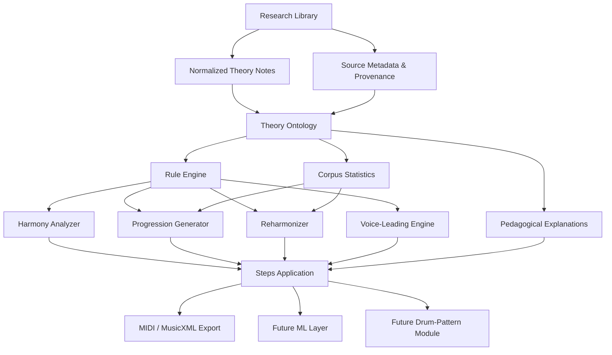
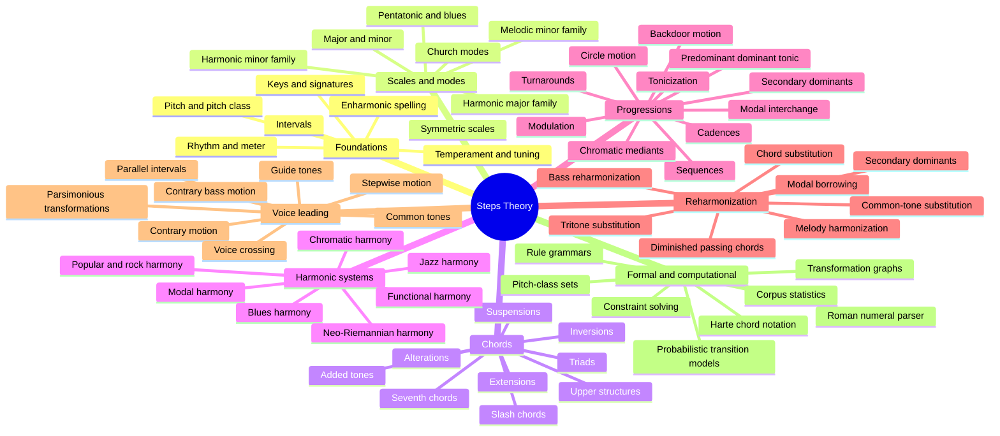
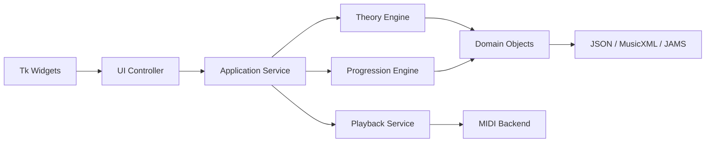
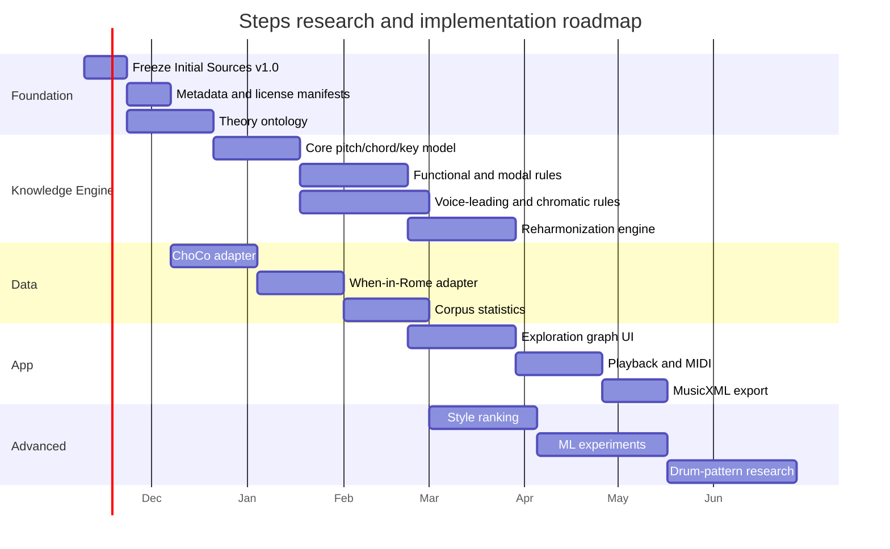
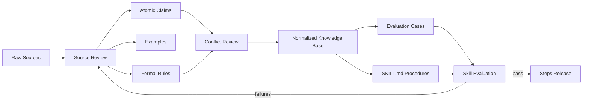

# Steps Research Foundation: Music Theory, Harmony, and Chord-Progression Skill

## Executive summary

**Steps** should be designed as two related but deliberately separate systems: a **music-theory knowledge engine** and an **interactive harmony application**. The knowledge engine should encode concepts, terminology, competing analytical interpretations, formal rules, examples, provenance, and uncertainty; the application should query that engine to explain, analyze, generate, transform, audition, and eventually export harmonic material. This separation is important because a chord-progression UI will evolve much faster than the underlying theory corpus, and because not every useful musical relationship should be hard-coded directly into interface logic.

Your existing collection is already unusually useful as a starting seed because it spans introductory theory, practical chord navigation, modal systems, reharmonization, popular-music analysis, mathematical music theory, computational formalization, and philosophical perspectives. In particular, the supplied Computational Music Theory paper explicitly frames music theory as rules whose semantics can be made machine-intelligible, which is almost exactly the architectural problem Steps needs to solve. [Quellenreferenz: turn0file2] The Chord Files material contributes a practical navigation model based on diatonic chords, secondary dominants, modal interchange, and directed resolution arrows. [Quellenreferenz: turn0file4] ModeWheel contributes a different paradigm: navigating scale families, modes, tonics, scale steps, root chords, II–V–I relations, keyboard visualization, and playback through a single interactive representation. [Quellenreferenz: turn0file9]

The main weakness of the present library is **not lack of introductory theory**. It is the absence of a sufficiently systematic layer connecting several schools of harmony: common-practice functional harmony, modal practice, jazz harmony, popular-music harmony, chromatic/transformational theories, voice-leading geometry, corpus-derived harmonic syntax, and computational representations. Authoritative additions should therefore prioritize sources such as Lerdahl and Jackendoff's *A Generative Theory of Tonal Music*, Lerdahl's *Tonal Pitch Space*, Cohn's *Audacious Euphony*, Tymoczko's *A Geometry of Music*, Rohrmeier's generative syntax of tonal harmony, de Clercq and Temperley's rock-harmony corpus work, and structured harmonic corpora such as ChoCo and When in Rome. [Quellenreferenz: turn614333search3, turn614333search2, turn614333search4, turn614333search0, turn914880search0, turn343331search7, turn343331search1, turn343331search4]

The recommended implementation strategy is **rule-based and provenance-aware first, probabilistic second, machine-learning third**. Deterministic theory rules are substantially easier to inspect, test, explain, and teach. Corpus statistics can then rank alternatives without redefining theoretical correctness, and ML can later serve as a suggestion or continuation layer rather than becoming the canonical theory engine. Rohrmeier's work is especially relevant here because it argues that tonal harmonic organization cannot be reduced adequately to simple Markov transition tables and instead benefits from hierarchical rules involving function, scale degree, key structure, and modulation. [Quellenreferenz: turn914880search0]

The resulting architecture should therefore look like this:



The most important product principle is that Steps should not tell a user that there is only one "correct next chord." Instead it should expose a **space of theoretically motivated possibilities**, explain why each is available, and rank or group them by function, voice-leading distance, stylistic context, tension, chromaticism, or corpus prevalence. That design captures the strongest aspect of Chord Files—"showing possibilities"—while avoiding the limitations of a fixed printed card. The current Chord Files site still presents this philosophy explicitly through its three-stage workflow: set a key, select a main chord, then move toward more complex harmonic options such as secondary dominants and modal interchange. [Quellenreferenz: turn238854search0, turn238854search3]

## Initial Sources v1.0 and research gap map

The following 20 files form the recommended immutable seed collection **`Initial Sources v1.0`**. They should remain untouched in an archival `sources/raw/initial-v1.0/` directory; all annotations, extracted concepts, summaries, and normalized rules should live separately. This makes later corrections auditable and prevents derived notes from becoming confused with source material.

| Initial source | Primary role in Steps | Priority for extraction |
|---|---|---:|
| `7 levels of reharmonising Eleanor Rigby.txt` | Practical progressive reharmonization; melody/chord compatibility; modal reinterpretation; tension versus resolution. The text explicitly moves from the original harmony through Dorian and harmonic-minor reinterpretations and explains chord choice relative to melody notes. [Quellenreferenz: turn0file0] | High |
| `Chord FIles 2026 Showcase.txt` | Product philosophy, progression discovery, secondary dominants, modal interchange, dark harmony and scale practice. [Quellenreferenz: turn0file1] | High |
| `Computational_Music_Theory.pdf` | Formalization of musical rules and machine reasoning; highly relevant to the theory engine. [Quellenreferenz: turn0file2] | Critical |
| `harmony as a student.txt` | Pedagogical explanation of harmony, scale/chord relationships and tension/release; useful for explanation-layer tone, but not sufficient as a canonical theoretical authority. [Quellenreferenz: turn0file3] | Medium |
| `How to use chord files.txt` | Detailed interaction model: Main Chords, Secondary Dominants, Modal Interchange, resolution arrows, chord diagrams and scale tones. [Quellenreferenz: turn0file4] | Critical |
| `Is_Generative_Theory_Misleading_for_Music.pdf` | Critique of generative approaches and the relationship between analytical musicology, cognition, Schenkerian thought and GTTM. Useful as a methodological counterweight. [Quellenreferenz: turn0file5] | Medium |
| `Kants_Theory_of_Music.pdf` | Aesthetic philosophy, affect and musical significance; relevant to conceptual framing rather than harmony calculation. [Quellenreferenz: turn0file6] | Low |
| `L-0002916879.pdf` | Adorno's *Current of Music*; useful for musicology/media-theory context, not the core harmonic engine. [Quellenreferenz: turn0file7] | Low |
| `MakingMusic.pdf` | Intended source is presently **unreadable in this session**: the supplied file does not parse as a valid PDF, so its content should not yet influence the knowledge base. | Pending repair |
| `Mathematics_and_Music.pdf` | Pitch, intervals, tuning, chromatic structure, integer and ratio representations; valuable for computational foundations. [Quellenreferenz: turn0file8] | High |
| `ModeWheel_Manual_1.21.pdf` | Interactive modal navigation across Major, Melodic Minor, Harmonic Minor and Harmonic Major families, with II–V–I, keyboard graphics and playback. [Quellenreferenz: turn0file9] | Critical |
| `Music_Theory_Advanced_Level.pdf` | Advanced theory reference; extraction should focus on material not duplicated elsewhere. [Quellenreferenz: turn0file10] | Medium |
| `Music_theory_handbook.pdf` | Counterpoint, reharmonization, rhythm, seventh chords and blues; useful modular teaching reference. [Quellenreferenz: turn0file11] | High |
| `Name_Music_Theory_Worksheet_Music_Theory.pdf` | Beginner notation and theory exercises; pedagogical and curriculum layer rather than harmonic authority. [Quellenreferenz: turn0file12] | Medium |
| `Popular_Music_Analysis_in_American_Music.pdf` | Methodological foundations for popular-music analysis and the limits of classical-theory transfer. [Quellenreferenz: turn0file13] | High |
| `Scales with 4 smart tools.txt` | Four seven-scale families / 28-scale exploration model; chord-scale lookup and physical wheel interaction. [Quellenreferenz: turn0file14] | High |
| `THE_ELEMENTS_OF_MUSIC.pdf` | General vocabulary: rhythm, melody, harmony, texture, form and related concepts; useful ontology baseline. [Quellenreferenz: turn0file15] | Medium |
| `the-chord-wheel.pdf` | Circle/wheel approach to key relationships, transposition, improvisation and composition. [Quellenreferenz: turn0file16] | High |
| `Understanding_Basic_Music_Theory.pdf` | Broad fundamentals reference; good baseline for concepts and prerequisite graphs. [Quellenreferenz: turn0file17] | High |
| `What_is_popular_music_And_what_isn_t_An.pdf` | Popular-music historiography and genre framing; useful for scope and terminology rather than chord logic. [Quellenreferenz: turn0file18] | Medium |

The current collection therefore has **strong coverage of fundamentals, modal exploration, wheel-based interfaces, practical reharmonization, and introductory computational thinking**, but several high-value gaps remain.

| Gap | Why it matters to Steps | Recommended authoritative additions | Priority |
|---|---|---|---:|
| Formal tonal hierarchy and expectation | Necessary for explaining why some progressions feel structurally more stable than others without collapsing everything into simple chord-to-chord rules. | Lerdahl & Jackendoff, *A Generative Theory of Tonal Music*; Lerdahl, *Tonal Pitch Space*. GTTM models hierarchical musical structure; *Tonal Pitch Space* formalizes distances among pitches, chords and regions and connects them to tension and attraction. [Quellenreferenz: turn614333search3, turn614333search2] | Critical |
| Voice-leading geometry | Allows ranking chord transitions by minimal motion independently of purely functional labels. | Dmitri Tymoczko, *A Geometry of Music*. Its program explicitly connects harmony, counterpoint, modulation and geometric voice-leading space. [Quellenreferenz: turn614333search0] | Critical |
| Chromatic and transformational harmony | Needed for mediants, chromatic-third relations, parsimonious transformations and progressions that conventional dominant-tonic logic explains poorly. | Richard Cohn, *Audacious Euphony*. Cohn explicitly models triadic distance using common tones and semitonal voice leading. [Quellenreferenz: turn614333search4, turn614333search6] | High |
| Hierarchical computational grammar | Needed for explainable progression generation beyond transition tables. | Martin Rohrmeier, "Towards a generative syntax of tonal harmony." [Quellenreferenz: turn914880search0] | Critical |
| Popular/rock harmonic statistics | Prevents the engine from treating common-practice harmony as a universal norm for modern songwriting. | de Clercq & Temperley, "A corpus analysis of rock harmony"; their corpus study manually analyzed roughly 100 canonical rock songs using Roman numerals and examined chord and transition frequencies. [Quellenreferenz: turn343331search7, turn343331search0] | Critical |
| Machine-readable chord notation | Required for interoperable annotations. | Harte et al.'s structured chord-symbol syntax, designed to be human-readable but unambiguous for software. [Quellenreferenz: turn343331search8] | Critical |
| Large harmonic corpora | Needed for empirical ranking, testing and later ML. | ChoCo integrates harmonic datasets into standardized JAMS representations and a knowledge graph; the project reports more than 20,000 files and harmonizes Harte and Roman-numeral representations. [Quellenreferenz: turn343331search1, turn343331search3] | Critical |
| Functional-analysis corpus | Required for testing Roman-numeral analysis and modulation logic. | When in Rome aggregates approximately 2,000 encoded analyses of about 1,500 works and provides music21-based tooling. [Quellenreferenz: turn343331search4, turn343331search5] | Critical |
| Open pedagogical reference | Lets the project legally reuse/adapt explanatory material when attribution/share-alike requirements are satisfied. | *Open Music Theory*, an OER covering fundamentals, harmony, chromatic harmony, jazz, popular music, counterpoint and related subjects; its text is CC BY-SA 4.0. [Quellenreferenz: turn205343search0, turn754448search0] | Critical |
| Explicit jazz-harmony layer | Needed for ii–V–I chains, tritone substitutions, altered dominants, upper structures, chord-scale relationships and extended voicing practice. | Add a respected jazz-theory textbook and academic jazz-analysis sources; because most standard textbooks are copyrighted, use them as reference material rather than redistributable corpus content. | High |
| Minor-key and modal function models | Steps should not treat minor merely as "relative major with altered notes," and modal progression generation needs different stability models. | Combine OMT, corpus sources, ModeWheel material and specific scholarly literature rather than relying on one wheel model. OMT already includes diatonic/chromatic harmony and separate jazz/pop coverage. [Quellenreferenz: turn205343search1, turn205343search11] | High |
| Pitch-class/set and post-tonal theory | Useful for advanced chord collections, symmetric scales, non-tertian harmony and future expansion. | Add a standard post-tonal theory reference plus open teaching material. | Medium |

The resulting library should deliberately contain **contradictions**. A functional analyst, a neo-Riemannian analyst, a jazz musician, and a corpus researcher may describe the same progression differently. Steps should preserve those interpretations as multiple analytical lenses rather than force a false universal theory.

## Knowledge architecture for the Skill

The Skill should understand music theory at several levels simultaneously. A flat glossary is insufficient because concepts such as `V/V`, `borrowed iv`, `tritone substitution`, `chromatic mediant`, and `modal interchange` are not isolated facts; they are transformations within a harmonic context.

The proposed domain taxonomy is:



### Core representations

Every chord object should be representable independently of display notation. A suggested normalized structure is:

```json
{
  "root_pitch_class": 7,
  "root_spelling": "G",
  "quality": "dominant",
  "extensions": [7],
  "alterations": [],
  "added_tones": [],
  "omissions": [],
  "bass": "G",
  "pitch_classes": [7, 11, 2, 5],
  "roman": "V7",
  "functional_role": ["dominant"],
  "local_key": "C major",
  "global_key": "C major",
  "source_notation": "G7"
}
```

The distinction between **pitch-class identity** and **spelling** is essential. F♯ and G♭ may be the same pitch class in twelve-tone equal temperament but can carry different scale-degree and functional meanings. The mathematics source in your existing collection is useful here because it explicitly covers interval ratios, chromatic scales and integer representations of intervals. [Quellenreferenz: turn0file8]

Every **progression** should contain not just chords but temporal and analytical layers:

```json
{
  "key": "C major",
  "meter": "4/4",
  "events": [
    {
      "beat": 1.0,
      "duration_beats": 4.0,
      "chord": "Cmaj7",
      "roman": "Imaj7",
      "function": "tonic",
      "analysis_confidence": 1.0
    }
  ],
  "alternative_analyses": [],
  "style_tags": ["jazz"],
  "provenance": []
}
```

This mirrors the logic of modern harmonic corpora. ChoCo uses JAMS to normalize chord, key, mode and timing information across heterogeneous sources, and its provenance design tracks original annotations and curators. [Quellenreferenz: turn343331search1, turn343331search2] Steps should borrow this **conceptual architecture**, even if its internal schema is lighter than the full ChoCo ontology.

### Rules should be typed, not stored as prose

A knowledge rule should distinguish **possibility**, **preference**, **constraint**, and **interpretation**. For example:

```yaml
id: secondary-dominant.resolve-to-target
domain: functional_harmony
type: tendency
antecedent:
  chord_function: secondary_dominant
consequent:
  preferred_target: tonicized_degree
strength: strong
exceptions_allowed: true
style_scope:
  - common_practice
  - jazz
  - pop
explanation: >
  A secondary dominant tonicizes a diatonic or contextual target
  and commonly resolves by descending fifth/root motion.
sources:
  - source_id: ...
confidence: 0.95
```

This is preferable to encoding "`V/V` must resolve to `V`," because real repertoire regularly frustrates, redirects, extends or sequences dominant function. Your Chord Files source itself presents arrows as guidance rather than a universal law, and the source examples show secondary dominants and modal-interchange chords being combined in practical progressions. [Quellenreferenz: turn0file4] [Quellenreferenz: turn238854search2]

A second class of rules should capture **melody-to-harmony compatibility**. Your Eleanor Rigby reharmonization source explicitly describes a practical strategy in which a strong melody note may be chosen as a chord tone, while also demonstrating that deliberate non-chord-tone tension can be useful when it resolves convincingly. [Quellenreferenz: turn0file0] That distinction should become computational: `contains_melody_pitch` can be a feature, not a hard constraint.

### Analytical lenses

Each analysis returned by the Skill should be able to state its lens:

- **Scale-degree / Roman numeral:** `I – V/vi – vi – IV`
- **Function:** tonic → applied dominant → tonic substitute → predominant
- **Voice-leading:** common tones, semitone movements and total displacement
- **Modal:** chords characteristic of Dorian, Mixolydian, Aeolian, etc.
- **Chromatic:** borrowed chords, chromatic mediants, augmented-sixth relations, altered dominants
- **Transformational:** minimal triadic transformations or Tonnetz-like relations
- **Corpus:** "common/rare in corpus X"
- **Pedagogical:** simplified explanation for the user's expertise level

This multi-lens strategy directly addresses the concern raised in your supplied generative-theory critique: theoretical models are useful but should not be confused with the totality of musical cognition or musical practice. [Quellenreferenz: turn0file5]

## Competitive landscape and design lessons

iturn489438image0

The strongest lesson from the competitor set is that successful music-theory tools reduce **search complexity**. They do not initially present the user with every possible chord; they create a navigable neighborhood around a tonal or modal center.

| Product | Core model | Interaction model | Strongest idea for Steps | Limitation Steps can address |
|---|---|---|---|---|
| **Chord Files** | Diatonic main chords plus secondary dominants, modal interchange and, in the current range, secondary diminished, Neapolitan and harmonic-minor materials. [Quellenreferenz: turn238854search0, turn238854search1] | Physical sliders/cards; choose key, choose main chord, move vertically into more complex options, follow resolution arrows. [Quellenreferenz: turn238854search0] | **Contextual next-step discovery**. The interface offers harmonically meaningful options without requiring the user to remember terminology. | Static physical space limits depth, conditional logic, alternative analyses, voicing, ranking, undo/history and user-defined theoretical lenses. |
| **ModeWheel / NewModeWheel** | Four seven-note scale families in the original app: Major, Melodic Minor, Harmonic Minor and Harmonic Major. [Quellenreferenz: turn0file9] | Rotating modal wheel, family/mode/tonic selection, keyboard visualization and audio. The newer simplified version retains interactive mode exploration while stripping some teaching-oriented controls. [Quellenreferenz: turn238854search4] | **Transpose the model instead of recomputing the user's mental picture**; maintain spatial continuity between keys and modes. | Primarily mode/scale-centered rather than a full progression, reharmonization and analytical workbench. |
| **The Chord Wheel** | Circle-of-fifths / key-relationship model emphasizing transposition, key structure, improvisation and composition. [Quellenreferenz: turn0file16] | Mechanical wheel. | Immediate key-relative reasoning and transposition. | Conventional wheel topology can overemphasize fifth relationships and underrepresent modal, chromatic, melodic and voice-leading relationships. |
| **Mode Wheel portal** | Much broader contemporary wheel: interval ring, note wheel, color wheel, arbitrary scale selection and a searchable scale library covering all interval combinations supported by the tool. [Quellenreferenz: turn238854search5, turn238854search7] | Direct manipulation, audible notes/modes/chords, adjustable chord degrees and transposition. [Quellenreferenz: turn704392search2] | Separate **interval structure**, **root**, and **rotation/mode** as independent dimensions. | Exploration is scale-centric; Steps needs deeper functional/progression reasoning. |
| **Wheels of Music** | Circle of fifths on one side, chromatic circle on the other, combined with interval/chord/scale/mode formulas. [Quellenreferenz: turn182252search0] | Physical two-sided rotating wheel plus guidebook. | Formula-first pedagogy: the wheel becomes a coordinate system for concepts rather than a chart of memorized answers. | Less suited to conditional progression generation and deep analysis. |
| **Modelwheel** | **No authoritative music-theory product could be verified under this exact name during the research.** | — | Keep as an unresolved research placeholder rather than silently conflating it with ModeWheel. | A URL/vendor identifier is needed before reliable analysis. |
| **"Wheels of7"** | The exact name could not be verified as a current standalone product. Your local "four smart tools" material does, however, use four families of seven modes, yielding 28 scales, and is clearly relevant to the concept. [Quellenreferenz: turn0file14] | Four rotating physical tools. | Multiple related wheels can teach *families* rather than one universal circle. | Steps can unify families dynamically and avoid separate physical artifacts. |

Several additional tools are worth adding to the inspiration library even if they are not direct competitors. A current interactive Mode Wheel portal separates root, intervals, mode rotation, notation, chord voicing and playback in a way that is highly relevant to Steps' UI decomposition. [Quellenreferenz: turn704392search1, turn704392search2] The contemporary 5thsFlow app combines diatonic chords, modes, extensions, borrowed chords, progression sequencing and key-finding, showing that users now expect circle-based tools to be **playable workspaces**, not static reference diagrams. [Quellenreferenz: turn704392search0] More Than Modes adds modal interchange, harmonic cycles, negative-harmony transformations and immediate piano playback, which makes it a useful benchmark for exploratory transformation UX. [Quellenreferenz: turn704392search9]

The clearest opportunity for Steps is therefore a **graph-based exploration UI**. A selected chord becomes the center; neighboring options are grouped by *reason* rather than only geometric proximity:

```text
Current chord: Cmaj7
│
├── Diatonic
│   ├── Dm7  ii
│   ├── Em7  iii
│   ├── Fmaj7 IV
│   └── ...
│
├── Functional motion
│   ├── G7      V7
│   ├── D7      V/V
│   └── A7      V/ii
│
├── Modal interchange
│   ├── Fm      iv
│   ├── Ab      bVI
│   └── Bb      bVII
│
├── Voice-leading neighbors
│   ├── Am7
│   ├── C7
│   └── Em/C
│
├── Chromatic transformations
│   ├── E major
│   ├── Ab major
│   └── Cm
│
└── Reharmonization
    ├── diminished approach
    ├── tritone route
    └── bass substitution
```

Unlike a physical wheel, each branch can be filtered by `beginner / advanced`, `classical / jazz / pop / modal`, `low / medium / high tension`, or `strict / exploratory`. The UI should also display **why** the option exists.

## Technical architecture, algorithms, formats, and Python/Tk integration

The core engine should not depend on Tkinter. Tkinter should be only one presentation layer over a testable Python package. Python's official documentation describes `tkinter`/`ttk` as the standard Python interface to the cross-platform Tcl/Tk GUI toolkit. [Quellenreferenz: turn205343search16, turn205343search22]

A clean package structure would be:

```text
steps/
├── theory/
│   ├── pitch.py
│   ├── interval.py
│   ├── scale.py
│   ├── chord.py
│   ├── key.py
│   ├── roman.py
│   └── spelling.py
├── harmony/
│   ├── function.py
│   ├── progression.py
│   ├── cadence.py
│   ├── modulation.py
│   ├── mixture.py
│   ├── chromatic.py
│   └── jazz.py
├── voiceleading/
│   ├── distance.py
│   ├── constraints.py
│   └── voicing.py
├── reharmonization/
│   ├── substitutions.py
│   ├── melody_fit.py
│   └── transformations.py
├── corpus/
│   ├── import_choco.py
│   ├── import_romantext.py
│   └── statistics.py
├── generation/
│   ├── rules.py
│   ├── ranking.py
│   ├── graph.py
│   └── probabilistic.py
├── io/
│   ├── midi.py
│   ├── musicxml.py
│   ├── json.py
│   └── jams.py
├── ui/
│   └── tkinter/
└── tests/
```

### Deterministic theory engine

The first implementation should use a graph plus constraints.

A chord-transition candidate can receive a score such as:

\[
S(c_i,c_j)=
w_fF+
w_vV+
w_mM+
w_sS+
w_cC+
w_uU
\]

where:

- \(F\) = functional compatibility,
- \(V\) = voice-leading efficiency,
- \(M\) = melody compatibility,
- \(S\) = style/corpus likelihood,
- \(C\) = desired chromatic color,
- \(U\) = user preference/history.

The score is a **ranking mechanism**, not a claim that harmony has a universal mathematical quality function. Different presets simply alter weights.

Voice-leading distance can initially be computed from minimal pitch displacement under octave equivalence. Later, common-tone weighting, register constraints, doubling, range, voice crossing and instrument-specific constraints can be added. Tymoczko's work is particularly relevant because it treats voice-leading and chord progressions geometrically rather than reducing them to root motion alone. [Quellenreferenz: turn614333search0]

For generated progressions, implement four layers:

1. **Grammar/constraints:** what is theoretically available?
2. **Transition ranking:** what commonly or smoothly follows?
3. **Structural plan:** tonic → departure → intensification → cadence, or another chosen form.
4. **Voicing:** how should the abstract chords be realized?

That hierarchy is closer to Rohrmeier's generative model than a simple first-order Markov chain. [Quellenreferenz: turn914880search0]

### Corpus and probabilistic layer

Corpus statistics should answer questions such as:

- How often does `IV → I` occur in corpus X?
- How often does `bVII → I` appear in rock versus classical?
- What commonly precedes `V/V`?
- Which borrowed chords occur in major-key popular music?
- Which progression fragments occur at phrase endings?

The de Clercq/Temperley work demonstrates the usefulness of computing chord and chord-transition distributions from Roman-numeral analyses, while also highlighting that corpus and genre selection materially shape conclusions. [Quellenreferenz: turn343331search7, turn343331search0]

ChoCo should be investigated as the first major data acquisition because it already standardizes multiple chord datasets and representations. [Quellenreferenz: turn343331search1, turn343331search3] When in Rome should be the second because it directly supplies encoded functional analyses and music21 tooling. [Quellenreferenz: turn343331search4, turn343331search5]

### Machine-learning layer

ML should be added only after deterministic behavior has excellent tests.

Useful later approaches include:

| Approach | Use in Steps | Why not first |
|---|---|---|
| n-gram / Markov | Style-conditioned next-chord probabilities | Cannot adequately represent long-range hierarchical structure by itself; Rohrmeier explicitly identifies this limitation. [Quellenreferenz: turn914880search0] |
| HMM | Key/chord-state inference and sequence labeling | Useful for inference but not a complete theory model. |
| RNN/LSTM | Sequence continuation from symbolic corpora | Can learn temporal dependencies but explanations are harder to guarantee; recurrent symbolic models have historically been used for polyphonic sequence modeling. [Quellenreferenz: turn914880search6] |
| Constraint-guided neural generation | Melody harmonization with user-imposed chords/cadences | DeepBach shows the value of steerable generation with positional constraints. [Quellenreferenz: turn914880search1] |
| Transformer | Longer harmonic/formal context and conditioned accompaniment | Music Transformer demonstrated long-range symbolic modeling and melody-conditioned accompaniment, but this is materially more complex than Steps' initial theory engine. [Quellenreferenz: turn914880search2] |
| Retrieval + ranking | Find similar annotated progression patterns and explain them | Highly suitable because provenance remains visible. |

The most promising long-term architecture is **hybrid generation**: the rules define the valid or musically interpretable search space, corpus statistics provide priors, and an ML ranker may reorder candidates. It should never silently override source-backed rules.

### MIDI, MusicXML, and annotation formats

For interchange, maintain separate roles:

| Format | Steps role |
|---|---|
| **JSON/YAML** | Native internal project format for theory rules, progression objects and metadata. |
| **MIDI** | Playback, DAW interchange and note-event export. MIDI Association documentation remains the authoritative standard source; MIDI 1.0 remains relevant while MIDI 2.0 adds newer protocol capabilities. [Quellenreferenz: turn205343search4, turn205343search6] |
| **MusicXML** | Score notation, chord symbols, notes, measures and interchange with notation software. MusicXML 4.0 is a W3C Music Notation Community Group specification designed for digital sheet-music interchange. [Quellenreferenz: turn205343search15, turn205343search44] |
| **JAMS** | Research/corpus annotations and possible compatibility with ChoCo. ChoCo already uses JAMS for timed chord/key/mode annotations. [Quellenreferenz: turn343331search1] |
| **Harte notation** | Canonical text representation for machine-readable chord annotations. [Quellenreferenz: turn343331search8] |
| **RomanText / Roman numerals** | Functional analysis and harmonic corpora. music21 provides dedicated RomanNumeral objects supporting secondary numerals and key-aware analysis. [Quellenreferenz: turn714677search0] |

For Python, **music21** is the most important library to evaluate first because it already models chord symbols, Roman numerals, keys, pitch spelling, score structures and MusicXML workflows. Its RomanNumeral implementation supports secondary-function chains and mixture-related operations, while its Harmony classes bridge chord-symbol and analytical representations. [Quellenreferenz: turn714677search0, turn714677search1] The project is BSD-3-Clause licensed. [Quellenreferenz: turn754448search2]

For MIDI-level work, **Mido** and **pretty_midi** are reasonable complementary candidates; both are MIT-licensed according to their official repositories. [Quellenreferenz: turn754448search4, turn754448search5] `music21` should remain the semantic/theoretical layer, while a MIDI-specific library can handle performance/event details.

A practical Tk architecture is:



No theoretical rule should live inside button callbacks.

## Research-library governance, taxonomy, metadata, and licensing

The research library should be treated like a small scientific corpus rather than a folder of PDFs.

Recommended structure:

```text
steps-research/
├── README.md
├── manifests/
│   ├── sources.yaml
│   ├── licenses.yaml
│   └── concepts.yaml
├── sources/
│   ├── raw/
│   │   ├── initial-v1.0/
│   │   ├── academic/
│   │   ├── textbooks/
│   │   ├── product-docs/
│   │   └── datasets/
│   └── links/
├── extracts/
│   ├── theory/
│   ├── examples/
│   ├── definitions/
│   └── quotations/
├── normalized/
│   ├── concepts/
│   ├── rules/
│   ├── progression-patterns/
│   ├── chord-types/
│   ├── scales/
│   └── analytical-lenses/
├── competitors/
│   ├── chord-files/
│   ├── modewheel/
│   ├── chord-wheel/
│   └── others/
├── datasets/
│   ├── manifests/
│   └── adapters/
├── skill/
│   ├── drafts/
│   ├── generated/
│   └── evaluation/
├── tests/
│   ├── theory-cases/
│   ├── analysis-cases/
│   └── generation-cases/
└── roadmap/
```

### Metadata schema

Every source should have a manifest entry such as:

| Field | Meaning | Example |
|---|---|---|
| `source_id` | Permanent project identifier | `SRC-00021` |
| `title` | Canonical title | `A Geometry of Music` |
| `author` | Author/editor | `Dmitri Tymoczko` |
| `source_type` | book / paper / dataset / product / transcript / website | `book` |
| `year` | Publication year | `2011` |
| `edition` | Version/edition where relevant | `1st` |
| `publisher` | Publisher/institution | `Oxford University Press` |
| `doi_or_id` | DOI/ISBN/repository ID | project-specific |
| `local_path` | Local archived location | `sources/raw/...` |
| `canonical_url` | Official landing page | external reference |
| `topics` | Controlled vocabulary | `[voice-leading, chromatic-harmony]` |
| `theoretical_school` | Functional / Schenkerian / neo-Riemannian / jazz / corpus / etc. | `geometric` |
| `repertoire_scope` | Classical / jazz / rock / pop / cross-style | `cross-style` |
| `difficulty` | foundational / intermediate / advanced / research | `advanced` |
| `authority_level` | primary / peer-reviewed / textbook / practitioner / informal | `primary` |
| `license` | Explicit license or `copyrighted` | `copyrighted` |
| `redistribution` | yes / no / conditional | `no` |
| `quotation_policy` | project-defined extraction limit | `short-only` |
| `machine_readable` | yes/no/partial | `partial` |
| `extraction_status` | queued / indexed / reviewed / normalized | `reviewed` |
| `reviewer` | Person/agent who reviewed it | `...` |
| `claims_extracted` | count | `42` |
| `rules_extracted` | count | `11` |
| `conflicts_with` | related source IDs | `[SRC-00034]` |
| `confidence` | quality score | `0.95` |
| `notes` | Free-text provenance note | — |

Derived knowledge needs its own provenance:

```yaml
rule_id: RULE-HARM-0042
statement: "A dominant seventh built on V has a strong conventional tendency toward I in tonal syntax."
scope:
  styles: [common_practice, jazz]
  exclusions: [modal_vamps]
evidence:
  - source_id: SRC-...
    location: chapter_or_page
  - source_id: SRC-...
    location: section
status: reviewed
interpretation_level: conventional
```

### Licensing and IP

The biggest legal distinction is between **using a work as a research reference** and **redistributing or incorporating its expressive text, diagrams, music examples or datasets into an open-source repository**.

Your current commercial books and product materials should generally be treated as **reference-only unless an explicit license grants broader rights**. The local copy of *Current of Music*, for example, identifies the English edition as copyright Polity Press and states that reproduction is restricted apart from limited quotation contexts. [Quellenreferenz: turn0file7] Similarly, a commercial product's underlying *idea* may inspire interaction patterns, but Steps should avoid copying distinctive artwork, diagrams, wording, product trade dress, or proprietary layouts.

Openly licensed sources can play a different role. *Open Music Theory* states that its text is CC BY-SA 4.0, meaning adaptations require attribution and share-alike treatment. [Quellenreferenz: turn754448search0, turn754448search1] That license is valuable but needs architectural care: a CC BY-SA derivative text is not automatically equivalent to permissively licensed application code. Keep source-derived educational prose in a clearly attributed content layer.

Software components likewise require per-component review. `music21` is BSD-3-Clause; Mido and pretty_midi are MIT-licensed. [Quellenreferenz: turn754448search2, turn754448search4, turn754448search5] Importantly, the music21 project itself warns that encoded scores in its corpus can carry licenses distinct from the software license. [Quellenreferenz: turn754448search2] The same principle applies to harmonic datasets: **dataset license, annotation license, and underlying composition copyright are separate questions**.

Before any dataset enters the distributable Steps repository, record:

- dataset license;
- annotation license;
- whether compositions are public domain;
- whether only abstract chord labels are included;
- redistribution restrictions;
- attribution requirements;
- commercial-use restrictions;
- share-alike obligations.

The source library can be much larger than the distributable open-source package. That is the safest and cleanest design.

## Acquisition plan and product roadmap

Because budget, team size and deadline are unspecified, this roadmap uses **milestones and relative sequencing rather than calendar promises**. Responsibilities are roles rather than named people.



Treat the dates in the diagram as a **planning visualization beginning 9 November 2026**, not as delivery commitments.

The acquisition queue should be prioritized as follows:

| Tier | Acquire / normalize | Deliverable | Responsible role |
|---|---|---|---|
| **P0** | Repair or reacquire `MakingMusic.pdf`; freeze all 20 Initial Sources manifests | `initial-v1.0.yaml` | Research curator |
| **P0** | Open Music Theory | Legally reusable foundational explanations and concept map | Theory curator |
| **P0** | Harte chord syntax | Canonical chord-text grammar | Data engineer |
| **P0** | music21 documentation and test cases | Reference implementation benchmark | Python engineer |
| **P0** | ChoCo | Corpus adapter + license inventory | Data engineer |
| **P0** | When in Rome | Roman-analysis benchmark suite | Data engineer |
| **P1** | Lerdahl & Jackendoff; Lerdahl | Hierarchy/tension model notes | Theory researcher |
| **P1** | Tymoczko | Voice-leading distance specification | Theory researcher |
| **P1** | Rohrmeier | Generative harmony grammar prototype | Theory + software |
| **P1** | de Clercq/Temperley | Pop/rock transition statistics | Corpus analyst |
| **P1** | Cohn | Chromatic/transformational layer | Theory researcher |
| **P1** | Jazz-harmony reference set | Jazz rule module | Jazz specialist |
| **P2** | Additional modern product benchmarks | UX pattern catalog | Product/UX |
| **P2** | ML literature and symbolic models | Experiment notebook; **not production dependency** | ML researcher |
| **Later** | Genre-specific drum-pattern sources and datasets | Rhythm/drum ontology and sequencer specification | Rhythm specialist |

The drum-pattern work should remain outside the present theory corpus except for one architectural requirement: progression objects should already permit **meter, tempo, harmonic rhythm and section boundaries**, so a later drum engine can synchronize to them without redesigning the harmony model.

### Recommended acceptance tests

Before Steps calls itself a "music-theory Skill," build a benchmark suite containing at least these classes of tasks:

1. spell major/minor/modal scales correctly in every key;
2. construct triads and seventh chords with correct enharmonic spelling;
3. analyze diatonic progressions;
4. distinguish tonicization from modulation;
5. identify secondary dominants;
6. detect modal mixture;
7. identify common chromatic predominant/augmented-sixth patterns;
8. analyze minor-key dominant variants;
9. generate several valid reharmonizations of a melody while explaining note/chord relationships;
10. rank alternative progressions by voice-leading distance;
11. produce different analyses under classical, jazz and popular lenses;
12. preserve ambiguous analyses rather than invent certainty;
13. transpose while preserving harmonic function;
14. round-trip progression data through JSON and MusicXML;
15. export playable MIDI;
16. cite the exact project source used for theoretical claims.

A second benchmark should deliberately include cases that defeat simple rules: unresolved secondary dominants, modal vamps, chromatic planing, slash chords, pedal points, tonic ambiguity, deceptive cadences, enharmonic reinterpretations, and progressions whose bass implies a different interpretation than their chord symbols.

## SKILL.md derivation process and initial outline

Your existing `SKILL.md` already has several strong design choices: it distinguishes explanation, analysis, harmonization, reharmonization and composition; instructs the model not to fabricate book citations; accounts for German versus international note naming; and asks it to distinguish secure analysis, stylistic interpretation and creative suggestion. [Quellenreferenz: turn0file20] Those principles should be preserved.

The main change should be to make `SKILL.md` **small and procedural** while moving encyclopedic theory into structured references. The Skill file should tell Codex *how to reason with the library*, not attempt to contain the whole library itself.

A suitable initial outline is:

```markdown
---
name: steps-music-theory
description: >
  Specialist Skill for music theory, harmony, chord progressions,
  reharmonization, voice leading, tonal/modal/chromatic/jazz/pop analysis,
  and computational representation for the Steps application.
---

# Mission

Act as the theory and harmony engine for Steps.
Prefer explainable, source-grounded reasoning over unsupported rules.
Treat music-theory systems as contextual analytical models, not universal laws.

# Source hierarchy

1. Project-normalized reviewed rules
2. Primary / peer-reviewed sources
3. Open textbooks and canonical references
4. Project Initial Sources v1.0
5. Corpus evidence
6. General model knowledge, clearly identified

Never invent source locations, page numbers, quotations, corpus frequencies,
or theoretical consensus.

# Required analytical context

Determine or infer:
- tonic / tonal center
- key or mode
- local tonicizations
- meter and harmonic rhythm when relevant
- notation convention
- style / analytical lens
- melody notes when reharmonizing
- desired complexity

Represent uncertainty explicitly.

# Core theory domains

- pitch, interval and enharmonic spelling
- scales and modes
- chord construction and symbols
- Roman numerals and scale-degree analysis
- harmonic function
- cadences and sequences
- minor-key systems
- secondary dominants and tonicization
- modulation
- modal interchange / mixture
- chromatic harmony
- jazz harmony
- popular/rock harmony
- blues
- voice leading
- reharmonization
- transformational / geometric relationships
- computational representations

# Analysis workflow

1. Normalize the input.
2. Determine plausible tonal centers.
3. Label chords.
4. Produce Roman-numeral analysis where appropriate.
5. Identify function.
6. Identify chromatic/modal mechanisms.
7. Examine voice leading.
8. Produce alternative interpretations if materially plausible.
9. Cite project sources.
10. State confidence and assumptions.

# Progression-generation workflow

Generate candidate chords from separate mechanisms:
- diatonic
- functional
- applied dominants
- mixture
- modal
- chromatic
- jazz substitutions
- voice-leading neighbors

Score/rank candidates without claiming the ranking is universal.
Explain each candidate's theoretical relationship.

# Reharmonization workflow

Preserve melody constraints.
Distinguish:
- chord-tone support
- tensions/extensions
- non-chord tones
- deliberate dissonance and resolution

Generate multiple levels:
conservative -> colored -> advanced -> experimental.

# Voice-leading workflow

Measure:
- common tones
- semitone/whole-step motion
- total pitch displacement
- guide-tone motion
- bass movement
- range/crossing constraints

Do not equate minimum movement with musical superiority.

# Style lenses

Support:
- common-practice tonal
- jazz
- pop/rock
- blues
- modal
- chromatic/transformational

Never force one style's norms onto another.

# Data representations

Accept and emit:
- chord symbols
- Roman numerals
- normalized JSON
- MIDI-facing note events
- MusicXML-facing harmony structures

# Application guidance

When asked to design Steps:
- keep theory logic separate from GUI code
- prefer pure/testable Python domain objects
- use UI as a view/controller
- expose explanation/provenance with every generated option

# Source and copyright policy

Use copyrighted material for analysis/reference only unless licensing permits reuse.
Prefer open sources for reusable educational content.
Preserve source and license metadata.

# Output modes

- concise answer
- theory lesson
- harmonic analysis
- progression explorer
- reharmonization
- implementation specification
- test-case generation
- research synthesis

# Quality checks

Before answering:
- verify spelling
- verify scale degrees
- verify chord tones
- verify local/global key distinction
- verify function is context-appropriate
- check alternative interpretations
- distinguish rule from tendency
- distinguish theory from corpus observation
- attach provenance
```

The derivation pipeline should then be:



The most important immediate deliverables are therefore **not another large prompt**. They are:

- a frozen `Initial Sources v1.0` manifest;
- a source/license registry;
- a controlled music-theory vocabulary;
- an atomic-rule schema;
- a normalized chord/progression representation;
- a theory benchmark suite;
- acquisition of Open Music Theory, Harte notation, ChoCo, When in Rome, GTTM/Tonal Pitch Space, Tymoczko, Cohn, Rohrmeier, and de Clercq/Temperley;
- a `music21` proof-of-concept that parses chord symbols/Roman numerals and exports a small MusicXML/MIDI example;
- a graph-based progression prototype modeled around **reasons for harmonic connection**, not merely a circle of fifths;
- and only after those pieces stabilize, a condensed production `SKILL.md`.

That sequence gives Steps a defensible foundation: **theory first, provenance throughout, explainable generation, empirical ranking, and ML only where it adds value rather than replacing musical reasoning.**
