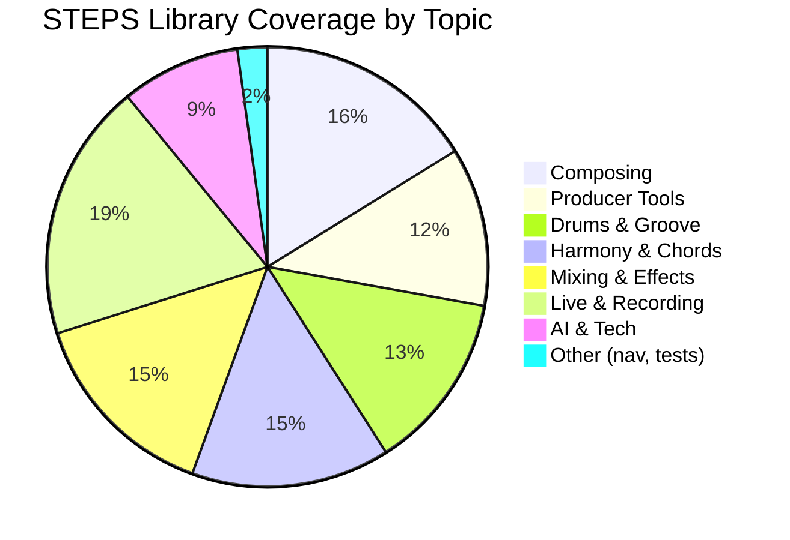
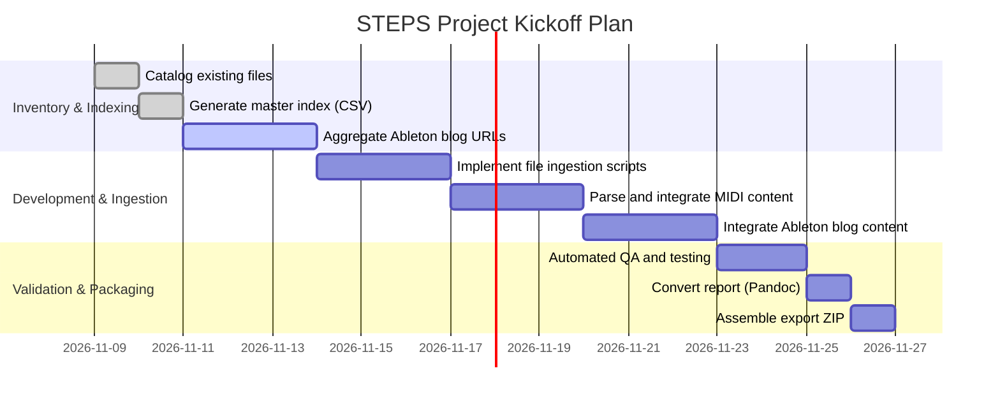
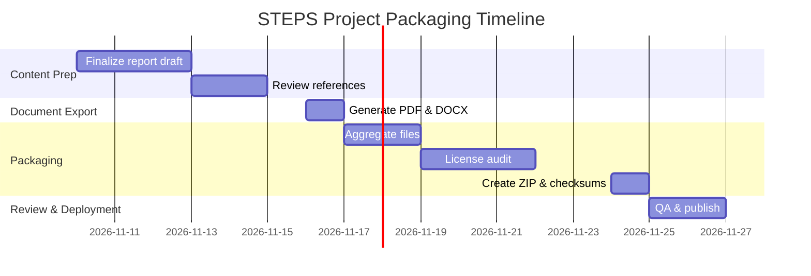
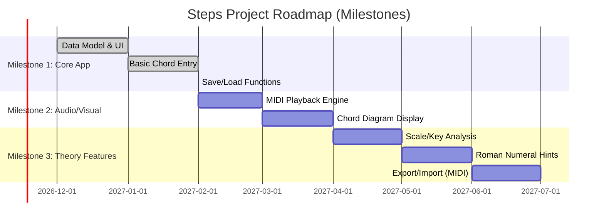
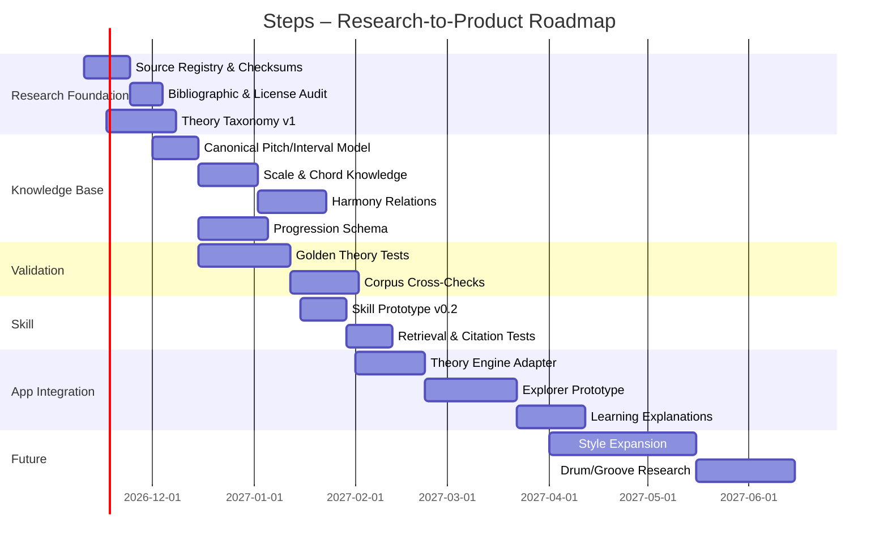

# Steps – technischer Anhang: eindeutige historische Vorlagen und Codebeispiele

**Stand:** 09.11.2026. Dies ist ein **quellengetreuer Anhang zur konsolidierten Projekt-Overview**, kein ausführbares, sicherheits-/lizenzgeprüftes Produktpaket. Jede untenstehende Vorlage stammt aus genau einem der sechs übergebenen Dokumente. **Identische Codeblöcke werden nur einmal aufgenommen.** Abweichende Varianten, historische Gantt-Pläne und Beispielschemata bleiben als unterschiedliche Originalinformationen erhalten. Eine Bewertung der bekannten technischen Probleme steht in der Overview (§9.3) und im Widerspruchsregister (§14). Rohbefehle niemals ohne Anpassung auf echte Speicherorte, Rechte-/Hash- und Importgrenzen ausführen.

**Abdeckung:** 39 eindeutige fenced blocks; 0 exakt identische Wiederholungen entfernt.

---

## Vorlage 01: `STEPS Project Export.md`, Zeilen 74–84

**Typ:** `mermaid`; **SHA-256 des Rohblocks:** `a69008cfe0c433fb…`



---

## Vorlage 02: `STEPS Project Export.md`, Zeilen 111–118

**Typ:** ```bash`; **SHA-256 des Rohblocks:** `6db8e687ab046535…`

  ```bash
  # Generate checksums for all files
  find "$STEPS_DIR" -type f -exec sha256sum {} \; > STEPS_checksums.sha256

  # Create CSV index (path, size, date)
  find "$STEPS_DIR" -type f \
       -printf "\"%p\",%s,%TY-%Tm-%Td\n" > STEPS_index.csv
  ```  

---

## Vorlage 03: `STEPS Project Export.md`, Zeilen 122–135

**Typ:** ````python`; **SHA-256 des Rohblocks:** `e967879a32e718f0…`

    ```python
    import mido, json
    mid = mido.MidiFile('example.mid')
    data = {'tracks': []}
    for i, track in enumerate(mid.tracks):
        data['tracks'].append([])
        for msg in track:
            data['tracks'][i].append({
                'time': msg.time,
                'bytes': list(msg.bytes())
            })
    with open('example.json', 'w') as fp:
        json.dump(data, fp, indent=2)
    ```  

---

## Vorlage 04: `STEPS Project Export.md`, Zeilen 142–144

**Typ:** ````bash`; **SHA-256 des Rohblocks:** `ed710f91d8fb9255…`

    ```bash
    zip -r STEPS_Project_20261109.zip STEPS_Library/ STEPS_Report.pdf STEPS_Report.docx STEPS_index.csv
    ```  

---

## Vorlage 05: `STEPS Project Export.md`, Zeilen 148–159

**Typ:** `mermaid`; **SHA-256 des Rohblocks:** `870f490933e25d81…`

```mermaid
flowchart TD
    A[Local STEPS Directory] --> B[Collect and Summarize Files]
    B --> C[Generate Metadata Index (CSV)]
    C --> D[Download & Integrate Ableton Blog Data]
    C --> E[Parse Local MIDI/ZIP Files]
    D --> F[Consolidate All Sources]
    E --> F
    F --> G[Validate Checksums & Content]
    G --> H[Quality Assurance Testing]
    H --> I[Generate Final Archive (ZIP/PDF/DOCX)]
```

---

## Vorlage 06: `STEPS Project Export.md`, Zeilen 167–180

**Typ:** `unbezeichnet`; **SHA-256 des Rohblocks:** `1c8018bbbcca7523…`

```
STEPS_Project_20261109.zip
├── STEPS_Library/               # Root of STEPS content
│   ├── 00_NAVIGATION/           # Index files, README, catalogs
│   ├── 01_MUSIC_THEORY/
│   ├── 02_HARMONY/
│   ├── ... (other numbered sections 03–43, 90, 99)
│   └── 90_ARCHIVE/              # Historic versions (if any included)
│
├── STEPS_Report.pdf             # The final report in PDF
├── STEPS_Report.docx            # The final report in DOCX
├── STEPS_Index.csv              # Master index (filename, path, size, checksum, etc.)
└── README.txt                   # Overview of archive contents and license info
```

---

## Vorlage 07: `STEPS Project Export.md`, Zeilen 190–192

**Typ:** ```bash`; **SHA-256 des Rohblocks:** `4a5dce78b684a7ba…`

  ```bash
  sort STEPS_Index.csv | uniq -c | awk '$1>1'
  ```  

---

## Vorlage 08: `STEPS Project Export.md`, Zeilen 207–223

**Typ:** `mermaid`; **SHA-256 des Rohblocks:** `34ef1c5b763526c2…`



---

## Vorlage 09: `STEPS Project Export.md`, Zeilen 232–238

**Typ:** ```bash`; **SHA-256 des Rohblocks:** `3295aa0173d19ac2…`

  ```bash
  # Example: collect file list and metadata in one go
  STEPS_DIR="/path/to/local/steps/project"
  mkdir -p STEPS_Archive
  cd "$STEPS_DIR"
  find . -type f > STEPS_Archive/file_list.txt
  ```

---

## Vorlage 10: `STEPS Project Export.md`, Zeilen 240–242

**Typ:** ```bash`; **SHA-256 des Rohblocks:** `f6013057d9d44cc7…`

  ```bash
  find "$STEPS_DIR" -type f -exec sha256sum {} \; > STEPS_Archive/steps_checksums.sha256
  ```

---

## Vorlage 11: `STEPS Project Export.md`, Zeilen 244–248

**Typ:** ```bash`; **SHA-256 des Rohblocks:** `99c8a3c157436263…`

  ```bash
  find "$STEPS_DIR" -type f \
       -printf "\"%p\",%s,%TY-%Tm-%Td,%p\n" \
       > STEPS_Archive/steps_index.csv
  ```

---

## Vorlage 12: `STEPS Project Export.md`, Zeilen 251–255

**Typ:** ```bash`; **SHA-256 des Rohblocks:** `8f6158bcd1580079…`

  ```bash
  cd STEPS_Archive
  pandoc STEPS_Report.md -V geometry:margin=1in -o STEPS_Report.pdf
  pandoc STEPS_Report.md -o STEPS_Report.docx
  ```

---

## Vorlage 13: `STEPS Project Export.md`, Zeilen 257–259

**Typ:** ```bash`; **SHA-256 des Rohblocks:** `0295caab8a547c1c…`

  ```bash
  zip -r STEPS_Project_$(date +%Y%m%d).zip STEPS_Library/ STEPS_Report.pdf STEPS_Report.docx steps_index.csv
  ```

---

## Vorlage 14: `STEPS Project Export.md`, Zeilen 265–279

**Typ:** `python`; **SHA-256 des Rohblocks:** `e5a59692ec140a8a…`

```python
# Example: Parse MIDI and output JSON (requires mido library)
import mido, json
mid = mido.MidiFile('example.mid')
data = []
for track in mid.tracks:
    track_msgs = []
    time_accum = 0
    for msg in track:
        time_accum += msg.time
        track_msgs.append({'time': time_accum, 'message': msg.dict()})
    data.append(track_msgs)
with open('example.json','w') as out:
    json.dump(data, out, indent=2)
```

---

## Vorlage 15: `Projekt Overview.md`, Zeilen 75–90

**Typ:** `mermaid`; **SHA-256 des Rohblocks:** `784174a09afe3e59…`



---

## Vorlage 16: `Projekt Overview.md`, Zeilen 108–115

**Typ:** `bash`; **SHA-256 des Rohblocks:** `52633cf875873062…`

```bash
# On Linux/macOS:
wget http://server/STEPS_Bibliothek_V6.6.zip
sha256sum STEPS_Bibliothek_V6.6.zip > SHA256SUMS.txt
unzip -l STEPS_Bibliothek_V6.6.zip   # list contents for spot check
# Compare the hash in SHA256SUMS.txt with official value:
grep STEPS_Bibliothek_V6.6.zip SHA256SUMS.txt
```

---

## Vorlage 17: `Projekt Overview.md`, Zeilen 117–122

**Typ:** `powershell`; **SHA-256 des Rohblocks:** `e2d04774a7570a02…`

```powershell
# On Windows:
CertUtil -hashfile STEPS_Bibliothek_V6.6.zip SHA256
7z l STEPS_Bibliothek_V6.6.zip   # list files (requires 7-Zip)
# Cross-check printed hash with the one we provide.
```

---

## Vorlage 18: `Project Definition & Positioning.md`, Zeilen 91–106

**Typ:** `mermaid`; **SHA-256 des Rohblocks:** `b0a29c4767e0b4f7…`



---

## Vorlage 19: `Project Definition & Positioning.md`, Zeilen 124–143

**Typ:** `unbezeichnet`; **SHA-256 des Rohblocks:** `d9823b61f3513b58…`

```
/ (root)
  README.md
  LICENSE
  .gitignore
  setup.py / pyproject.toml
  /steps/           (Python package)
    __init__.py
    ui.py
    chord.py
    playback.py
    analysis.py
    data/           (e.g. default chord tables)
  /docs/            (architecture, UML, how-to)
  /examples/        (pre-made progressions, images)
  CONTRIBUTING.md
  .github/
    ISSUE_TEMPLATE.md
    PULL_REQUEST_TEMPLATE.md
```

---

## Vorlage 20: `Project Definition & Positioning.md`, Zeilen 152–156

**Typ:** ````bash`; **SHA-256 des Rohblocks:** `1694c9df8f9d4682…`

   ```bash
   cd C:\Users\Timvo\OneDrive\Github  
   git clone https://github.com/YOUR_USER/steps.git  
   cd steps  
   ```  

---

## Vorlage 21: `Forschungs- und Projektgrundlage.md`, Zeilen 109–115

**Typ:** `text`; **SHA-256 des Rohblocks:** `a2f2fe1f00b18473…`

```text
Chord Identity
Chord Spelling
Chord Voicing
Chord Symbol
Harmonic Interpretation
```

---

## Vorlage 22: `Forschungs- und Projektgrundlage.md`, Zeilen 156–169

**Typ:** `text`; **SHA-256 des Rohblocks:** `57f0530aab59a70d…`

```text
absolute chords
relative scale degrees
key / tonic context
mode
harmonic rhythm
phrase position
cadential role
voice-leading metrics
source provenance
style/context tags
alternative analyses
confidence
```

---

## Vorlage 23: `Forschungs- und Projektgrundlage.md`, Zeilen 195–204

**Typ:** `text`; **SHA-256 des Rohblocks:** `93d13ba654a543b9…`

```text
Chord A
  ├─ functional_neighbors
  ├─ diatonic_neighbors
  ├─ modal_interchange_neighbors
  ├─ secondary_dominant_targets
  ├─ common_tone_neighbors
  ├─ minimal_voice_leading_neighbors
  └─ transformational_neighbors
```

---

## Vorlage 24: `Forschungs- und Projektgrundlage.md`, Zeilen 265–283

**Typ:** `text`; **SHA-256 des Rohblocks:** `ed45e406dd5c270e…`

```text
DIATONIC
Dm   Em   F   G   C

DOMINANT RELATIONS
E7 → Am

MODAL INTERCHANGE
A   D   F#dim ...

VOICE LEADING
C   Fmaj7   Am/C ...

TRANSFORMATIONS
relative / parallel / leading-tone exchange ...

REHARMONIZATION
substitution candidates ranked by melodic compatibility
```

---

## Vorlage 25: `Forschungs- und Projektgrundlage.md`, Zeilen 291–360

**Typ:** `text`; **SHA-256 des Rohblocks:** `b63c195ffadb63b0…`

```text
steps/
├── README.md
├── LICENSE
├── AGENTS.md
├── SKILL.md
├── pyproject.toml
│
├── app/
│   ├── core/
│   ├── theory/
│   ├── progression/
│   ├── audio/
│   ├── ui/
│   └── adapters/
│
├── knowledge/
│   ├── README.md
│   ├── sources/
│   │   ├── registry.yaml
│   │   ├── raw/
│   │   └── extracted/
│   │
│   ├── concepts/
│   │   ├── intervals/
│   │   ├── scales/
│   │   ├── chords/
│   │   ├── harmony/
│   │   ├── progressions/
│   │   ├── voice_leading/
│   │   └── styles/
│   │
│   ├── relations/
│   ├── examples/
│   ├── corpora/
│   └── glossary/
│
├── research/
│   ├── papers/
│   ├── notes/
│   ├── competitors/
│   ├── gaps/
│   └── bibliography/
│
├── decisions/
│   ├── ADR-0001-knowledge-base.md
│   ├── ADR-0002-canonical-pitch-model.md
│   └── ...
│
├── schemas/
│   ├── source.schema.json
│   ├── concept.schema.json
│   ├── chord.schema.json
│   ├── progression.schema.json
│   └── analysis.schema.json
│
├── tests/
│   ├── theory/
│   ├── chords/
│   ├── progressions/
│   ├── transposition/
│   ├── enharmonics/
│   └── fixtures/
│
└── docs/
    ├── architecture/
    ├── theory/
    ├── user/
    └── roadmap/
```

---

## Vorlage 26: `Forschungs- und Projektgrundlage.md`, Zeilen 366–405

**Typ:** `yaml`; **SHA-256 des Rohblocks:** `cf57beac31394b72…`

```yaml
id: src_neal_2005_popular_music_analysis
type: journal_article

title: "Popular Music Analysis in American Music Theory"
authors:
  - "Jocelyn Neal"

year: 2005
language: en

local_file:
  path: "knowledge/sources/raw/Popular_Music_Analysis_in_American_Music.pdf"
  sha256: null

identifiers:
  doi: "10.31751/524"

license:
  status: verified
  name: "CC BY 4.0"

ingestion:
  status: parsed
  extraction_method: pdf_text
  reviewed: false

topics:
  - popular_music
  - analysis
  - musicology
  - methodology

quality:
  source_type: peer_reviewed
  confidence: high

notes:
  - "Contextual research source; not a normative harmony rulebook."
```

---

## Vorlage 27: `Forschungs- und Projektgrundlage.md`, Zeilen 411–456

**Typ:** `yaml`; **SHA-256 des Rohblocks:** `de493ec75eff5c4b…`

```yaml
id: harmony.secondary_dominant
label:
  en: Secondary Dominant
  de: Zwischendominante

category:
  - harmony
  - tonicization

definition:
  summary: >
    Dominant-function chord whose temporary target is
    a scale degree other than the global tonic.

prerequisites:
  - chord.dominant_seventh
  - harmony.dominant_function
  - theory.scale_degree

relations:
  broader:
    - harmony.chromatic
  related:
    - harmony.tonicization
    - harmony.secondary_leading_tone

representations:
  roman_numeral:
    example: "V7/ii"

style_context:
  classical_tonal: common
  jazz: common
  pop_rock: context_dependent

sources:
  - src_chordfiles_progressions
  - src_music_theory_handbook

validation_cases:
  - test_secondary_dominant_v_of_ii_major
  - test_secondary_dominant_minor_context

status: reviewed
```

---

## Vorlage 28: `Forschungs- und Projektgrundlage.md`, Zeilen 460–484

**Typ:** `json`; **SHA-256 des Rohblocks:** `f065624d1a5269c2…`

```json
{
  "id": "prog_000001",
  "tonic": {
    "pitchClass": 0,
    "spelling": "C"
  },
  "mode": "major",
  "chords": [
    {"symbol": "C",  "roman": "I"},
    {"symbol": "E7", "roman": "V7/vi"},
    {"symbol": "Am", "roman": "vi"},
    {"symbol": "F",  "roman": "IV"}
  ],
  "analysis": [
    {
      "framework": "functional",
      "confidence": 0.95
    }
  ],
  "provenance": {
    "type": "constructed_example"
  }
}
```

---

## Vorlage 29: `Forschungs- und Projektgrundlage.md`, Zeilen 492–501

**Typ:** `text`; **SHA-256 des Rohblocks:** `25d46440de860ea2…`

```text
What?
According to whom?
From which source?
Which edition?
Under which theoretical framework?
With what confidence?
Validated by whom?
Used by which code/tests?
```

---

## Vorlage 30: `Forschungs- und Projektgrundlage.md`, Zeilen 507–523

**Typ:** `text`; **SHA-256 des Rohblocks:** `3c69f368af644e68…`

```text
SOURCE INGESTION
      ↓
METADATA NORMALIZATION
      ↓
CONCEPT EXTRACTION
      ↓
CLAIM EXTRACTION
      ↓
CROSS-SOURCE RECONCILIATION
      ↓
CANONICAL KNOWLEDGE ENTRY
      ↓
TEST CASE GENERATION
      ↓
APP INTEGRATION
```

---

## Vorlage 31: `Forschungs- und Projektgrundlage.md`, Zeilen 584–593

**Typ:** `text`; **SHA-256 des Rohblocks:** `321ab01c0b35f5af…`

```text
DOMINANT_OF
RESOLVES_TO
BORROWED_FROM
DIATONIC_WITH
COMMON_TONE_WITH
VOICE_LEADING_NEAR
TRANSFORMATION_OF
SUBSTITUTES_FOR
```

---

## Vorlage 32: `Forschungs- und Projektgrundlage.md`, Zeilen 625–657

**Typ:** `mermaid`; **SHA-256 des Rohblocks:** `c18305325cfd9ee0…`



---

## Vorlage 33: `Forschungs- und Projektgrundlage.md`, Zeilen 674–698

**Typ:** `text`; **SHA-256 des Rohblocks:** `cea870cd6921004f…`

```text
C major → C D E F G A B
A natural minor → A B C D E F G
C harmonic minor → C D Eb F G Ab B

C major triad → C E G
C dominant seventh → C E G Bb

C/E bass → E
C7 in F major → V7
E7 in C major → V7/vi

transpose(C–G–Am–F, +2) → D–A–Bm–G

German H → B natural
German B → Bb

V7/ii in C → A7
A7 target → Dm

modal interchange in C:
iv → Fm
bVI → Ab
bVII → Bb
```

---

## Vorlage 34: `Forschungs- und Projektgrundlage.md`, Zeilen 704–748

**Typ:** `markdown`; **SHA-256 des Rohblocks:** `4783d9f7d93170af…`

```markdown
# Source Record

## Identity
ID:
Title:
Author(s):
Year:
Publisher / Institution:
DOI:
URL:

## Local
File:
SHA-256:
Imported:
Parser:

## Rights
Copyright:
License:
Redistribution allowed:
Derived-text allowed:
Status: VERIFIED | UNKNOWN | RESTRICTED

## Classification
Source type:
Theory areas:
Style contexts:
Evidence quality:

## Extraction
Parsed:
Reviewed:
Relevant chapters/pages:

## Claims
- claim:
  confidence:
  concept_ids:

## Notes
Conflicts:
Open questions:
```

---

## Vorlage 35: `Forschungs- und Projektgrundlage.md`, Zeilen 752–782

**Typ:** `markdown`; **SHA-256 des Rohblocks:** `835e5b2d124549b8…`

```markdown
---
id: harmony.modal_interchange
status: draft
aliases:
  - borrowed chords
  - modal borrowing
---

# Modal Interchange

## Definition

## Preconditions

## Canonical examples

## Alternative interpretations

## Style scope

## Computational representation

## UI representation

## Common misconceptions

## Tests

## Sources
```

---

## Vorlage 36: `Forschungs- und Projektgrundlage.md`, Zeilen 786–811

**Typ:** `text`; **SHA-256 des Rohblocks:** `3dce3ed9e0ec4efb…`

```text
ROLE
You are the Steps Knowledge Ingestion Agent.

OBJECTIVE
Convert one supplied source into structured,
traceable knowledge without inventing missing information.

RULES
1. Preserve source metadata.
2. Do not infer author, year, license or page numbers unless evidenced.
3. Separate direct source claims from your interpretation.
4. Map claims onto existing concept IDs where possible.
5. Propose new IDs rather than silently creating terminology.
6. Flag contradictions with existing knowledge.
7. Generate validation examples only when the rule is sufficiently explicit.
8. Do not copy long copyrighted passages.

OUTPUT
- updated source record
- extracted concept candidates
- claim records
- unresolved questions
- conflicts
- candidate tests
```

---

## Vorlage 37: `Forschungs- und Projektgrundlage.md`, Zeilen 815–833

**Typ:** `text`; **SHA-256 des Rohblocks:** `5df88c4303ef0f9e…`

```text
Review concept: {{concept_id}}

Compare all registered sources attached to the concept.

Produce:
1. consensus definition
2. theoretical disagreements
3. stylistic scope
4. edge cases
5. canonical examples
6. counterexamples
7. computational representation
8. validation tests
9. confidence classification

Do not erase competing interpretations.
Do not convert stylistic tendencies into universal rules.
```

---

## Vorlage 38: `Forschungs- und Projektgrundlage.md`, Zeilen 839–873

**Typ:** `text`; **SHA-256 des Rohblocks:** `2bda9f51d0a29e1d…`

```text
Steps_Research_Foundation_v1.zip
│
├── 00_README.md
├── 01_PROJECT_REPORT.md
├── 02_PROJECT_CONTEXT_HANDOVER.md
├── 03_RESEARCH_BIBLIOGRAPHY.md
├── 04_SOURCE_INVENTORY.csv
├── 05_DECISION_REGISTER.md
├── 06_RESEARCH_GAPS.md
├── 07_ROADMAP.md
│
├── skill/
│   └── SKILL_DRAFT.md
│
├── schemas/
│   ├── source.schema.json
│   ├── concept.schema.json
│   ├── chord.schema.json
│   └── progression.schema.json
│
├── templates/
│   ├── SOURCE_TEMPLATE.md
│   ├── CONCEPT_TEMPLATE.md
│   ├── ADR_TEMPLATE.md
│   └── CODEX_PROMPTS.md
│
├── competitors/
│   ├── COMPETITOR_MATRIX.md
│   └── NOTES/
│
└── sources/
    ├── README.md
    └── LOCAL_SOURCE_MANIFEST.yaml
```

---

## Vorlage 39: `Forschungs- und Projektgrundlage.md`, Zeilen 879–890

**Typ:** `bash`; **SHA-256 des Rohblocks:** `e93aefc3c095ea6c…`

```bash
zip -r Steps_Research_Foundation_v1.zip \
  00_README.md \
  01_PROJECT_REPORT.md \
  02_PROJECT_CONTEXT_HANDOVER.md \
  03_RESEARCH_BIBLIOGRAPHY.md \
  04_SOURCE_INVENTORY.csv \
  05_DECISION_REGISTER.md \
  06_RESEARCH_GAPS.md \
  07_ROADMAP.md \
  skill/ schemas/ templates/ competitors/ sources/
```
