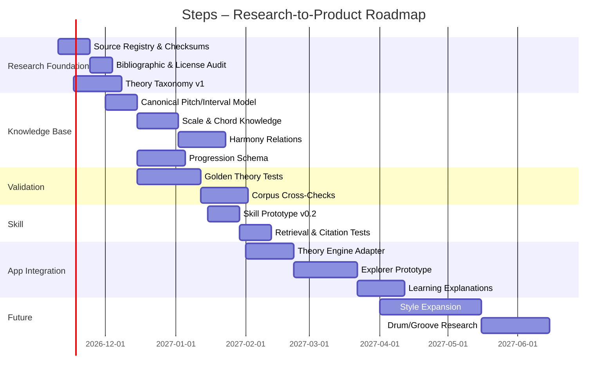

# Steps — Forschungs- und Projektgrundlage für eine erweiterbare Harmony Knowledge Base

## Executive Summary

**Steps** ist als unabhängige Open-Source-Anwendung für das Erkunden, Verstehen, Analysieren und Erzeugen von Akkordfolgen konzipiert:

> **Steps – An independent, open-source chord progression app for exploring harmony & learning music theory.**

Der aktuelle Projektstand ist noch bewusst **vor der eigentlichen Produktimplementierung** angesiedelt. Eine Python-/Tkinter-GUI-Basis existiert bereits; ebenso ein erster Entwurf für einen spezialisierten Music-Theory-/Harmony-Skill sowie eine Sammlung aus zwanzig lokalen PDF-/TXT-Quellen und mehreren Wettbewerbs- bzw. Inspirationsmaterialien. Der bestehende Skill-Entwurf enthält bereits sinnvolle Regeln zur Quellenverwendung, zur Unterscheidung deutscher und internationaler Notation, zur Analyse von Tonart, Modus, Akkordfunktion, Voice Leading und stilistisch mehrdeutigen Fällen. Er sollte deshalb nicht verworfen, sondern später als schlanke Zugriffsschicht über einer erheblich größeren Wissensbasis weiterentwickelt werden. fileciteturn0file21

Die zentrale Empfehlung dieses Reports lautet daher: **Die `SKILL.md` darf nicht zum Wissensspeicher des Projekts werden.** Stattdessen sollte Steps eine versionierte, quellennachweisbare Knowledge Base erhalten, aus der Skill, App-Logik, Tests, Dokumentation, Lerntexte und spätere Generatoren gespeist werden. Ein solcher Aufbau passt auch zur vorhandenen Computational-Music-Theory-Literatur: Boenn et al. zeigen exemplarisch, dass musiktheoretische Regeln formalisiert und maschinenlesbar repräsentiert werden können, warnen aber implizit vor der Vorstellung eines einzigen universellen Regelwerks, da ihr Ansatz gezielt ein bestimmtes stilistisches Regelsystem — Renaissance Counterpoint — formalisiert. fileciteturn0file3 Die veröffentlichte Fassung erschien 2012 bei AAAI unter DOI `10.1609/aiide.v8i4.12559`. citeturn307882search0

Für Steps sollte deshalb nicht ein einzelnes Harmoniemodell als „Wahrheit“ implementiert werden. Die Knowledge Base sollte mehrere Analyseperspektiven parallel repräsentieren: diatonische und funktionale Harmonik, Roman-Numeral-Analyse, modale Systeme, Jazz-/Chord-Scale-Ansätze, Pop-/Rock-Harmonik, chromatische Substitutionen, Voice Leading, transformational bzw. neo-Riemannian perspectives und gegebenenfalls Schenkerian oder generative approaches. Dass Pop-/Rock-Harmonik nicht einfach als klassische Funktionstheorie mit anderem Repertoire behandelt werden sollte, ist auch in Open Music Theory ausdrücklich thematisiert; dort wird betont, dass Pop-/Rock-Analyse eigene harmonische Konventionen und wiederkehrende progression patterns besitzt. citeturn647090search18

Die vorhandenen Produktreferenzen zeigen bereits eine erkennbare Richtung. **Chord Files** stellt diatonische Main Chords, Secondary Dominants und Modal Interchange als unmittelbar navigierbare Beziehungen dar und erweitert dies inzwischen um Secondary Diminished Chords, Neapolitan harmony, Harmonic Minor und Chord/Scale relationships. fileciteturn0file5 citeturn101488search0turn101488search3 **ModeWheel** nutzt rotierende visuelle Strukturen für Major, Melodic Minor, Harmonic Minor und Harmonic Major und kombiniert Mode, tonic, scale steps, root chord, II–V–I und Audio-Playback. fileciteturn0file10 **The Chord Wheel** konzentriert sich auf Tonartbeziehungen, Transposition, Komposition und das Erkennen harmonischer Beziehungen. citeturn101488search6 **4× Wheels of 7** erweitert die Idee auf vier Familien mit jeweils sieben Modi und ist damit besonders relevant für eine zukünftige Scale-/Mode-Navigation. fileciteturn0file15

Daraus ergibt sich eine deutlich eigenständigere Produktidee als ein weiterer „Chord Wheel Clone“:

**Steps sollte Harmonie als navigierbaren, erklärbaren Zustandsraum behandeln.** Ein Akkord ist dabei nicht nur ein Button oder Symbol, sondern ein Knoten mit Beziehungen zu Tonart, Skalenstufen, Funktionen, möglichen Vorgängern und Nachfolgern, Voice-Leading-Distanzen, Modal-Interchange-Ursprüngen, Secondary-Dominant-Beziehungen, Alternativanalysen und Lerninhalten.

Das ist technisch realistisch. MusicXML kann chord symbols und Harmonieinformationen strukturiert speichern; sein `<harmony>`-Element ist ausdrücklich für popular-music chord symbols und functional harmony analysis vorgesehen. citeturn647090search3turn647090search20 `music21` bietet bereits Klassen für Chords, Chord Symbols, Roman Numerals und harmonic function analysis und eignet sich deshalb hervorragend als Referenz- und Testwerkzeug — auch wenn Steps seine Kernlogik nicht zwingend von `music21` abhängig machen sollte. citeturn647090search0turn647090search1turn647090search7

Für größere empirische Analysen ist **ChoCo — the Chord Corpus** eine besonders wichtige zusätzliche Referenz. Das Projekt integriert mehr als 20.000 zeitbezogene Akkordanmerkungen aus zahlreichen Quellen, normalisiert verschiedene Notationsformen, speichert Provenienz und stellt Daten sowohl als JAMS als auch als Knowledge Graph bereit. Diese Architektur ist für Steps mindestens ebenso interessant wie die eigentlichen Akkorddaten. citeturn470475search0turn470475search1

Der unmittelbare Projektstart sollte deshalb nicht „mehr GUI bauen“ lauten, sondern:

**Source Registry → Theory Taxonomy → Canonical Chord Model → Validation Corpus → Progression Relation Model → Skill Prototype → GUI Integration.**

Drum patterns bleiben entsprechend deiner Entscheidung außerhalb des aktuellen Forschungsumfangs. Sie sollten lediglich als spätere Roadmap-Erweiterung geführt werden.

## Projektdefinition, Status und vorhandener Quellenbestand

### Projektdefinition und Grenzen

Steps soll gleichzeitig drei Funktionen erfüllen:

**Exploration.** Der Nutzer soll harmonische Möglichkeiten entdecken können, ohne bereits die theoretischen Namen aller Konzepte kennen zu müssen.

**Explanation.** Jede relevante Beziehung soll auf Wunsch theoretisch erklärt werden können: beispielsweise warum `E7 → Am` als Secondary Dominant funktioniert, warum `Ab → C` als modal-interchange relationship interpretiert werden kann oder warum eine bestimmte chromatische Verbindung besser durch Voice Leading als durch traditionelle Funktionstheorie beschrieben wird.

**Education.** Die Anwendung soll nicht nur Akkorde liefern, sondern beim Gebrauch Musiktheorie vermitteln.

Das unterscheidet Steps von einem rein algorithmischen progression generator. Das bestehende Chord-Files-Material ist hierfür ein starkes Vorbild: Es liefert nicht einfach Akkorde, sondern organisiert Beziehungen sichtbar in Main Chords, Secondary Dominants und Modal Interchange und verwendet arrows als Auflösungshinweise. fileciteturn0file5 Chord Files selbst beschreibt die aktuelle Progressions-Version zusätzlich als Werkzeug zum Transponieren, Analysieren und Kombinieren von Chords und Scales. citeturn101488search1turn101488search2

Aktuell bestätigt sind:

- Open-Source-Ausrichtung.
- Python als bestehende technische Basis.
- Tkinter als derzeitige GUI-Basis.
- Musiktheorie, Harmonie und Chord Progressions als Kernwissen.
- Aufbau eines spezialisierten Codex-/AI-Skills.
- Vorhandener erster `SKILL.md`-Entwurf.
- Vorhandene Wettbewerbs- und Inspirationsanalyse.
- Drum-/Genre-Patterns **nicht** Bestandteil der aktuellen Forschungsphase.
- Quellen sollen zunächst breit gesammelt werden, bevor sie für Skill oder Produkt verdichtet werden.
- Codex soll später nicht nur dokumentieren, sondern die Knowledge Base tatsächlich strukturieren, ingestieren und testen.

Der frühere Handover-Prompt verfolgt genau diesen Preservation-first-Ansatz und verlangt eine Trennung zwischen bestätigten Entscheidungen, Research-Support, vorhandener Infrastruktur und bloßen Vorschlägen. Diese Statussemantik sollte in das Repository übernommen werden. fileciteturn0file0

### Source Inventory der zwanzig Ausgangsdateien

Die folgende Tabelle trennt **bibliografisch verifizierte Information** von noch zu prüfenden Angaben. „Parsed“ bedeutet hier nur, dass im bisherigen Research-Kontext verwertbarer Text extrahiert werden konnte — nicht, dass die Quelle bereits vollständig kapitelweise ingestiert wurde.

| Datei | Autor / Institution | Jahr | Typ | Hauptinhalt | Lizenz-/Rechte-Status | aktueller Status |
|---|---|---:|---|---|---|---|
| `ModeWheel_Manual_1.21.pdf` | Autor lokal noch zu verifizieren; ModeWheel/NewPsyc | 2023 | PDF, Manual | vier Scale Families; Mode Wheel; tonic/mode selection; scale steps; root chord; II–V–I; Playback | Software-/Manual-Rechte prüfen | **Parsed**, 9 Seiten; Version 1.2.1 ist Mai 2023 datiert. fileciteturn0file10 |
| `Music_Theory_Advanced_Level.pdf` | wahrscheinlich Compilation aus Eowyn/Mysongbook-Material; muss am Original verifiziert werden | unbekannt | PDF | fortgeschrittene Theorie, Harmony, Progressions | unbekannt | **Partial/metadata only**; Web-Spuren weisen auf eine ältere Compilation hin, aber File-Match noch verifizieren. citeturn420931search19 |
| `Music_theory_handbook.pdf` | Berklee Online; Beiträge u. a. Beth Denisch, Steve Rochinski, Paul Schmeling, Michael Rendish | unbekannt | PDF | Counterpoint, Reharmonization, Rhythm, Seventh Chords, Blues | vermutlich proprietäres Berklee-Material; Nutzung prüfen | **Parsed**; Inhaltsverzeichnis bestätigt die fünf Themenblöcke. fileciteturn0file12 |
| `Name_Music_Theory_Worksheet_Music_Theory.pdf` | Serenade Music Publishing | 2015 | PDF, Worksheets | Notation, clefs, elementary theory exercises | Copyright; Wiederverwendung prüfen | **Parsed**; Copyright-Hinweis 2015 sichtbar. fileciteturn0file13 |
| `Popular_Music_Analysis_in_American_Music.pdf` | Jocelyn Neal | 2005 | wissenschaftlicher Artikel | Entwicklung von Popular Music Analysis in US music theory | **CC BY 4.0** | **Parsed / high-value**; DOI `10.31751/524`. fileciteturn0file14 citeturn307882search2 |
| `Scales with 4 smart tools.txt` | Transkript zu Oliver-Prehn/NewJazz-Konzept | unbekannt | TXT/Transcript | vier Wheels × sieben Modes; scale/chord relationships | Herkunft/Lizenz prüfen | **Parsed**; 28-scale-Konzept explizit beschrieben. fileciteturn0file15 |
| `THE_ELEMENTS_OF_MUSIC.pdf` | genaue Ausgabe/Urheberschaft noch zu identifizieren | unbekannt | PDF | Rhythm, Dynamics, Melody, Harmony, Timbre, Texture, Form | unbekannt | **Parsed**, aber bibliografische Identität noch unsicher. fileciteturn0file16 |
| `the-chord-wheel.pdf` | Jim Fleser / Hal Leonard | Ausgabe prüfen | PDF/Auszug | key relationships, transposition, improvisation, composition | proprietär | **Parsed excerpt**; Autor und Verlag sind sichtbar. fileciteturn0file17 Offizielle Hal-Leonard-Seite bestätigt Jim Fleser. citeturn101488search6 |
| `Understanding_Basic_Music_Theory.pdf` | Catherine Schmidt-Jones; teilweise Russell Jones | 2007 | Open textbook | notation, intervals, scales, keys, chords, harmony | Originalausgabe unter CC BY; exakte Version prüfen | **Parsed**, aber Encoding teilweise beschädigt. Web-Bibliografie bestätigt Schmidt-Jones und 2007. fileciteturn0file18 citeturn420931search0turn420931search2 |
| `What_is_popular_music_And_what_isn_t_An.pdf` | Franco Fabbri | 2010 | Zeitschriftenartikel | Definition und Grenzziehung von popular music | Lizenz der Ausgabe prüfen | **Parsed**; erschien in *Musiikki* 2/2010. fileciteturn0file19 |
| `7 levels of reharmonising Eleanor Rigby.txt` | Autor/Videoquelle noch verifizieren | unbekannt | TXT/Transcript | stufenweise Reharmonisierung, Dorian, harmonic minor, melody/chord interaction | Quelle/Lizenz prüfen | **Parsed**; behandelt explizit Melody-note compatibility, cadence/tension und scale changes. fileciteturn0file1 |
| `Chord FIles 2026 Showcase.txt` | Chord Files / Jaka | 2026-Kontext | TXT/Transcript | Produktüberblick: Progressions, Dark Harmony, Scales/Blues | proprietär | **Parsed**; beschreibt Secondary Dominants, Modal Interchange, Harmonic Minor, Neapolitan und Secondary Diminished concepts. fileciteturn0file2 |
| `Computational_Music_Theory.pdf` | Georg Boenn, Martin Brain, Marina De Vos, John ffitch | 2012 | wissenschaftlicher Artikel | Formalisierung musiktheoretischer Regeln; Answer Set Programming; algorithmic composition | AAAI publication; Wiederverwendung separat prüfen | **Parsed / high-value**; DOI `10.1609/aiide.v8i4.12559`. fileciteturn0file3 citeturn307882search0 |
| `harmony as a student.txt` | Nari Sol laut Transcript | unbekannt | TXT/Transcript | intuitive Harmonie, scale/chord relationships, tension/release, contextuality | Quelle/Lizenz prüfen | **Parsed**; besonders nützlich als didaktische Perspektive, nicht als normative Theoriequelle. fileciteturn0file4 |
| `How to use chord files.txt` | Chord Files / Jaka | unbekannt | TXT/Transcript | Main Chords, Secondary Dominants, Modal Interchange, diagrams | proprietär | **Parsed / product-reference**. fileciteturn0file5 |
| `Is_Generative_Theory_Misleading_for_Music.pdf` | Rafael Barbosa | 2019 | wissenschaftlicher Beitrag | Kritik generativer Musiktheorie; GTTM, Schenker, cognition | Open Access via HAL; konkrete reuse license prüfen | **Parsed**; HAL-ID `hal-02184441`. fileciteturn0file6 |
| `Kants_Theory_of_Music.pdf` | Oliver Thorndike | 2021 | peer-reviewed philosophy article | Kant, absolute music, affect, aesthetic ideas | Journal-/Zenodo-Lizenz prüfen | **Parsed**; DOI `10.5281/zenodo.5776100`. fileciteturn0file7 |
| `L-0002916879.pdf` | Theodor W. Adorno; ed. Robert Hullot-Kentor | engl. Ausgabe 2009 | Buchauszug | *Current of Music: Elements of a Radio Theory* | **copyrighted / all rights reserved** | **Parsed partial**; für App-Theorie nur peripher relevant. fileciteturn0file8 |
| `MakingMusic.pdf` | Dennis DeSantis / Ableton | 2015 | Buch | creative strategies für elektronische Musikproduktion | öffentlich lesbar, aber nicht automatisch offene Wiederverwendung | **Attachment aktuell nicht zuverlässig parsed**; bibliografisch über Ableton verifiziert. citeturn307882search1turn307882search18 |
| `Mathematics_and_Music.pdf` | David Wright | 2009 | Buch | intervals, ratios, logarithms, scales, tuning, mathematical structures | AMS copyright; Reproduktion lizenzpflichtig | **Parsed**; Inhaltsverzeichnis zeigt u. a. ratios, intervals, chromatic scales und tuning. fileciteturn0file9 AMS-Metadaten bestätigen Rechtevorbehalt. citeturn617706search48 |

Die Sammlung ist damit bereits deutlich breiter als eine normale „Chord Progression“-Bibliothek. Sie enthält Grundlagen, Harmonik, Reharmonisierung, Popular-Music-Analyse, mathematische Modelle, computational theory und sogar ästhetisch-philosophische Perspektiven. Gleichzeitig ist sie **noch nicht ausreichend ausgeglichen**: Es fehlen unter anderem systematische Primärquellen zu voice leading, jazz harmony, modern pop harmony, transformational theory, chromatic harmony, chord-symbol standards, corpus-based progression analysis und maschinenlesbaren Musikformaten.

## Wissensarchitektur und notwendige Forschung

Die zukünftige Knowledge Base sollte nicht als lineares Lehrbuch modelliert werden, sondern als **Graph miteinander verknüpfter musiktheoretischer Konzepte**.

### Fundamentale Music Theory

Die erste Ebene umfasst Pitch, pitch class, note spelling, enharmonic equivalence, intervals, octave equivalence, tuning/temperament, scales, modes, key signatures, tonal centers, rhythm, meter und basic form.

Wichtig ist hier insbesondere eine saubere Trennung von **akustischer Gleichheit und notierter/theoretischer Funktion**. `F#` und `Gb` können beispielsweise bei gleichstufiger Stimmung dieselbe sounding pitch class darstellen, aber unterschiedliche harmonische Rollen besitzen. Diese Information muss im Datenmodell erhalten bleiben, sonst werden spätere Analysen von Alterations, secondary dominants oder chromatic voice leading unzuverlässig.

`Mathematics and Music` bietet hierfür eine geeignete mathematische Ergänzung, da das Werk ausdrücklich ratios, logarithmic interval representation, chromatic scales und tuning behandelt. fileciteturn0file9

### Chord Theory

Das Modell sollte mindestens unterscheiden:

Triads, seventh chords, sixth chords, extensions 9/11/13, added-note chords, suspended chords, alterations, omissions, inversions, slash chords, polychords, rootless voicings und enharmonic respellings.

Eine wichtige Architekturentscheidung ist die Trennung zwischen:

```text
Chord Identity
Chord Spelling
Chord Voicing
Chord Symbol
Harmonic Interpretation
```

`C-E-G-Bb` könnte beispielsweise als `C7` gespeichert werden, während eine konkrete Voicing-Instanz zusätzlich Oktavlage, doubling und bass note enthält. Eine Roman-Numeral-Analyse `V7/IV` ist wiederum **keine Eigenschaft des Akkords allein**, sondern des Akkords in einem tonalen Kontext.

Genau diese Kontextabhängigkeit bildet `music21` ab: Ein `RomanNumeral` enthält scale degree und function in Beziehung zu einem Key, während ein generic chord symbol nicht dieselbe Kontextsemantik besitzt. citeturn647090search0turn647090search1

### Harmony

Mindestens folgende families sollten getrennt erfasst werden:

- diatonic harmony;
- functional harmony;
- Roman Numeral analysis;
- cadential syntax;
- tonicization;
- secondary dominants;
- secondary leading-tone/diminished chords;
- modal interchange / borrowed chords;
- chromatic mediants;
- Neapolitan harmony;
- augmented-sixth families;
- modulation;
- common-tone harmony;
- pedal harmony;
- sequence models;
- blues harmony;
- modal harmony;
- jazz functional harmony;
- chord-scale theory;
- nonfunctional harmony;
- planing;
- transformational / neo-Riemannian relations.

Für Steps ist besonders wichtig, dass eine Progression **mehr als eine valide Analyse besitzen kann**. Open Music Theory beschreibt harmonic analysis explizit als interpretativen Vorgang, der über bloßes chord labeling hinausgeht. citeturn647090search34

### Chord Progressions

Der zentrale Knowledge-Base-Typ sollte nicht „Liste von Akkorden“, sondern ein **Progression Object** sein.

Es braucht mindestens:

```text
absolute chords
relative scale degrees
key / tonic context
mode
harmonic rhythm
phrase position
cadential role
voice-leading metrics
source provenance
style/context tags
alternative analyses
confidence
```

Das erlaubt die wichtige Unterscheidung zwischen:

`C – G – Am – F`

und

`I – V – vi – IV`

Die erste Darstellung ist key-specific; die zweite ist transposable. Darüber hinaus kann dieselbe Akkordsequenz in einem modalen oder phrase-level context anders interpretiert werden.

Für empirische Daten sollte ChoCo als Designreferenz untersucht werden. ChoCo integriert mehr als 20.000 chord annotations, normalisiert unterschiedliche Notationen und bewahrt Provenienz. Es unterstützt sowohl Harte chord notation als auch Roman numerals und veröffentlicht die Daten als JAMS und Knowledge Graph. citeturn470475search0turn470475search1

Der McGill Billboard corpus kann ergänzend für Popular-Music-Progressions verwendet werden; seine Annotationsdateien enthalten unter anderem title, artist, metre, tonic, key changes und chord-related phrase structure. citeturn470475search2

### Voice Leading und Transformational Perspectives

Dieser Bereich ist in der jetzigen lokalen Bibliothek unterrepräsentiert und sollte hohe Forschungspriorität erhalten.

Die späteren Steps-Empfehlungen sollten nicht ausschließlich mit `V → I`-ähnlichen Funktionen arbeiten. Progressions können ebenso über **parsimonious voice leading**, common tones oder transformation distance interessant sein.

Neo-Riemannian- und Tonnetz-Modelle sind dafür besonders relevant. Moderne Forschung verwendet Tonnetz- und transformational spaces, um Akkordnähe und voice-leading relationships zu modellieren, auch jenseits traditioneller diatonischer Funktionen. citeturn647090search17turn647090search38

Ein potenzielles Steps-Konzept wäre deshalb:

```text
Chord A
  ├─ functional_neighbors
  ├─ diatonic_neighbors
  ├─ modal_interchange_neighbors
  ├─ secondary_dominant_targets
  ├─ common_tone_neighbors
  ├─ minimal_voice_leading_neighbors
  └─ transformational_neighbors
```

Damit würde sich Steps deutlich von einfachen circle-of-fifths tools unterscheiden.

### Stilistische Perspektiven

Die Knowledge Base sollte Stil nicht als kosmetisches Tag behandeln, sondern als **theoretischen Kontext**.

Ein `bVII → I` besitzt beispielsweise in Rock, modal harmony und classical tonal analysis unterschiedliche Normalität und Interpretation. Open Music Theory weist ausdrücklich darauf hin, dass Pop-/Rock-Harmonik eigene normative patterns besitzt. citeturn647090search18turn647090search42

Mindestens folgende contexts sollten langfristig vorgesehen werden:

Classical tonal, Romantic chromatic, Jazz, Blues, Gospel, Pop, Rock, Soul/R&B, Neo-Soul, Film/Cinematic und Modal/folk-derived harmony.

Nicht jeder Kontext muss im MVP vollständig implementiert werden.

### Computational Music Theory

Hier sollte das Projekt von Anfang an zwischen drei Dingen unterscheiden:

**Rule representation** — explizite musiktheoretische Regeln.

**Statistical evidence** — Progressionen, die empirisch häufig auftreten.

**Creative recommendation** — musikalisch interessante Vorschläge.

Diese Kategorien dürfen später in der App nicht vermischt werden.

Boenn et al. zeigen einen rule-based Ansatz auf Basis formal codierter Stilregeln. citeturn307882search0 ChoCo dagegen eignet sich für corpus-based/statistical harmonic research. citeturn470475search1 Steps kann langfristig beides kombinieren, sollte aber jeweils sichtbar machen, **warum** eine Empfehlung erscheint.

## Inspirations- und Wettbewerbsanalyse

### Feature-Matrix

| System | Hauptidee | Harmony Depth | Visual Exploration | Erklärung/Lernen | Transposition | Audio | besondere Inspiration für Steps |
|---|---|---:|---:|---:|---:|---:|---|
| **Chord Files** | physisches chord-navigation tool | hoch für gezielt ausgewählte Konzepte | hoch | mittel | ja | nein/produktabhängig | Beziehungen statt isolierter Akkordlisten |
| **ModeWheel** | rotierender Mode-/Scale explorer | mittel | sehr hoch | hoch | tonic switching | ja | Scale families + immediate audiovisual feedback |
| **4× Wheels of 7** | vier Families × sieben Modi | mittel | sehr hoch | hoch | ja | im Lehrkontext | systematische Scale-Family-Navigation |
| **The Chord Wheel** | circle-based key/chord relationships | grundlegend–mittel | hoch | mittel | stark | App: ja | unmittelbare Tonart-/Transpositionslogik |
| **Modelwheel** | lokale Referenz vorhanden; externe Identität noch nicht zuverlässig geklärt | offen | offen | offen | offen | offen | erst nach lokaler Quellenprüfung bewerten |
| **Steps — Zielbild** | multidimensional harmony explorer + tutor | **sehr hoch** | **hoch** | **sehr hoch** | ja | geplant | Theorie + Exploration + Provenienz + alternative Analysen |

Chord Files bietet inzwischen Modal Interchange, Secondary Dominants, Secondary Diminished, Neapolitan 6th, Harmonic Minor und chord/scale relationships; die offizielle Produktbeschreibung hebt außerdem Instant Transposition und Progression Analysis hervor. citeturn101488search1turn101488search3

ModeWheel deckt die vier Families Major, Melodic Minor, Harmonic Minor und Harmonic Major ab; das Handbuch zeigt zusätzlich tonic selection, root chord, II–V–I und audio playback. fileciteturn0file10 Die aktuelle offizielle Seite beschreibt NewModeWheel als vereinfachte Weiterentwicklung und bestätigt, dass das ursprüngliche System auf Oliver Prehns print-based design basiert. citeturn101488search4

The Chord Wheel positioniert sich primär um chord/key relationships, transposition, improvisation und songwriting. Die aktuelle digitale Version kann Akkorde zusätzlich unmittelbar wiedergeben. citeturn101488search5turn101488search7

### Produktlücke für Steps

Der eigentliche Wettbewerbsvorteil sollte deshalb **nicht** lauten:

> „Wir haben mehr Akkorde.“

Sondern:

> **„Steps zeigt mehrere musikalisch begründete Wege von einem harmonischen Zustand zum nächsten und erklärt, warum diese Wege funktionieren.“**

Ein Nutzer könnte beispielsweise `Am` anklicken und verschiedene Relation Layers einblenden:

```text
DIATONIC
Dm   Em   F   G   C

DOMINANT RELATIONS
E7 → Am

MODAL INTERCHANGE
A   D   F#dim ...

VOICE LEADING
C   Fmaj7   Am/C ...

TRANSFORMATIONS
relative / parallel / leading-tone exchange ...

REHARMONIZATION
substitution candidates ranked by melodic compatibility
```

Die Reharmonization-Unterlage zu *Eleanor Rigby* ist dafür ein hervorragender konzeptioneller Impuls, weil sie harmonische Auswahl nicht nur über Akkordtabellen erklärt, sondern über **Melody–Chord compatibility, scale identity, tension und cadence**. fileciteturn0file1

## Knowledge Base, Repository und Codex-Architektur

### Empfohlene Repository-Struktur

```text
steps/
├── README.md
├── LICENSE
├── AGENTS.md
├── SKILL.md
├── pyproject.toml
│
├── app/
│   ├── core/
│   ├── theory/
│   ├── progression/
│   ├── audio/
│   ├── ui/
│   └── adapters/
│
├── knowledge/
│   ├── README.md
│   ├── sources/
│   │   ├── registry.yaml
│   │   ├── raw/
│   │   └── extracted/
│   │
│   ├── concepts/
│   │   ├── intervals/
│   │   ├── scales/
│   │   ├── chords/
│   │   ├── harmony/
│   │   ├── progressions/
│   │   ├── voice_leading/
│   │   └── styles/
│   │
│   ├── relations/
│   ├── examples/
│   ├── corpora/
│   └── glossary/
│
├── research/
│   ├── papers/
│   ├── notes/
│   ├── competitors/
│   ├── gaps/
│   └── bibliography/
│
├── decisions/
│   ├── ADR-0001-knowledge-base.md
│   ├── ADR-0002-canonical-pitch-model.md
│   └── ...
│
├── schemas/
│   ├── source.schema.json
│   ├── concept.schema.json
│   ├── chord.schema.json
│   ├── progression.schema.json
│   └── analysis.schema.json
│
├── tests/
│   ├── theory/
│   ├── chords/
│   ├── progressions/
│   ├── transposition/
│   ├── enharmonics/
│   └── fixtures/
│
└── docs/
    ├── architecture/
    ├── theory/
    ├── user/
    └── roadmap/
```

Für externe Interoperabilität sollte MusicXML früh berücksichtigt werden. Der MusicXML-Standard besitzt ein eigenes `harmony` model für chord symbols und functional analysis und kann altered/additional chord degrees explizit darstellen. citeturn647090search3turn647090search21

### Source Metadata Schema

```yaml
id: src_neal_2005_popular_music_analysis
type: journal_article

title: "Popular Music Analysis in American Music Theory"
authors:
  - "Jocelyn Neal"

year: 2005
language: en

local_file:
  path: "knowledge/sources/raw/Popular_Music_Analysis_in_American_Music.pdf"
  sha256: null

identifiers:
  doi: "10.31751/524"

license:
  status: verified
  name: "CC BY 4.0"

ingestion:
  status: parsed
  extraction_method: pdf_text
  reviewed: false

topics:
  - popular_music
  - analysis
  - musicology
  - methodology

quality:
  source_type: peer_reviewed
  confidence: high

notes:
  - "Contextual research source; not a normative harmony rulebook."
```

Neals PDF bezeichnet sich selbst ausdrücklich als Open Access unter CC BY 4.0. fileciteturn0file14

### Concept Schema

```yaml
id: harmony.secondary_dominant
label:
  en: Secondary Dominant
  de: Zwischendominante

category:
  - harmony
  - tonicization

definition:
  summary: >
    Dominant-function chord whose temporary target is
    a scale degree other than the global tonic.

prerequisites:
  - chord.dominant_seventh
  - harmony.dominant_function
  - theory.scale_degree

relations:
  broader:
    - harmony.chromatic
  related:
    - harmony.tonicization
    - harmony.secondary_leading_tone

representations:
  roman_numeral:
    example: "V7/ii"

style_context:
  classical_tonal: common
  jazz: common
  pop_rock: context_dependent

sources:
  - src_chordfiles_progressions
  - src_music_theory_handbook

validation_cases:
  - test_secondary_dominant_v_of_ii_major
  - test_secondary_dominant_minor_context

status: reviewed
```

### Progression Object

```json
{
  "id": "prog_000001",
  "tonic": {
    "pitchClass": 0,
    "spelling": "C"
  },
  "mode": "major",
  "chords": [
    {"symbol": "C",  "roman": "I"},
    {"symbol": "E7", "roman": "V7/vi"},
    {"symbol": "Am", "roman": "vi"},
    {"symbol": "F",  "roman": "IV"}
  ],
  "analysis": [
    {
      "framework": "functional",
      "confidence": 0.95
    }
  ],
  "provenance": {
    "type": "constructed_example"
  }
}
```

### Warum Provenienz zwingend erforderlich ist

ChoCo ist hier ein relevantes Vorbild. Das Projekt bewahrt nicht nur normalisierte chord annotations, sondern auch Informationen über Originalquelle, annotators, identifiers und links. citeturn470475search0turn470475search1

Steps sollte deshalb für jede wissensbasierte Aussage mindestens wissen:

```text
What?
According to whom?
From which source?
Which edition?
Under which theoretical framework?
With what confidence?
Validated by whom?
Used by which code/tests?
```

### Codex-Arbeitsmodell

Codex sollte in klar getrennten Phasen arbeiten:

```text
SOURCE INGESTION
      ↓
METADATA NORMALIZATION
      ↓
CONCEPT EXTRACTION
      ↓
CLAIM EXTRACTION
      ↓
CROSS-SOURCE RECONCILIATION
      ↓
CANONICAL KNOWLEDGE ENTRY
      ↓
TEST CASE GENERATION
      ↓
APP INTEGRATION
```

Ein wichtiger Grundsatz aus dem bestehenden `SKILL.md` sollte beibehalten werden: Buchtitel, Autor oder Seitenangaben dürfen nur genannt werden, wenn sie tatsächlich belegt sind; fehlende Quellen dürfen nicht halluziniert werden. fileciteturn0file21

## Gaps, Risiken und Decision Register

### Größte Wissenslücken

**Voice Leading.** Aktuell existieren viele harmonic-function sources, aber keine gleichwertige strukturierte Sammlung für parsimonious movement, common-tone retention, guide tones und voice-leading optimization.

**Jazz Harmony.** Chord extensions und Modes sind vorhanden, aber noch keine umfassende Referenzbasis zu jazz functional harmony, guide-tone lines, tritone substitution, backdoor dominants, altered dominants, diminished substitutions oder modal jazz.

**Modern Popular Harmony.** Neals Überblick ist methodisch wichtig, ersetzt aber keine konkrete Pop-/Rock-Harmonielehre. fileciteturn0file14

**Transformation Theory / Tonnetz.** Für ein grafisches Harmony-Exploration-Tool wahrscheinlich strategisch besonders wertvoll; bislang nur indirekt vorhanden. Forschung zu Tonnetz und voice-leading spaces zeigt, dass solche Modelle Akkordbewegungen als navigierbare Räume darstellen können. citeturn647090search17turn647090search31

**Notation Standards.** Ein eigener kanonischer chord parser ist notwendig oder zumindest eine klare mapping layer. MusicXML und Harte notation sollten früh untersucht werden. ChoCo nutzt Harte als Interoperabilitätsbrücke zwischen verschiedenen chord representations. citeturn470475search0

**Corpus Validation.** Es fehlen aktuell eigene golden datasets, an denen Steps' Analysen geprüft werden können.

### Hauptrisiken

| Risiko | Auswirkung | Gegenmaßnahme |
|---|---|---|
| eine Theorie wird als universell behandelt | falsche Analysen außerhalb ihres Stils | Framework + style-context speichern |
| enharmonic spelling geht verloren | theoretisch falsche Akkorde/Modulationen | spelling getrennt von pitch class |
| Skill wird Wissensdatenbank | unwartbar, schwer testbar | KB separat versionieren |
| Quellen ohne Lizenzprüfung werden kopiert | rechtliches Risiko | Source Registry mit reuse status |
| GUI-Logik enthält Theorie | spätere Architekturblockade | theory engine vollständig UI-unabhängig |
| generierte Progressions werden als „Regeln“ dargestellt | pädagogisch irreführend | rule/statistic/creative klar trennen |
| Transcripts werden wie peer-reviewed theory behandelt | Qualitätsverlust | source-quality tiers |
| zu frühe Feature-Expansion | Projekt zerfasert | Drum/groove layer erst nach Harmony MVP |

### Decision Register

**ADR-001 — Knowledge Base außerhalb von `SKILL.md`**

Status: **PROPOSED → hohe Priorität zur Bestätigung**

Entscheidung: `SKILL.md` enthält Rollen, Workflows und Retrieval-Regeln; Fachwissen liegt in `knowledge/`.

Alternativen: alles in Skill; RAG-only; relational database only.

Kriterium: Wartbarkeit, Testbarkeit, Zitierbarkeit, Codex-Verständlichkeit.

**ADR-002 — Canonical harmonic model**

Status: **OPEN**

Option A: eigener Python-domain model.  
Option B: `music21` als Kernmodell.  
Option C: eigener Kern + `music21` adapter.

Empfehlung: **C**. `music21` besitzt starke Harmony- und Roman-Numeral-Funktionen, aber ein eigenes Kernmodell verhindert harte technische Kopplung. citeturn647090search0turn647090search15

**ADR-003 — Harmonie als Graph**

Status: **PROPOSED**

Akkorde werden über typed relations verbunden:

```text
DOMINANT_OF
RESOLVES_TO
BORROWED_FROM
DIATONIC_WITH
COMMON_TONE_WITH
VOICE_LEADING_NEAR
TRANSFORMATION_OF
SUBSTITUTES_FOR
```

Alternative: lineare progression tables.

Empfehlung: Graph semantics, zunächst aber in YAML/JSON repräsentiert; keine Graph-Datenbank im MVP.

**ADR-004 — Tkinter behalten**

Status: **EXISTING / vorläufig**

Tkinter bleibt für den Forschungsprototyp bestehen.

Kriterium für späteren Wechsel: Interaktion, animation, accessibility, packaging und cross-platform UX — nicht bloß ästhetische Präferenz.

**ADR-005 — Drum engine**

Status: **DEFERRED**

Keine Forschung oder Implementierung in der aktuellen Phase.

**ADR-006 — Multiple-analysis policy**

Status: **PROPOSED**

Steps darf mehrere harmonische Interpretationen eines passage speichern.

Das entspricht dem interpretativen Charakter realer Harmonieanalyse und verhindert künstliche Eindeutigkeit. citeturn647090search34

## Roadmap, konkrete Startaufträge und wiederverwendbare Templates

### Phasenplan



Die Datumsangaben sind **Planungsvorschläge**, keine bereits getroffenen Projektentscheidungen.

### Minimal Viable Deliverables vor UI-Ausbau

Der erste fachliche Milestone sollte nicht eine visuell fertige App sein. Er sollte aus sechs überprüfbaren Artefakten bestehen:

1. **Source Registry v1** — alle vorhandenen Quellen mit Hash, Lizenz, Status und Themen.
2. **Theory Taxonomy v1** — strukturierte concept IDs.
3. **Canonical Theory Engine v0.1** — pitches, intervals, scales, chords, transposition.
4. **Harmony Relations v0.1** — diatonic, secondary dominant, modal interchange.
5. **Golden Test Suite v0.1** — mindestens 100 deterministische Tests.
6. **Skill v0.2** — greift auf dieselben Definitionen zu und darf keine eigenen widersprechenden Regeln führen.

### Erste Validierungstests

```text
C major → C D E F G A B
A natural minor → A B C D E F G
C harmonic minor → C D Eb F G Ab B

C major triad → C E G
C dominant seventh → C E G Bb

C/E bass → E
C7 in F major → V7
E7 in C major → V7/vi

transpose(C–G–Am–F, +2) → D–A–Bm–G

German H → B natural
German B → Bb

V7/ii in C → A7
A7 target → Dm

modal interchange in C:
iv → Fm
bVI → Ab
bVII → Bb
```

Zusätzlich sollten die Tests bewusst **Mehrdeutigkeit** enthalten.

### Source-Intake-Template

```markdown
# Source Record

## Identity
ID:
Title:
Author(s):
Year:
Publisher / Institution:
DOI:
URL:

## Local
File:
SHA-256:
Imported:
Parser:

## Rights
Copyright:
License:
Redistribution allowed:
Derived-text allowed:
Status: VERIFIED | UNKNOWN | RESTRICTED

## Classification
Source type:
Theory areas:
Style contexts:
Evidence quality:

## Extraction
Parsed:
Reviewed:
Relevant chapters/pages:

## Claims
- claim:
  confidence:
  concept_ids:

## Notes
Conflicts:
Open questions:
```

### Concept-Document-Template

```markdown
---
id: harmony.modal_interchange
status: draft
aliases:
  - borrowed chords
  - modal borrowing
---

# Modal Interchange

## Definition

## Preconditions

## Canonical examples

## Alternative interpretations

## Style scope

## Computational representation

## UI representation

## Common misconceptions

## Tests

## Sources
```

### Codex-Ingestion-Prompt

```text
ROLE
You are the Steps Knowledge Ingestion Agent.

OBJECTIVE
Convert one supplied source into structured,
traceable knowledge without inventing missing information.

RULES
1. Preserve source metadata.
2. Do not infer author, year, license or page numbers unless evidenced.
3. Separate direct source claims from your interpretation.
4. Map claims onto existing concept IDs where possible.
5. Propose new IDs rather than silently creating terminology.
6. Flag contradictions with existing knowledge.
7. Generate validation examples only when the rule is sufficiently explicit.
8. Do not copy long copyrighted passages.

OUTPUT
- updated source record
- extracted concept candidates
- claim records
- unresolved questions
- conflicts
- candidate tests
```

### Codex-Konzeptreview-Prompt

```text
Review concept: {{concept_id}}

Compare all registered sources attached to the concept.

Produce:
1. consensus definition
2. theoretical disagreements
3. stylistic scope
4. edge cases
5. canonical examples
6. counterexamples
7. computational representation
8. validation tests
9. confidence classification

Do not erase competing interpretations.
Do not convert stylistic tendencies into universal rules.
```

### ZIP-Paket für Codex

Die Übergabe sollte nicht nur aus einem langen Report bestehen. Empfehlenswert ist ein Paket wie:

```text
Steps_Research_Foundation_v1.zip
│
├── 00_README.md
├── 01_PROJECT_REPORT.md
├── 02_PROJECT_CONTEXT_HANDOVER.md
├── 03_RESEARCH_BIBLIOGRAPHY.md
├── 04_SOURCE_INVENTORY.csv
├── 05_DECISION_REGISTER.md
├── 06_RESEARCH_GAPS.md
├── 07_ROADMAP.md
│
├── skill/
│   └── SKILL_DRAFT.md
│
├── schemas/
│   ├── source.schema.json
│   ├── concept.schema.json
│   ├── chord.schema.json
│   └── progression.schema.json
│
├── templates/
│   ├── SOURCE_TEMPLATE.md
│   ├── CONCEPT_TEMPLATE.md
│   ├── ADR_TEMPLATE.md
│   └── CODEX_PROMPTS.md
│
├── competitors/
│   ├── COMPETITOR_MATRIX.md
│   └── NOTES/
│
└── sources/
    ├── README.md
    └── LOCAL_SOURCE_MANIFEST.yaml
```

Die Original-PDFs sollten **nur dann** in dasselbe ZIP aufgenommen werden, wenn ihre lokale Speicherung und Weitergabe rechtlich zulässig ist. Ein öffentlich zugängliches PDF ist nicht automatisch frei redistributable; David Wrights *Mathematics and Music* ist beispielsweise online auffindbar, während die AMS ausdrücklich einen Rechtevorbehalt für Reproduktion nennt. citeturn617706search48 Im Gegensatz dazu ist Neals Artikel explizit CC BY 4.0. fileciteturn0file14

Ein reproduzierbares Packaging-Skript könnte später etwa Folgendes erzeugen:

```bash
zip -r Steps_Research_Foundation_v1.zip \
  00_README.md \
  01_PROJECT_REPORT.md \
  02_PROJECT_CONTEXT_HANDOVER.md \
  03_RESEARCH_BIBLIOGRAPHY.md \
  04_SOURCE_INVENTORY.csv \
  05_DECISION_REGISTER.md \
  06_RESEARCH_GAPS.md \
  07_ROADMAP.md \
  skill/ schemas/ templates/ competitors/ sources/
```

### Priorisierte nächste Research-Aufträge

Die nächste Recherchewelle sollte gezielt die aktuell schwächeren Bereiche ergänzen, statt weitere allgemeine Beginner-Music-Theory-PDFs zu sammeln. Besonders wertvoll wären wissenschaftliche und offizielle Primärquellen zu **voice leading and parsimonious harmony, tonal and jazz harmonic syntax, popular-music harmony, transformational/neo-Riemannian theory, chord-symbol syntax, modal harmony, chord-scale theory, corpus-based harmonic analysis und symbolic music interchange**.

Für den Datenbereich sollten ChoCo, McGill Billboard, JAMS/Harte concepts, MusicXML und `music21` zuerst evaluiert werden. ChoCo ist wegen seiner semantischen Normalisierung und Provenienz besonders nah an der Architektur, die Steps selbst benötigt. citeturn470475search0turn470475search1 MusicXML bietet einen etablierten interchange layer für symbolische Harmonie. citeturn647090search3turn647090search20 `music21` bietet wiederum eine praktische Referenzimplementierung für Chords und Roman-Numeral-Analyse. citeturn647090search0turn647090search15

Damit entsteht eine klare Arbeitsrichtung:

**Die zwanzig Ausgangsquellen bleiben das historische Research-Fundament. Die nächste Phase baut daraus keine große Prompt-Datei, sondern eine überprüfbare Music-Theory Knowledge Infrastructure. Der Skill wird anschließend zu einer kontrollierten Schnittstelle auf diese Infrastruktur; die GUI wird zum Explorer; und Steps selbst wird zu einem System, das harmonische Beziehungen nicht nur berechnet, sondern sichtbar und verständlich macht.**