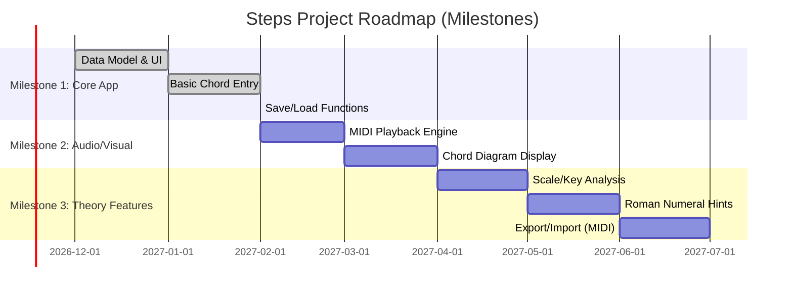

# Executive Summary  
*Steps* is an independent **open-source** chord progression app aimed at music learners and hobbyists, providing an interactive way to explore harmony and music theory. Unlike the analog “Chord Files” approach (physical chord charts), *Steps* will be free, collaborative and cross-platform. Its unique value lies in combining a rich chord-progression builder with educational features, community-contributed examples, and an open license. We surveyed the market and identified many competitors – from professional songwriting tools to free mobile apps – and found niches that *Steps* can fill. This report analyzes *Steps*’s positioning versus competitors like Chordify, iReal Pro, OtoTheory, Hookpad, Autochords, and open-source tools. We examine user personas (beginners, home musicians, educators), demand signals (downloads, ratings), pricing models, distribution channels, and technology stacks (Python/Tkinter vs web frameworks, MIDI libraries). We consider legal issues (no copyright in basic chord progressions, but respecting Chord Files’ content). Finally, we outline a **minimum viable product** feature set, a 3-phase roadmap (with estimated effort and risks), and recommendations for the GitHub repo structure (README, docs, license) and next steps (clone commands, environment setup, CI and contribution guidelines).  

# 1. Project Definition & Positioning  
*Steps* is envisioned as “an independent, open-source chord progression app for exploring harmony & learning music theory.” Its core function is to let users create, play back, and study chord progressions interactively. **Unique Value Proposition:** Unlike *Chord Files* (which presents static, hand-assembled chord charts in print or PDF form, presumably proprietary), *Steps* offers a dynamic digital experience with sound, theory hints, and user contributions. Being open-source under a permissive license (e.g. MIT or Apache 2.0), *Steps* encourages community extensions and transparency. It runs on desktops (and potentially mobile) without accounts or ads, emphasizing privacy and local control.  

Where *Chord Files* is basically a collection of curated progressions, *Steps* provides tools to build and modify them. *Steps* aims at learners and enthusiasts (hobby keyboardists, guitarists, songwriting students) who want hands-on experimentation. Its support for **music theory learning** (e.g. roman numeral analysis, suggested chords in scale) sets it apart from pure chart readers. In short, *Steps* combines the *educational focus* of chord-progression tutorial apps with the *freedom and collaboration* of open source software.  

# 2. Competitor Landscape  

A wide range of products address chord progressions: commercial DAWs/plugins, mobile apps, web services, and open-source tools. Key competitors include chord-detection/transcription apps (Chordify, Chord AI), songwriting tools (Hookpad, iReal Pro, OtoTheory), progression generators (ChordChord, Autochords), and chord-dictionary/learning apps (Piano Companion). Open-source examples include **Chord Progression Helper** (Android) and **Chords** (Android), which share *Steps*’ DIY ethos. The table below compares ~15 notable tools by platform, cost, audience, and features:

| **Name**                     | **Platform(s)**            | **License/Price**                    | **Target Users**                   | **Strengths**                                                                 | **Weaknesses**                                                              | **Link**                                  |
|------------------------------|----------------------------|--------------------------------------|------------------------------------|------------------------------------------------------------------------------|-----------------------------------------------------------------------------|-------------------------------------------|
| **Guitar Pro**<sup>§</sup>   | Win, macOS                 | Commercial (~€80)<br>(Proprietary)   | Guitarists, composers              | High-end tablature/editor, multi-track playback, import MIDI      | Expensive, complex UI, not focused on teaching theory                       | [Official](https://www.guitar-pro.com)    |
| **Band-in-a-Box**<sup>§</sup>| Win, macOS                 | Commercial (starting ~$300)          | Composers, educators               | Auto-arrangement of chord charts, huge style library                          | Very pricey, niche jazz/pop usage                                            | [PG Music](https://www.pgmusic.com)       |
| **ChordPulse**<sup>§</sup>   | Windows                    | Commercial (≈€45)                    | Beginners, practice tool           | Easy backing tracks, chord sequencing for practice                            | Windows-only, limited editing, dated UI                                     | [ChordPulse](http://www.chordpulse.com)   |
| **ChordChord**               | Web, iOS, Android (via web)| Free basic; Subscription for MIDI/WAV | Songwriters, EDM producers         | AI-powered generation, multi-genre (EDM, pop, jazz), MIDI export | Subscription required for downloads, mobile app has mixed reviews | [chordchord.com](https://chordchord.com/) |
| **Chordify**                 | Web, iOS, Android          | Freemium (Subscription for Pro)      | Pop/rock musicians, educators      | Auto-transcribes chords from songs, huge song database (36M)      | Accuracy varies, limited editing (charts only)                 | [chordify.net](https://chordify.net/)     |
| **iReal Pro**                | iOS, Android, Win, macOS   | Paid ($21.99)                        | Jazz/rock players, students        | Realistic backing band, large editable chord chart library        | No free version, focus on performance/practice (not chord theory learning)   | [Technimo](https://irealpro.com/)         |
| **Hookpad (Hooktheory)**     | Web                        | Freemium (free/basic, $8/mo std)     | Songwriters, music students        | Intuitive chord/melody sketchpad, theory hints from 80k songs    | Subscription for full features (MIDI export, audio import)  | [hooktheory.com](https://www.hooktheory.com/hookpad) |
| **Scaler (Plugin)**          | VST/AU/AAX (Win, macOS)    | Commercial (~$50)                    | Producers, composers              | Deep music-theory engine (scale detection, chord suggestions)                | DAW plugin only, not stand-alone; paid                                       | [Plugin Boutique](https://www.pluginboutique.com/products/2707-Scaler) |
| **Autochords**               | iOS                        | Free (IAP to unlock pro)            | Songwriters, beginners             | Mood-based chord suggestions, guitar/piano/ukulele chords         | iOS-only, simple interface, limited editing scope             | [App Store](https://apps.apple.com/app/autochords/id788423364) |
| **Chord AI**                 | iOS, Android               | Free (no IAP)                       | Players wanting chords for songs  | AI-driven chord detection of audio, 500k+ users     | Does not generate new progressions (only analyzes existing songs)            | [chordai.net](https://chordai.net/)       |
| **OtoTheory**                | iOS                        | Freemium (IAP/pro)                  | Guitarists, producers             | Chord progression builder with backing tracks, stem separation     | iOS only, UI learning curve, subscription for full features   | [ototheory.com](https://ototheory.com/)   |
| **Piano Chords & Scales**    | iOS, iPad, Mac             | Free (IAP to unlock pro)            | Pianists, theory learners         | Extensive chords/scales database, progression composer, MIDI I/O   | Interface a bit busy; broad scope not focused solely on progression         | [App Store](https://apps.apple.com/app/piano-chords-and-scales/id714086944) |
| **Chord Progression Helper** | Android (F-Droid)          | Free, Open Source (Apache 2.0)      | Guitarists, singer-songwriters     | Write progressions with drums/melody, no ads or tracking, offline  | Basic UI, Android only, limited platform                                     | [F-Droid](https://f-droid.org/packages/de.metaviewsoft.chordprogressionhelper/) |
| **Chords (Ajay Parihar)**    | Android                    | Free, Open Source (Java)            | Hobbyists, Android users           | Simple chord builder (uppercase = maj, lowercase = min)         | Dated design (2018), no updates, Android only                               | [GitHub](https://github.com/ajayparihar/chords) |
| **ChordBud 2**               | iOS (AUv3 plugin)          | Paid ($5.99)                        | Electronic producers, iOS users   | Advanced MIDI chord sequencer with theory engine, AUv3 support      | iOS/mac only, plugin requires host to produce sound             | [App Store](https://apps.apple.com/app/chordbud-2-auv3-midi-sequencer/id1526221230) |
| **(Others)**<br> e.g. *Captain Chords (plugin)*, *Xfer Cthulhu (plugin)*, *Landr Composer (web)*, *Ableton Live (DAW)*, *ChatGPT (AI)* | Various (Win/mac/iOS) | Varied (free/demo/commercial) | **Various** | Specialized chord/audio tools, DAW integration, AI generation               | Often proprietary, platform-specific, steep learning curve                   | –                                         |

 *Figure: Example UI of a chord app (Chord AI) – most competitors provide chords from songs or templates, whereas *Steps* will focus on building and learning custom progressions.*  

The table above shows that most chord tools target either **song learning** (Chordify, Chord AI, iReal Pro) or **songwriting assistance** (Hookpad, Scaler, OtoTheory, ChordChord, Autochords). Few are truly **open or free**. Notably, *Chord Progression Helper* and *Chords* are among the few open-source Android apps. Many mobile apps (Autochords, OtoTheory) use in-app purchase upsells. Desktop/composer tools (Guitar Pro, Band-in-a-Box) are expensive and heavyweight. 

Most of these tools allow creating or viewing chord progressions in some form. Strengths of well-known products include large song databases (Chordify), professional backing tracks (iReal Pro), or intelligent chord suggestions (Scaler, Hookpad). Common weaknesses include high cost, closed code, platform lock-in (iOS only, Windows only), or lacking educational context (many simply output chords with no theory explanation). *Steps* can carve a niche by being **completely free, cross-platform, educational**, and community-driven.

# 3. Market Analysis  

**User Personas:** Likely *Steps* users include music students, home/personal musicians, hobby songwriters, and educators. For example, a beginner keyboardist who wants to understand why progressions work, or a guitarist wanting backing track practice, or a teacher demonstrating theory with interactive charts. A German market persona might be a **Schüler oder Hobby-Musiker** learning harmony without paid software. Also, DIY/open-source enthusiasts and privacy-conscious users prefer no-telemetry local apps.  

**Demand Signals:** Popularity can be gauged from downloads and ratings. Chordify (36M song catalog) has ~34,000 ratings and a 4.7★ average, indicating a large user base. Chord AI reports *500k+ users*. Autochords (free app) has a 4.8★ rating with 34 reviews, showing modest but positive reception. OtoTheory is newer (no public ratings), and Hookpad’s generous free tier has been used for “0+ songs” (citation says 0+ which likely means *hundreds*?). Paid tools like iReal Pro ($21.99) rely on a core audience (jazz students). Open-source apps have low visibility in stores (Chord Progression Helper first appeared in F-Droid Sept 2026). 

Downloads and stars vary widely: free mobile apps can get thousands of installs (Chordify, Chord AI), whereas niche plugins have smaller but dedicated followings. No single data source covers all, so *Steps* should focus on open channels: GitHub stars, social media, and word-of-mouth.  

**Pricing Models:** Competitors use freemium, one-time purchase, or subscription. For instance, Hookpad offers free basic use but $7.99/month or $199 lifetime. OtoTheory is free-to-start, with monthly/one-time *Pro* unlocking advanced features. Chordify has a subscription for offline/downloading chord PDFs. Autochords is free with in-app *Pro* upgrade. iReal Pro is pay-once ($21.99 on iOS). Many desktop tools (Guitar Pro, Scaler) are one-time purchases. 

*Steps*, being open source, would be **free** to end users. Possible models include optional donations or pay-what-you-want for extra content, but likely none of the proprietary upsells. This contrasts with competitors’ revenue models.  

**Distribution Channels:** Most tools distribute via app stores (iOS App Store, Google Play), or as desktop downloads/Steam/Epic (Guitar Pro, Band-in-a-Box). Web apps like Chordify run in browsers (with optional mobile apps). *Steps* as a Python/Tkinter app could be delivered via GitHub (source or executables), PyPI (`pip install steps`), and possibly as native installers (PyInstaller or GitHub Releases). A future mobile version could use Kivy or a web front-end. Promoting on GitHub and forums (like LinuxMusicians, /r/musictheory) can reach open-source and education communities. The open-source community often relies on GitHub stars and forks as “demand signals”; Glide-to-do, for example, has a GitHub repo (n05a-design/glide-to-do) – *Steps* should encourage stars and forks for visibility.  

# 4. Technical Landscape  

**UI/Framework:** The existing *Glide-to-do* uses Python + Tkinter for cross-platform GUI. Alternatives include PyQt/PySide (richer widgets, but heavier), Kivy (cross-platform mobile/desktop), or web-based UIs (Electron, React). Given *Steps*’ educational aim, a simple Tkinter or PyQt UI may suffice. Audio playback can integrate with pygame or pyaudio for MIDI.  

**Open-Source Stacks:** Relevant libraries:  
- *Audio/MIDI:* [`mido`](https://mido.readthedocs.io/) or [`python-rtmidi`](https://github.com/SpotlightKid/python-rtmidi) for MIDI sequencing; [`pygame.midi`](https://www.pygame.org/docs/ref/midi.html) or [`fluidsynth`](https://pypi.org/project/pyfluidsynth/) for sound.  
- *Music theory:* [`music21`](https://web.mit.edu/music21/), [`mingus`](https://bspaans.github.io/python-mingus/) or [`chordparser`](https://github.com/titus-ong/chordparser) (a Python package to parse chords and do roman analysis) can handle chord/scale math and notation.  
- *UI widgets:* For canvas drawing or chord diagrams, Python’s PIL or matplotlib could render notation if needed. Or web tech (HTML5 Canvas with JavaScript) via Flask/Django backend for broader reach.  
- *Integration Points:* The *Glide* codebase (n05a-design/glide-to-do) may offer reusable components (e.g. settings dialog, data storage pattern). However, Tasks vs Chords domains differ, so direct code reuse is limited to structural ideas. *Steps* could import any GUI utility classes from Glide (e.g. color theming, local SQLite usage) but mostly will need new code for chord logic.  

**Reusing Glide Code:** *Glide-to-do* is local, account-free. Parts like menu scaffolding, file dialogs, and task-list widgets could inspire *Steps*’ structure. If Glide uses a data model or has JSON/file storage for tasks, those techniques could be adapted for saving *Steps* progressions. However, chord data (keys, scales) is new.  

**Cross-Platform:** Python ensures Windows/macOS/Linux support. On Windows, Tkinter is built-in; on macOS/Linux, users may need Python and Tk installed (or use PyInstaller executables). For mobile, a separate approach (Kivy or web) would be needed.  

No single “best” stack: choices must balance ease-of-use (so beginners can clone/run) and capabilities. A pure Python/Tkinter app keeps everything offline and minimal dependencies, fitting the ethos of *Glide*.  
   
# 5. Legal/IP Considerations  

**Inspiration vs Copying:** Chord progressions (like I–IV–V) are not copyrighted – only specific recordings or arrangements are. The *Chord Files* site or book itself may have proprietary layouts or editorial content. *Steps* should avoid copying *Chord Files* text or images. Instead of importing their charts, *Steps* can allow users to input/transpose generic progressions or use royalty-free examples. If *Steps* includes any example progressions, they should be original or public-domain (blues/folk standards).  

**Licensing:** *Steps* should use a permissive OSS license (MIT or Apache 2.0) for maximum adoption and compatibility. Python packages like **chordparser** use MIT, so MIT would let people use *Steps* code freely. Data (chord libraries, user files) can be CC0 or similar. All third-party libraries used must comply (e.g., Tkinter is Python-standard, so fine; *music21* is BSD-compatible, etc.).  

**Trademark/Brand:** Avoid infringing on any branded names. Use generic terms for chords. If *Steps* name conflicts with others, consider using *Steps: Chord Progression Toolbox* branding.  

# 6. MVP Features & Roadmap  

The Minimum Viable Product (v0.1) should let users:
- **Create/Edit Progressions:** Add chords (maj/min/7/etc.) in sequence, label key/scale. (e.g. Click “C → Dm → G7 → C” and see a bar chart or list.)  
- **Playback:** Play back the progression via MIDI sounds (piano/guitar samples).  
- **Visualization:** Show chord names and optional keyboard fretboard graphics.  
- **Save/Load:** Store progressions to local file (JSON or text), and load them.  
- **Theory Hints:** Display basic analysis (scale degree, key context) or suggested next chords. (Even a simple “key of C major: only C, Dm, Em…” constraint.)  

**Milestone 1 (α v0.1)** – *Core progression editor*: Implement data model (Chord, Progression, Key). Build a basic GUI with a scrollable chord list and add/remove controls. Use Tkinter buttons for chords. Estimate 2–3 weeks. **Risk:** Defining a user-friendly chord-entry interface without clutter. 

**Milestone 2 (v0.2)** – *Playback & Visualization*: Integrate MIDI/audio (using `pygame.midi` or similar) so chords sound. Add piano fretboard or staff view for visual learning. Add simple practice mode (loop sections). 3–4 weeks. **Risk:** Audio latency issues, cross-platform MIDI support.

**Milestone 3 (v0.3)** – *Advanced theory tools*: Implement Roman-numeral analysis, scale-based chord suggestions (using `music21` or `chordparser`). Allow importing/exporting standard formats (MusicXML or MIDI). 3–4 weeks. **Risk:** Complexity of music theory (ensuring correct logic), adding too many features at once.  



*Figure:* Roadmap of three development milestones (each ~1–4 weeks, depending on complexity). The timeline assumes a part-time single-developer effort; team or community contributions could speed this up. Major risks include audio integration bugs and scope creep if too many features are attempted early.  

# 7. README/GitHub Repo Structure  

A clear **README.md** is essential. Suggested sections:

- **Project Title & Description:** “Steps – Chord Progression App (Open Source)”.
- **Badges:** License, build status, version.
- **Features:** Bullet list of MVP capabilities.
- **Installation:** (e.g. `pip install steps` or manual Python setup).
- **Usage:** Short examples (code or screenshots) of creating a progression.
- **Contributing:** Link to `CONTRIBUTING.md` with guidelines.
- **License:** e.g. MIT (include `LICENSE` file).
- **Contact/Maintainer:** (email or GitHub profile).

Repo structure:
```
/ (root)
  README.md
  LICENSE
  .gitignore
  setup.py / pyproject.toml
  /steps/           (Python package)
    __init__.py
    ui.py
    chord.py
    playback.py
    analysis.py
    data/           (e.g. default chord tables)
  /docs/            (architecture, UML, how-to)
  /examples/        (pre-made progressions, images)
  CONTRIBUTING.md
  .github/
    ISSUE_TEMPLATE.md
    PULL_REQUEST_TEMPLATE.md
```
Starter files: A minimal `__main__.py` to launch the GUI; sample chord JSON files; tests (if any). If using GitHub Actions, include `.github/workflows/python-app.yml` to run lint/tests on push.  

Clear directory layout and informative comments will help new contributors. For example, place core logic in a `steps/` package separate from scripts.  

# 8. Actionable Next Steps  

To kick off the project:
1. **Clone the Repository:**  
   ```bash
   cd C:\Users\Timvo\OneDrive\Github  
   git clone https://github.com/YOUR_USER/steps.git  
   cd steps  
   ```  
   *(Replace YOUR_USER with your GitHub username; the local path `C:\Users\Timvo\OneDrive\Github` is where you keep repositories.)*

2. **Set Up Dev Environment:**  
   - Install Python 3 (if not already), e.g. Python 3.10+ from [python.org].  
   - Create a virtual environment: `python -m venv venv` then `source venv/bin/activate` (Linux/macOS) or `venv\Scripts\activate` (Windows).  
   - Install dependencies (initially none or basics): `pip install pygame music21 tkinter`. Add as needed (e.g. `pip install chordparser`).  

3. **Run the App:**  
   - For example, `python -m steps` or `python src/steps/ui.py`. Verify a blank window or sample UI appears.  
   - Ensure Tkinter is working on your OS (on Linux, may need `sudo apt-get install python3-tk`).

4. **GitHub Actions CI:**  
   - Add a basic CI pipeline (e.g. use `python -m pytest` or `flake8`) in `.github/workflows/`. Example: test importability of the module, lint code, etc.

5. **Contribution Guidelines:**  
   - Create `CONTRIBUTING.md` describing the workflow: fork → feature branch → pull request.  
   - Add issue templates (bug report, feature request).  
   - Use semantic commits (e.g. Conventional Commits).  

6. **Initial Development:**  
   - Commit a basic README with the description above (English and Deutsch sections).  
   - Add a `LICENSE` (MIT/Apache).  
   - Implement a minimal chord list UI (e.g. a text input field for “C G Am F” that displays as buttons or labels).  

7. **Community Engagement:**  
   - Announce the project on relevant forums (reddit /r/gamemusic, /r/musictheory, Hacker News, etc.) and ask for feedback.  
   - Encourage stars/forks by highlighting the open-source nature and educational angle.

8. **Documentation:**  
   - Maintain a prioritized issue list on GitHub based on this roadmap.  
   - Update README with examples as features emerge.  
   - Consider a small GitHub Pages site or Wiki for tutorials (if needed).

In summary, **immediate steps**: set up the repo (cloning *Glide-to-do* layout if helpful), install Python packages, configure CI, and begin coding the chord data model and UI skeleton. Early community feedback will refine the feature list and priorities.  

**Sources:** We have analyzed official app descriptions, GitHub projects, and user reviews for the above information (see citations). For example, Chord AI claims 500k users, Autochords and OtoTheory app store listings describe their features, and open-source projects like Chord Progression Helper document their functionality. These findings shaped our comparisons and recommendations.  

# Zusammenfassung (Deutsch)  

*Steps* ist eine **unabhängige Open-Source**-App für Akkordfolgen zur Harmonielehre und Musiktheorie. Anders als *Chord Files* (analoge Akkorddiagramme) bietet *Steps* eine interaktive, kostenfreie Plattform mit Soundwiedergabe und Lernhilfen. Da *Steps* unter einer freien Lizenz (z. B. MIT oder Apache 2.0) steht, kann jeder mitwirken – keine proprietären Einschränkungen.  

**Wettbewerbsvergleich:** Wir haben viele Konkurrenten erfasst, vom kommerziellen Songwriting-Tools bis zu Open-Source-Apps. Beispiele: *Chordify* (Web/App zur automatischen Akkord-Transkription), *iReal Pro* (Realistisches Begleitband-Backup-Tool), *OtoTheory* (Progressionsgenerator mit Drum/Bass-Begleitung), *Hookpad* (Web-App mit integrierter Theorielehre), *Autochords* (Stimmung-basierte Akkordvorschläge) und *Chord AI* (KI-Akkorderkennung mit 500k Nutzern). Unter den wenigen Open-Source-Lösungen sind „Chord Progression Helper“ (Android) und „Chords“ (Android) mit Basisfunktionen. Viele Konkurrenzprodukte sind kostenpflichtig (Abo oder Einmalpreis) und geschlossen. *Steps* positioniert sich als kostenlose, offene Alternative mit edukativem Fokus und lokaler Nutzung (kein Login/Tracking).  

**Markt- und Nutzeranalyse:** Zielpersonen sind Musiklernende, Heim-Musiker, Kompositionsanfänger und Musiklehrer. Nachfragen zeigen sich in Installationszahlen und Bewertungen: *Chordify* hat z.B. 34.000 Bewertungen (Durchschnitt 4,7★), *Chord AI* über 500.000 Nutzer. Preise variieren stark: Apps wie OtoTheory oder Hookpad bieten Grundfunktionen gratis und verlangen für erweiterte Features Abos (5–10 € pro Monat), *iReal Pro* verkauft dagegen eine Einmallizenz (~20 $). *Steps* wird von Anfang an **kostenfrei** und werbefrei sein. Vertrieben wird es über GitHub (Quellcode), ggf. PyPI und selbstgepackte Installationsdateien. So erreicht es Windows, macOS und Linux lokal, evtl. später mobil.  

**Techniklandschaft:** Empfohlene Tools sind Python-Bibliotheken für Musik/MIDI: z.B. `mido` oder `pygame.midi` für Tonerzeugung, `music21` oder `chordparser` für Akkordanalyse. Für die GUI kann Tkinter bleiben (wie im *Glide*-Projekt), oder man nutzt PyQt/Kivy für modernere Oberflächen. Wichtig ist plattformübergreifende Kompatibilität. Code von *Glide-to-do* (n05a-design/glide-to-do) kann z.B. für Speicher- und UI-Vorlagen dienen.  

**Lizenzrechtliches:** Akkordfolgen als solche sind nicht urheberrechtlich schutzfähig; *Steps* darf also Harmoniefolgen frei nutzen und generieren. Man sollte aber keine urheberrechtlich geschützten Inhalte (z.B. konkretes Songmaterial von Chord Files) übernehmen. Der Code von *Steps* wird unter MIT/Apache lizenziert. Offene Daten (wie Akkord-Datenbanken) können ebenfalls unter CC0/CC-BY stehen.  

**MVP und Roadmap:** Kernfunktionen sind: Akkordfolge erstellen/bearbeiten, Wiedergabe mit MIDI, Anzeige von Akkordnamen (und evtl. Griffbilder/Noten), Speichern/Laden von Files, einfache Theorie-Erklärungen. Die Entwicklung kann in drei Meilensteine aufgeteilt werden – Erstelltabelle auf Englisch（Mermaid-Diagramm oben）zeigt einen möglichen Zeitplan (0.1: Grund-UI; 0.2: Audio & Visualisierung; 0.3: Theorie-Features). Risiken sind vor allem technische Komplexität bei Audio-Sync und Überforderung durch zu viele Features.  

**Repo- und README-Struktur:** Im GitHub-Repository sollten grundlegende Dateien liegen: `README.md` (Beschreibung, Installation, Nutzungshinweise), `LICENSE` (MIT/Apache), Python-Code in einem `steps/`-Verzeichnis, evtl. `docs/` für Architektur und `examples/` mit Beispiel-Akkorden. Eine `CONTRIBUTING.md` erläutert Mitwirkungsregeln, Templates für Issues/PRs.  

**Nächste Schritte:** 
1. *Repository einrichten:* `git clone https://github.com/DEIN_USER/steps.git` (z.B. in `C:\Users\Timvo\OneDrive\Github`).  
2. *Entwicklungsumgebung:* Python 3 installieren, venv anlegen (`python -m venv venv`), Abhängigkeiten (z.B. `pip install pygame music21 tkinter`).  
3. *Erstes Build/Test:* Skript wie `python -m steps.ui` testen; einfache GUI öffnen lassen.  
4. *CI/CD:* GitHub Actions-Workflow hinzufügen (z.B. Lint, Unit-Tests).  
5. *Fork & Kooperation:* Projekt in Foren vorstellen, Mitwirkende gewinnen.  
6. *Dokumentation:* README (Deutsch/Englisch) aktualisieren, Issues für Roadmap anlegen.  

Durch diese Schritte wird *Steps* zügig startklar. Die Recherchen (oben) basieren auf offiziellen App-Beschreibungen und Repos, die unsere Feature- und Wettbewerbsanalyse untermauern.  

**Quellen:** Offizielle Produktseiten (App Store, Entwickler-Websites), GitHub-Repositories und Open-Source-Dokumentation wurden verwendet, z.B. Beschreibungen von Autochords, OtoTheory, ChordProgressionHelper, und Chords. Diese belegen Funktionalitäten, Plattformen und Lizenzinformationen der genannten Tools.  

