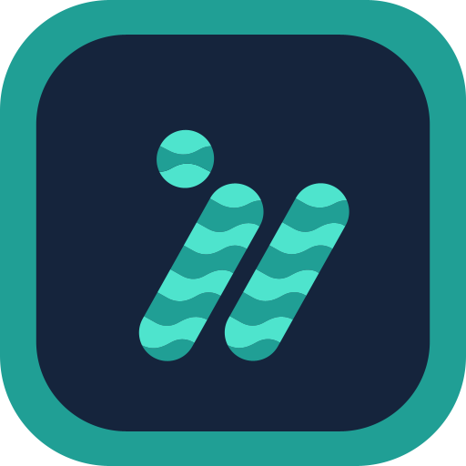
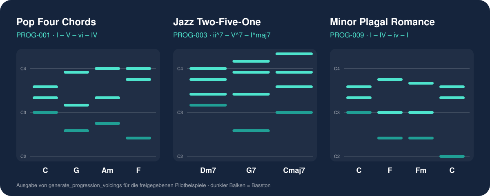

<p align="center">
  
</p>

<h1 align="center">STEPS</h1>

<p align="center">
  <strong>Akkordfolgen bauen. Harmonie erkunden. MIDI exportieren.</strong><br>
  STEPS ist ein eigenständiges Open-Source-Projekt für Akkordfolgen, Harmonielehre und Musiktheorie. Der Python-Kern, ein Tkinter-Desktop-Prototyp, Projekt-Speicherdienste und MIDI-Dateiexport sind vorhanden. Eine vollständige, installierbare Produktversion ist noch nicht freigegeben.
</p>

<p align="center">
  
  
  <a href="LICENSE"></a>
  <a href="https://github.com/n05a-design/steps/actions/workflows/python-tests.yml"></a>
</p>

<p align="center">
  <a href="#schnellstart"><strong>Loslegen</strong></a> ·
  <a href="#was-steps-heute-kann">Was STEPS kann</a> ·
  <a href="#ein-blick-hinein">Ein Blick hinein</a> ·
  <a href="knowledge/concepts/progressions/REVIEWED_PROGRESSIONS.md">Lernbeispiele</a> ·
  <a href="docs/theory/API.md">Python-API</a> ·
  <a href="CHANGELOG.md">Änderungen</a> ·
  <a href="README.md">English</a>
</p>

<p align="center">
  <strong>Projektentwicklung</strong><br>
  <a href="CONTRIBUTING.md">An STEPS arbeiten</a> ·
  <a href="docs/roadmap/ROADMAP_AND_RESOURCE_PLAN.md">Roadmap</a> ·
  <a href="docs/IMPLEMENTATION.md">Implementierungsstand</a> ·
  <a href="docs/architecture/README.md">Aufbau</a> ·
  <a href="docs/product/PRODUCT_STRATEGY_AND_MVP.md">Produktstrategie</a> ·
  <a href="docs/quality/README.md">Qualität</a>
</p>

## Warum STEPS?

- **Akkorde im Zusammenhang lesen.** STEPS löst Stufen in einer gewählten Tonart auf. `E7` ist in a-Moll die V⁷ und in C-Dur die V⁷/vi: derselbe Akkord, zwei Lesarten.
- **Schreibweise ernst nehmen.** Deutsches H/B und internationales B/B♭ sind getrennte Konventionen. Tonklasse und Notenname bleiben eigene Angaben, damit Enharmonik erhalten bleibt.
- **Vom Symbol zum Voicing.** Aus `Dm7 – G7 – Cmaj7` werden spielbare MIDI-Noten in enger Lage, als Drop 2, Shell oder ohne Grundton. Die Stimmführung hält die Bewegung zwischen den Akkorden klein.
- **Aussagen mit Quelle.** Die App-Schnittstelle liefert ein Lernbeispiel erst, wenn ein Mensch jede seiner Aussagen in genau dieser Fassung freigegeben hat. Die Fundstellen stehen im Quellenregister.
- **Nachprüfbar.** Golden-Fälle, Tests und Generatoren laufen bei jeder Änderung in der CI. Der Code steht unter MPL-2.0.

## Ein Blick hinein

STEPS hat einen Tkinter-Desktop-Prototyp, aber noch keine veröffentlichungsreife Produktoberfläche. Die Abbildung zeigt, was der Kern berechnet: die Voicings der drei freigegebenen Pilotbeispiele als Notenrolle. Sie wird mit [`render_project_page_figure.py`](scripts/render_project_page_figure.py) aus dem aktuellen Code erzeugt.


<p><sub><strong>Pilotbeispiele</strong> · MIDI-Noten je Akkord, der dunklere Balken ist der Basston</sub></p>

```python
from app.knowledge import get_reviewed_progression
from src.steps.progression import generate_progression_voicings, resolve_roman_degree

example = get_reviewed_progression("PROG-003")
print(example.progression.chords_str)                 # Dm7 - G7 - Cmaj7
for voicing in generate_progression_voicings(example.progression):
    print(voicing.midi_notes)                         # [50, 53, 57, 60]
                                                      # [43, 53, 59, 62]
                                                      # [48, 55, 59, 64]
print(example.lesson)                                 # freigegebener Lehrtext mit Quellen
print(resolve_roman_degree("V7/vi", "C").symbol)      # E7
```

Zu jedem Beispiel gehören der freigegebene Lehrtext, die Quellen-IDs und das Datum der Freigabe. [Alle drei Lernbeispiele lesen](knowledge/concepts/progressions/REVIEWED_PROGRESSIONS.md)

## Was STEPS heute kann

### Töne, Intervalle und Akkorde

- **Tonhöhen und Schreibweise:** Tonklasse und diatonische Schreibweise als eigene Typen, MIDI-Nummern und Frequenzen in gleichstufiger Stimmung mit 440 Hz als Standard.
- **Zwei Notationen:** `INT` liest B/B♭, `DE` liest H/B. `parse_chord("Esmaj7/B", "DE")` ergibt E♭maj7 mit B♭ im Bass.
- **Intervalle:** klingender Abstand in Halbtönen und diatonische Intervalle, Umkehrung und Transposition mit erhaltener Schreibweise.
- **Akkordsymbole:** 30 registrierte Akkordqualitäten mit ihren Aliassen. `CM7` ist Dur, `Cm7` Moll. Ein Slash-Bass ändert den tiefsten Ton, nicht die Akkordidentität.
- **Dreiklänge und Septakkorde:** Konstruktion, Umkehrungen, Drop-2- und Shell-Voicings.

### Stufen, Transposition und Stimmführung

- **Stufen auflösen:** römische Stufen in einem vorgegebenen Dur- oder Moll-Kontext, ausgewählte Zwischendominanten und Generalbassfiguren.
- **Progressionskatalog:** 28 Bestandsprogressionen, in jede Tonart übertragbar.
- **Voicings erzeugen:** Startlagen `CLOSE`, `DROP2`, `SHELL` und `ROOTLESS` mit durchgehender Stimmenzahl im MIDI-Bereich 0 bis 127.
- **Stimmführung:** Der Solver minimiert die Halbtonbewegung je Übergang. Der strikte Modus prüft zusätzlich parallele Quinten und Oktaven.
- **Desktop-Vertikalschnitte:** Der Prototyp zeigt Nächste-Akkord-Kandidaten, lädt freigegebene Reviewed-Progressionen als Projekte und bietet einen persistenten Stimmführungsstil. Dies sind implementierte Workflows, keine eigenständige Produkt- oder Fachfreigabe.
- **Klare Fehler:** Unlösbare Vorgaben und nicht registrierte Symbole melden einen Fehler, statt still zu raten.

### Geprüftes Lernmaterial und Wissensbasis

- **Drei freigegebene Pilotbeispiele:** Pop Four Chords, Jazz Two-Five-One und Minor Plagal Romance, jeweils mit Lehrtext, Quellen und Freigabe je Aussage.
- **Ein Datensatz für App und Lesetext:** Die App-Schnittstelle und das veröffentlichte Lernmaterial verwenden dieselben Daten. Bei fehlender oder veralteter Freigabe verweigert die Schnittstelle die Ausgabe.
- **Quellenregister:** Jede Aussage führt Quell-ID, Fundstelle, Geltungsbereich und Gegenprobe.
- **Golden-Fälle:** 198 Referenzfälle, davon 120 ausgeführt und 78 als Spezifikationsbeispiele strukturell geprüft.

Der Akkord-Explorer zeigt eine lokalisierte Begründung zur Auswahl und bewahrt die Originalerklärung und Quell-ID. Im Stimmführungslabor lassen sich zwei Stile mit gleicher Tick- und Tonhöhenskala vergleichen.

Der [Implementierungsstand](docs/IMPLEMENTATION.md) beschreibt Verhalten und Grenzen jeder Funktion, die [Python-API](docs/theory/API.md) alle Exporte.

## Was noch nicht geht

- **Keine freigegebene Desktop-Distribution.** Ein Tkinter-Prototyp und ein CLI-Einstieg existieren, aber es gibt keine geprüften Plattform-Installer oder öffentliche Produktfreigabe.
- **Kein In-App-Audio und kein MIDI-Import.** Ein SMF-Dateiexport ist im Kern, im Controller und über CLI/UI-Prototyp vorhanden. Eine Abnahme in unabhängigen DAWs ist noch zu belegen.
- **Speichern und Laden:** Das Hauptfenster bietet Dateiauswahl, Speichern/Öffnen, Rückfrage bei ungespeicherten Änderungen und sichtbare Fehlermeldungen. Plattform-, Barrierefreiheits- und Wiederherstellungsabnahme bleiben offen.
- **Keine automatische Analyse.** STEPS erkennt keine Tonart aus Audio und wählt keine Deutung für dich aus. Die Tonart gibst du vor.
- **Bewusst enge Grenzen.** `C11` ist nicht registriert, `V7(alt)` wird abgewiesen. Solche Lücken stehen im Implementierungsstand, nicht in einer Fußnote.
- **Englisch/Deutsch teilweise implementiert.** Laufzeitumschaltung, persistierte Spracheinstellung und EN/DE-Kataloge sind vorhanden; unabhängige Übersetzungs-, native Plattform- und Accessibility-Abnahme bleiben offen.

## Wohin STEPS will

Das Ziel ist eine Desktop-App, in der du Akkordfolgen anlegst, transponierst, erklärt bekommst und als MIDI ausgibst – ohne Benutzerkonto. Die [Produktstrategie](docs/product/PRODUCT_STRATEGY_AND_MVP.md) unterscheidet drei Zielbilder: ein Harmonie-Labor zum Erkunden und Lernen, ein Sketchpad für Akkord- und Drum-Folgen und eine Wissensbibliothek zur Musikproduktion.

Theorie- und Zeitmodelle, Projekt-Speicherdienste, Progressions-Controller und MIDI-Export sind bereits im Repository vorhanden. Die nächsten Produktlücken sind die vollständige Einbindung dieser Abläufe in die Desktop-Oberfläche, Internationalisierung, Plattform-/Accessibility-Abnahme und Distribution. Das vorgeschlagene, noch nicht vom Inhaber freigegebene [v1.0-Zielbild](docs/product/V1.0.0_PRODUCT_CONTRACT.md) trennt diese Lücken vom vorhandenen Code.

Die [Produktstrategie](docs/product/PRODUCT_STRATEGY_AND_MVP.md) bewahrt historische Hypothesen und Scope-Entscheidungen; [ADR-013](decisions/ADR-013-v01-umfang-akkorde-und-midi-export.md) legt v0.1 auf Akkorde und MIDI-Export fest und verschiebt Drums auf v2. Ein v1.0-Umfang ist noch nicht als ADR angenommen. Das [Entscheidungsregister](decisions/DECISION_REGISTER.md) führt den Entscheidungsstand.

## Schnellstart

STEPS braucht Python 3.11 bis 3.14 und keine weiteren Pakete. Alle Befehle laufen aus dem Repository-Root.

| Startweg | Verfügbarkeit | Nächster Schritt |
|---|---|---|
| **Python-Kern** | Im Repository enthalten | Repository klonen und das Beispiel unten ausführen |
| **Desktop-Prototyp** | Im Repository; noch keine Produktfreigabe | [Implementierungsstand](docs/IMPLEMENTATION.md) |
| **Installationspakete** | Kein geprüfter Desktop-Installer | – |

```python
from src.steps.theory import parse_chord

chord = parse_chord("Esmaj7/B", "DE")
print(chord.symbol, int(chord.bass.pitch_class))
```

Im Beispiel bezeichnet deutsches B den Ton B♭ mit Tonklasse 10. Die
[API-Verträge](docs/theory/API_VERTRAEGE.md) erläutern die Eingabekonventionen.

Um STEPS eigenständig als Desktop-Anwendung **außerhalb einer DAW** zu starten (mit automatischer Python-Versionsprüfung und Bytecode-Cache im Benutzer-Cache-Ordner), stehen folgende Startwege bereit:

```sh
python3 -m app           # Empfohlener Modulstart (app.start)
python3 STEPS.pyw        # Fensterloser Python-Desktop-Starter
./STEPS.command          # Doppelklickbarer macOS-Finder-Starter
steps-desktop            # GUI-Skript nach Paketinstallation
```

Alternativ startet `python3 -m app.main` oder `steps` direkt in einer Umgebung mit Tk und grafischer Anzeige.

Prüfen, ob dein Checkout in Ordnung ist:

```sh
python -B -m unittest discover -s tests
python -B scripts/verify_reference_integrity.py
python -B scripts/render_api_reference.py --check
```

Die [CI-Matrix](.github/workflows/python-tests.yml) führt dieselben Prüfungen mit Python 3.11 bis 3.14 aus.

Für einen temporären Build des vorhandenen Python-Wheel-Artefakts, ohne Abhängigkeiten in die Repository-Umgebung zu installieren:

```sh
python3 -m pip wheel . --no-deps --wheel-dir ./dist
python3 -B -m unittest tests.test_package_artifacts -v
```

Die Wheel-Prüfung startet eine isolierte Installation und verifiziert den Konsolen-Einstieg, die Laufzeitressourcen und alle drei freigegebenen Beispiele. Die [Desktop-Prüfanleitung](tests/native_ui/README.md) beschreibt den lokalen macOS-Entwicklungsbuild und die Widget-Tests.
Weitere Aufrufe und Grenzen stehen in der [Testanleitung](tests/README.md).

## Quellen und Rechte

- Das [App-Quellenregister](knowledge/sources/README.md) führt jede Quelle mit ihrem Nutzungsrahmen.
- Die [Pilot-Abnahmeliste](knowledge/benchmark/PILOT_ABNAHME.md) weist die fachlichen Freigaben der Lernbeispiele aus.
- Forschungsnotizen und Rohmedien sind vom App-Material getrennt. Die App-Schnittstelle lädt sie nicht.
- Offene Nachweise stehen in der [Lückenliste](research/gaps/OPEN_GAPS.md) und im [Fable-Audit](docs/audit/fable-5.2/README.md).
- Für Quellen und Fremdmaterial gelten die jeweiligen [Nutzungsbedingungen](knowledge/sources/RIGHTS_POLICY.md).

<details>
<summary><strong>Häufige Fragen</strong></summary>

**Kann ich STEPS schon herunterladen und starten?** Ein Repository-Checkout enthält den Python-Kern, CLI und Tkinter-Prototyp. Ein veröffentlichter Desktop-Installer ist noch nicht verfügbar; siehe [Implementierungsstand](docs/IMPLEMENTATION.md).

**Kann STEPS MIDI-Dateien schreiben?** Ja. Der Kern und die Prototyp-Integrationen exportieren SMF-Dateien. Die geprüfte Interoperabilität mit unabhängigen DAWs bleibt noch nachzuweisen.

**Warum unterscheidet STEPS H und B?** Im Deutschen heißt der Ton unter C „H“ und „B“ meint B♭. International meint „B“ den Ton H. STEPS verlangt bei mehrdeutigen Eingaben die Konvention, damit kein Akkord einen Halbton daneben landet.

**Sagt mir STEPS, welche Analyse richtig ist?** Nein. STEPS rechnet im Kontext, den du vorgibst, und hält alternative Lesarten offen. Die Lernbeispiele nennen ihre Annahmen ausdrücklich.

**Wie hängt STEPS mit Glide zusammen?** STEPS ist ein eigenes Projekt. Glide ist der Desktop-Planer desselben Inhabers; seine Fenster-Shell wird als technische Grundlage für die STEPS-Oberfläche geprüft.

**Unter welcher Lizenz steht STEPS?** Der Quellcode steht unter MPL-2.0. Quellen und Fremdmaterial behalten ihre eigenen Bedingungen; siehe [Lizenz](#lizenz).

</details>

## Rückmeldung

Fehler und Wünsche nimmt der [Issue-Bereich](https://github.com/n05a-design/steps/issues/new/choose) mit kurzen Formularen entgegen. Bei musikalischen Fehlern helfen Eingabe, Notationskonvention und erwartetes Ergebnis. Sicherheitslücken meldest du nach der [Sicherheitsrichtlinie](SECURITY.md).

## Entwicklung und Qualität

[VERSION](VERSION) nennt den Entwicklungsstand (`0.8.0-dev`), [`src.steps.__version__`](src/steps/__init__.py) die Python-Paketversion (`0.8.0.dev0`). Die Desktop-Anwendung baut produktiv auf [`glide_shell/`](glide_shell/__init__.py) (`0.6.2`, aus Glide `v1.0.2`) mit responsivem 2-Bereiche-Layout, durchgehenden Glide-`RoundedSurfaceCard`-Flächen und `RoundedButton`-Bedienelementen, 10 barrierefreien Glide-Themes, Akzentfarben, 10 Hintergrund-Farbtönen, einstellbarer Eckenrundung, Schriftgrößenskalierung, Einstellungen-Persistenz und modalem Erscheinungsbild-Dialog auf.

- [An STEPS arbeiten](CONTRIBUTING.md) · [Arbeitsregeln für Agenten](AGENTS.md) · [GitHub und CI](.github/GITHUB_UND_CI.md)
- [Implementierungsstand](docs/IMPLEMENTATION.md) · [Python-API](docs/theory/API.md) · [Testanleitung](tests/README.md)
- [Architektur](docs/architecture/README.md) · [Entscheidungsregister](decisions/DECISION_REGISTER.md) · [Glide-Reuse](docs/system_reuse/README.md)
- [Produkt und Lernkonzept](docs/product/README.md) · [Roadmap](docs/roadmap/README.md) · [Qualität](docs/quality/README.md)
- [Wissensbasis](knowledge/README.md) · [Rechte, Sicherheit und Veröffentlichung](docs/governance/README.md) · [Logo und Marke](design/brand/README.md)
- [Dokumentationsindex](docs/README.md) · [Sicherheitsrichtlinie](SECURITY.md)

<details>
<summary><strong>Repository-Übersicht</strong></summary>

| Ordner | Inhalt |
| --- | --- |
| [src](src/README.md) | Aktiver Python-Kern, historischer STEPS-Entwurf und Glide-Referenz. |
| [app](app/README.md) | App-Wissensadapter, Logo und App-Symbol sowie geplante Desktop-, UI- und Audio-Schichten. |
| [knowledge](knowledge/README.md) | Lernmaterial, Quellenregister, Fachkataloge und Wissensbenchmark. |
| [research](research/README.md) | Historische Forschungsbibliothek, Arbeitsnotizen und offene Nachweise. |
| [docs](docs/README.md) | Implementierungsstand, Architektur, Projektbetrieb, Roadmap und Audits. |
| [decisions](decisions/README.md) | Architekturentscheidungen und ADR-Vorlagen. |
| [design](design/README.md) | Logo-Master, Gestaltungsvorgaben, Referenzen und Ablage für eigene Designartefakte. |
| [schemas](schemas/README.md) | JSON-Schema-Entwürfe für Fach- und Quelldaten. |
| [tests](tests/README.md) | Prüfbefehle, Testmodule, Golden-Daten und Grenzen der Abnahme. |
| [scripts](scripts/README.md) | Reproduzierbare Prüfungen, Generatoren und Übergabewerkzeuge. |
| [tools](tools/README.md) | Strukturprüfung, Migration und historische Bestandswerkzeuge. |
| [skills](skills/README.md) · [.agents](.agents/README.md) | Historischer Coach und aktiver Kurationsworkflow. |
| [prompts](prompts/README.md) · [templates](templates/README.md) | Arbeitsaufträge und Vorlagen für neue Einträge. |
| [manifests](manifests/README.md) | Datierte Bestands-, Quellen- und Auditnachweise. |
| [archive](archive/README.md) · [source_archive](source_archive/README.md) | Frühere Projektstände, Originale und Provenienz. |
| [publish_overlay](publish_overlay/README.md) | Historischer Publikationsentwurf. |
| [.github](.github/GITHUB_UND_CI.md) | Workflows, PR-Vorlage und Reviewzuständigkeiten. |

</details>

## Lizenz

Der STEPS-Quellcode steht unter der **Mozilla Public License 2.0 (`MPL-2.0`)**. Maßgeblich ist der vollständige [Lizenztext](LICENSE). Quellen und Fremdmaterial behalten ihre jeweiligen [Nutzungsbedingungen](knowledge/sources/RIGHTS_POLICY.md). Markenrechte am [Logo](design/brand/README.md) werden gesondert behandelt.

## English

See the complete [English README](README.md).
