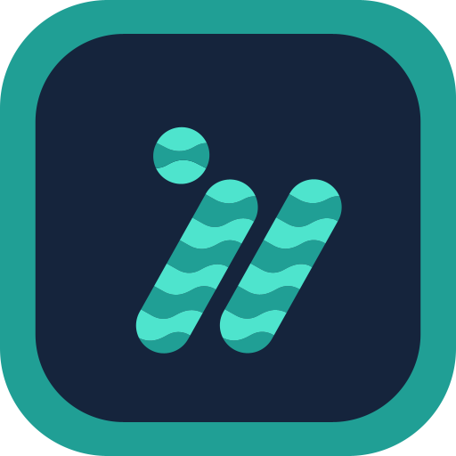

<p align="center">
  
</p>

<h1 align="center">STEPS</h1>

<p align="center">
  <strong>Python-Kern für Musiktheorie und Akkordfolgen.</strong><br>
  STEPS verarbeitet Tonhöhen, Notation, Intervalle, Akkordsymbole, Stufen, Transposition und Stimmführung. Über die App-Schnittstelle sind drei fachlich freigegebene Pilotbeispiele mit Quellen verfügbar. Desktop-Oberfläche, Wiedergabe und Installationspakete befinden sich in Vorbereitung.
</p>

<p align="center">
  
  <a href="LICENSE"></a>
  <a href="https://github.com/n05a-design/steps/actions/workflows/python-tests.yml"></a>
</p>

<p align="center">
  <a href="#schnellstart"><strong>Schnellstart</strong></a> ·
  <a href="docs/IMPLEMENTATION.md">Implementierungsstand</a> ·
  <a href="knowledge/concepts/progressions/REVIEWED_PROGRESSIONS.md">Geprüfte Lernbeispiele</a> ·
  <a href="docs/theory/API.md">Python-API</a> ·
  <a href="CHANGELOG.md">Änderungen</a>
</p>

## Schnellstart

Die [CI-Matrix](.github/workflows/python-tests.yml) verwendet Python 3.11 bis
3.14. Aus dem Repository-Root ausführen.

```sh
python -B -m unittest discover -s tests
python -B scripts/verify_reference_integrity.py
python -B scripts/render_api_reference.py --check
```

```python
from src.steps.theory import parse_chord

chord = parse_chord("Esmaj7/B", "DE")
print(chord.symbol, int(chord.bass.pitch_class))
```

Im Beispiel bezeichnet deutsches B den Ton B♭ mit Tonklasse 10. Die
[API-Verträge](docs/theory/API_VERTRAEGE.md) erläutern die Eingabekonventionen.
Weitere Aufrufe und Grenzen stehen in der [Testanleitung](tests/README.md).

## Repository-Übersicht

| Ordner | Inhalt |
| --- | --- |
| [src](src/README.md) | Aktiver Python-Kern, historischer STEPS-Entwurf und Glide-Referenz. |
| [app](app/README.md) | App-Wissensadapter, Logo und App-Symbol sowie geplante Desktop-, UI- und Audio-Schichten. |
| [knowledge](knowledge/README.md) | Lernmaterial, Quellenregister, Fachkataloge und Wissensbenchmark. |
| [research](research/README.md) | Historische Forschungsbibliothek, Arbeitsnotizen und offene Nachweise. |
| [docs](docs/README.md) | Implementierungsstand, Architektur, Projektbetrieb, Roadmap und Audits. |
| [decisions](decisions/README.md) | Architekturentscheidungen und ADR-Vorlagen. |
| [design](design/README.md) | Logo-Master, Gestaltungsvorgaben, Referenzen und Ablage für eigene Designartefakte. |
| [schemas](schemas/README.md) | JSON-Schema-Entwürfe für Fach- und Quelldaten. |
| [tests](tests/README.md) | Prüfbefehle, Testmodule, Golden-Daten und Grenzen der Abnahme. |
| [scripts](scripts/README.md) | Reproduzierbare Prüfungen, Generatoren und Übergabewerkzeuge. |
| [tools](tools/README.md) | Strukturprüfung, Migration und historische Bestandswerkzeuge. |
| [skills](skills/README.md) · [.agents](.agents/README.md) | Historischer Coach und aktiver Kurationsworkflow. |
| [prompts](prompts/README.md) · [templates](templates/README.md) | Arbeitsaufträge und Vorlagen für neue Einträge. |
| [manifests](manifests/README.md) | Datierte Bestands-, Quellen- und Auditnachweise. |
| [archive](archive/README.md) · [source_archive](source_archive/README.md) | Frühere Projektstände, Originale und Provenienz. |
| [publish_overlay](publish_overlay/README.md) | Historischer Publikationsentwurf. |
| [.github](.github/README.md) | Workflows, PR-Vorlage und Reviewzuständigkeiten. |

## Quellen, Qualität und Mitarbeit

Das [App-Quellenregister](knowledge/sources/README.md) führt Quellen und
Nutzungsrahmen. Die [Pilot-Abnahmeliste](knowledge/benchmark/PILOT_ABNAHME.md)
weist die zugehörigen fachlichen Freigaben aus. Offene Nachweise stehen in der
[Lückenliste](research/gaps/OPEN_GAPS.md) und im [Fable-Audit](docs/audit/fable-5.2/README.md).

[VERSION](VERSION) nennt den Entwicklungsstand,
[`src.steps.__version__`](src/steps/__init__.py) die Python-Paketversion.
Für den STEPS-Quellcode gilt die [Mozilla Public License 2.0](LICENSE).
Für Quellen und Fremdmaterial gelten die jeweiligen
[Nutzungsbedingungen](knowledge/sources/RIGHTS_POLICY.md).
[Mitwirken](CONTRIBUTING.md) · [Sicherheitsmeldungen](SECURITY.md)
