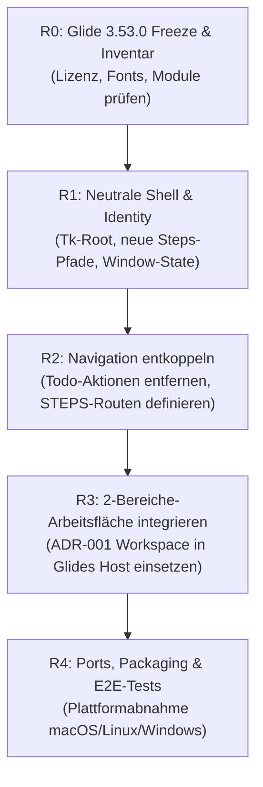

# STEPS – Architektur-Übergabedokument: App-Shell & Glide-3.53-Roadmap

> **Status:** Verbindlicher Architektur- und Übergabekontrakt (Stand: 17.11.2026).  
> **Gültigkeit:** Für alle mitwirkenden Entwickler und KI-Agenten (Codex, Antigravity, Claude, etc.).  
> **Bezug:** Ergänzt [`GLIDE_TO_STEPS_2_AREA_SHELL.md`](GLIDE_TO_STEPS_2_AREA_SHELL.md), [`AGENTS.md`](../../AGENTS.md) und [`EXECUTION_BACKLOG.md`](../../EXECUTION_BACKLOG.md).

---

## 1. Wichtige Klarstellung: Status von `app/ui/main_window.py`

1. **Vorläufiger Referenz- und CI-Skeleton:**  
   Die in `app/ui/main_window.py` liegende Implementierung ist ein **minimaler, handgeschriebener Tkinter-Prototyp** (ca. 290 Zeilen Standard-Python ohne externe Frameworks). Er dient ausschließlich der:
   - Validierung des **ADR-001** Layout-Vertrags („Arbeitsbereich oben: Progression, Transponieren, MIDI-Export; Informationsbereich unten: Voicings, Skalenempfehlungen, Harmoniefunktionen“).
   - Absicherung des `--headless`-Modus in `app/main.py` für automatisierte CI- und Unittests auf Headless-Servern.
   - Absicherung des Design-Token-Schemas (`design/tokens/tokens.json`) auf Barrierefreiheit (WCAG 2.1 AA Kontraste).

2. **Keine Code-Übernahme aus Glide:**  
   In `app/` befindet sich **keine einzige Zeile Code** aus dem Projekt `glide-to-do`. Die geplante Entkopplung und Übernahme der echten Glide-Desktop-Shell hat noch **nicht** begonnen.

3. **Reihenfolge der Meilensteine:**  
   Die Priorität liegt unverändert auf der **vollständigen Konsolidierung der Wissensbasis (`knowledge/`, Forschungsextrakte, Harmonielehre-Invariante)**. Erst wenn die fachliche Domäne und die Datenablage vollständig ausgearbeitet sind, erfolgt die Übertragung auf das ausgereifte Glide-Shell-Framework.

---

## 2. Transfer-Artefakte für die spätere Glide-Shell-Implementierung

Alles, was im vorläufigen Prototyp etabliert wurde, ist modular aufgebaut und wird bei der späteren Glide-Adaption 1:1 weiterverwendet:

| Etabliertes Artefakt | Implementierungsort | Geplante Verwendung im Glide-3.53-Framework |
|---|---|---|
| **Layout-Vertrag ADR-001** | `app/ui/main_window.py` | Zieht als `WorkspaceHost`-Hauptansicht in Glides rechte Arbeitsfläche ein (Bereich A oben: Timeline/Progression, Bereich B unten: Musiktheorie/Analyse). |
| **Session & Controller** | `app/ui/session_controller.py` | Bleibt unverändert. Verbindet die UI-Ereignisse entkoppelt mit der Fachlogik in `src/steps/progression/` und `src/steps/ports/`. |
| **Design-Tokens** | `design/tokens/tokens.json` | Werden in Glides dynamisches `ThemeService`- und Palette-System eingespeist (Dark/Light mit 4.5:1 Mindestkontrast). |
| **Headless- & CI-Gateway** | `app/main.py` (`--headless`) | Garantiert, dass alle UI-Controller und Workflows auch ohne X11/Wayland-Display auf CI-Servern getestet werden können. |

---

## 3. Roadmap zur Glide-3.53-Shell (R0 bis R4)

Sobald die Fach- und Wissensablage freigegeben ist, erfolgt die systematische Übernahme gemäß [`docs/architecture/GLIDE_TO_STEPS_2_AREA_SHELL.md`](GLIDE_TO_STEPS_2_AREA_SHELL.md):

### Stufen im Detail:
- **R0 – Technische Inventur:** Vergleich mit Glide HEAD (`9e767bea`), Lizenzprüfung, Ausschluss nicht-freier Fonts/Assets.
- **R1 – Neutrale Shell:** Generische UI-Bausteine isolieren (`RoundedButton`, `RoundedContainer`, `ThemedAutoScrollbar`, SVG-Rasterung, Geometrie-Persistenz).
- **R2 – Neutrale Navigation:** Die Seitenleiste wird von allen Aufgaben-, Listen- und Todo-Logiken bereinigt. Menüpunkte erhalten reine STEPS-Routen (`Progression`, `Scale Explorer`, `Voicing Lab`, `Drums & Groove`, `Settings`).
- **R3 – Integration des Arbeitsbereichs:** Der in `main_window.py` erprobte 2-Bereiche-Workflow ersetzt die Todo-Kacheln im rechten Hauptbereich.
- **R4 – End-to-End-Abnahme:** Native UI-Tests auf allen Betriebssystemen.

---

## 4. Verbindliche Verhaltensregeln für alle KI-Agenten

1. **Strikte Schichtentrennung (`AGENTS.md` Regel 4):**
   - `src/steps/`: Reine, testbare Harmonielehre und Fachmodelle. **Niemals Tkinter, GUI-Code oder Glide-Imports hier einfügen.**
   - `app/`: Ausschließlich UI, Views, Präsentations-Controller und Desktop-Entrypoint.
   - `knowledge/`: Fakten, Quellen und musikwissenschaftliche Belege mit Provenienz.
2. **Keine Einschleppung von Glide-Task-Daten (`AGENTS.md` Regel 9):**
   - Es dürfen keine Glide-Aufgabenmodelle, Task-Listen, alten Pfade (`GLIDE_DATA_DIR`) oder Aufgaben-Caches übernommen werden.
3. **Preservation-first (`AGENTS.md` Regel 2):**
   - Keine vorzeitigen Löschungen historischer Referenzdateien ohne vorherigen Prüfbericht und Hash-Manifest.
