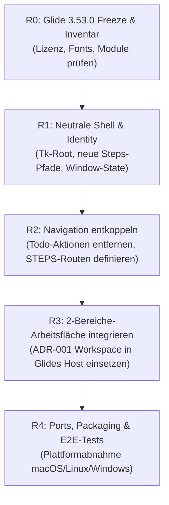

# STEPS – Architektur-Übergabedokument: App-Shell & Glide-Integration

> **Aktueller Integrationsstand (23.11.2026):** Die früher geplante manuelle Extraktion aus Glide `3.53.0` (`app.pyw`) ist durch die produktive Übernahme des eigenständigen Pakets **`glide_shell` (`0.6.2`)** aus dem verifizierten Glide-Release **`v1.0.2`** (Commit `7dcd8dc04366f88943fa17827882cef4d81421b8`, Glide System `V1.86`, Lizenz `MPL-2.0`) abgelöst. Der produktive Desktop-Start nutzt `glide_shell.app_host.AppHost`.

---

## 0. Produktive Glide-Shell-Integration (Glide `v1.0.2` / Shell `0.6.2`)

| Eigenschaft | Wert / Nachweis |
|---|---|
| **Glide-Release & Commit** | `v1.0.2` · `7dcd8dc04366f88943fa17827882cef4d81421b8` · System `V1.86` |
| **Übernommenes Paket** | [`glide_shell/`](../../glide_shell/__init__.py) (`SHELL_VERSION = "0.6.2"`, 23 Dateien) |
| **Herkunfts- & Hash-Nachweis** | [`glide_shell/SHELL_MANIFEST.json`](../../glide_shell/SHELL_MANIFEST.json) (MPL-2.0, `quelle_unveraendert: true`) |
| **Designvertrag** | [`glide_shell/DESIGN_RICHTLINIEN.md`](../../glide_shell/DESIGN_RICHTLINIEN.md) + [`design/tokens/tokens.json`](../../design/tokens/tokens.json) |
| **Agenten-Bootstrap** | [`.agents/skills/glide-shell/SKILL.md`](../../.agents/skills/glide-shell/SKILL.md), [`.claude/skills/glide-shell/SKILL.md`](../../.claude/skills/glide-shell/SKILL.md), [`AGENTS.md`](../../AGENTS.md) |
| **Selbsttest** | `python3 -m glide_shell.selftest` (13/13 Checks, inkl. Manifestintegrität) |
| **Upgrade-Verfahren** | Ausschließlich über `shell_uebernehmen.py --commit <REV> --agenten-bootstrap --projekt-root . .` aus einem verifizierten Glide-Git-Checkout; keine manuellen Änderungen in `glide_shell/`. |
| **Rollback-Strategie** | Reversibler Git-Branch (`migrate_steps_glide_shell`) und atomarer Snapshot/Rollback innerhalb von `shell_uebernehmen.py`. |

### Verwendete Shell-APIs und STEPS-Adapter

| STEPS-Komponente | Genutzte `glide_shell`-API | Produktiver Integrationsvertrag |
|---|---|---|
| `app/main.py` | `app_host.AppHost` | Produktiver GUI-Start via `create_desktop_host(theme)` / `AppHost.run(...)`; CLI (`--headless`, `--export-midi`, `--language`, `--theme`) bleibt vollständig erhalten. |
| `app/ui/main_window.py` | `app_host.attach_menubar`, `primary_shortcuts`, `bind_shortcuts`, `install_close`, `desktop_adapter`, `window_lifetime.scope_for` | Menüleiste, plattformkonforme Kürzel, einheitlicher Schließweg inkl. macOS `::tk::mac::Quit` mit Dirty-State-Rückfrage sowie Fenster-Timer-Bereinigung. |
| `app/ui/dialog_support.py` | `modal_session` (`create_dialog`, `remember_focus`, `return_focus`, `ensure_min_width`, `ACTIVE_ATTRIBUTE`), `window_lifetime.scope_for` | Nicht-blockierender STEPS-Dialogvertrag (`ModalDialog._show` / `_close`) mit sicherer Fokus- und Grab-Rückgabe bei verschachtelten Dialogen. |
| `app/ui/theme.py` | `custom_controls.set_font_provider`, `system_appearance.resolve`/`tk_is_dark`, `window_geometry.clamp`/`format_geometry`, `text_fit.clip`/`fit` | STEPS-Design-Tokens (`tokens.json`) bleiben führend; Host-/Widget-Provider-Isolation am Root-Fenster; geklemmte Fenster-Mindestmaße (B15). |
| `src/steps/progression/session.py` | *(bewusst eigenständig)* | Musikalische Undo/Redo-Historie mit Dirty-State, Timings und Revisionen bleibt führend; keine zweite konkurrierende `command_history`. |

### Hinweise zu Layout und offenen Punkten

- **Layout-Hinweis (ADR-001 vs. aktueller Desktop-Stand):** [`ADR-001`](../../decisions/ADR-001-ein-fenster-zwei-bereiche.md) beschreibt konzeptionell ein Hauptfenster mit zwei Bereichen (dort links/rechts notiert), während der produktive Desktop-Code in `app/ui/main_window.py` eine Oben/Unten-Split-Anordnung (`tk.PanedWindow(orient=tk.VERTICAL)`) umsetzt. Dieses funktionierende UI bleibt während der technischen Framework-Migration unverändert erhalten.
- **Unabhängigkeitsgrenze:** `src/steps/` importiert weder `tkinter` noch `glide_shell` noch `app/`. Keine Übernahme von Glide-Todo-Fachobjekten oder `.glideexchange`-Verträgen.

---

## 1. Historischer Ausgangsstand (Archivierte Roadmap vor Shell 0.6.2)

> **Status:** Historisch datierter Ausgangsstand (17.11.2026) zur Nachvollziehbarkeit vor Übernahme der `glide_shell` 0.6.2.  
> **Gültigkeit:** Dokumentiert den früheren Zustand von `main_window.py` und die damalige 3.53-Planung.  
> **Bezug:** [`AGENTS.md`](../../AGENTS.md) und [`EXECUTION_BACKLOG.md`](../../EXECUTION_BACKLOG.md).

---

## 1. Wichtige Klarstellung: Status von `app/ui/main_window.py`

1. **Vorläufiger Referenz- und CI-Skeleton:**  
   Die in `app/ui/main_window.py` liegende Implementierung ist ein **minimaler, handgeschriebener Tkinter-Prototyp** (ca. 290 Zeilen Standard-Python ohne externe Frameworks). Er dient ausschließlich der:
   - Validierung des **ADR-001** Layout-Vertrags („Arbeitsbereich oben: Progression, Transponieren, MIDI-Export; Informationsbereich unten: Voicings, Skalenempfehlungen, Harmoniefunktionen“).
   - Absicherung des `--headless`-Modus in `app/main.py` für automatisierte CI- und Unittests auf Headless-Servern.
   - Absicherung des Design-Token-Schemas (`design/tokens/tokens.json`) auf Barrierefreiheit (WCAG 2.1 AA Kontraste).

2. **Keine Code-Übernahme aus Glide:**  
   In `app/` befindet sich **keine einzige Zeile Code** aus dem Projekt `glide-to-do`. Die geplante Entkopplung und Übernahme der echten Glide-Desktop-Shell hat noch **nicht** begonnen.

3. **Reihenfolge der Meilensteine:**  
   Die Priorität liegt unverändert auf der **vollständigen Konsolidierung der Wissensbasis (`knowledge/`, Forschungsextrakte, Harmonielehre-Invariante)**. Erst wenn die fachliche Domäne und die Datenablage vollständig ausgearbeitet sind, erfolgt die Übertragung auf das ausgereifte Glide-Shell-Framework.

---

## 2. Transfer-Artefakte für die spätere Glide-Shell-Implementierung

Alles, was im vorläufigen Prototyp etabliert wurde, ist modular aufgebaut und wird bei der späteren Glide-Adaption 1:1 weiterverwendet:

| Etabliertes Artefakt | Implementierungsort | Geplante Verwendung im Glide-3.53-Framework |
|---|---|---|
| **Layout-Vertrag ADR-001** | `app/ui/main_window.py` | Zieht als `WorkspaceHost`-Hauptansicht in Glides rechte Arbeitsfläche ein (Bereich A oben: Timeline/Progression, Bereich B unten: Musiktheorie/Analyse). |
| **Session & Controller** | `app/ui/session_controller.py` | Bleibt unverändert. Verbindet die UI-Ereignisse entkoppelt mit der Fachlogik in `src/steps/progression/` und `src/steps/ports/`. |
| **Design-Tokens** | `design/tokens/tokens.json` | Werden in Glides dynamisches `ThemeService`- und Palette-System eingespeist (Dark/Light mit 4.5:1 Mindestkontrast). |
| **Headless- & CI-Gateway** | `app/main.py` (`--headless`) | Garantiert, dass alle UI-Controller und Workflows auch ohne X11/Wayland-Display auf CI-Servern getestet werden können. |

---

## 3. Roadmap zur Glide-3.53-Shell (R0 bis R4)

Sobald die Fach- und Wissensablage freigegeben ist, erfolgt die systematische Übernahme gemäß [`docs/architecture/GLIDE_TO_STEPS_2_AREA_SHELL.md`](GLIDE_TO_STEPS_2_AREA_SHELL.md):

### Stufen im Detail:
- **R0 – Technische Inventur:** Vergleich mit Glide HEAD (`9e767bea`), Lizenzprüfung, Ausschluss nicht-freier Fonts/Assets.
- **R1 – Neutrale Shell:** Generische UI-Bausteine isolieren (`RoundedButton`, `RoundedContainer`, `ThemedAutoScrollbar`, SVG-Rasterung, Geometrie-Persistenz).
- **R2 – Neutrale Navigation:** Die Seitenleiste wird von allen Aufgaben-, Listen- und Todo-Logiken bereinigt. Menüpunkte erhalten reine STEPS-Routen (`Progression`, `Scale Explorer`, `Voicing Lab`, `Drums & Groove`, `Settings`).
- **R3 – Integration des Arbeitsbereichs:** Der in `main_window.py` erprobte 2-Bereiche-Workflow ersetzt die Todo-Kacheln im rechten Hauptbereich.
- **R4 – End-to-End-Abnahme:** Native UI-Tests auf allen Betriebssystemen.

---

## 4. Verbindliche Verhaltensregeln für alle KI-Agenten

1. **Strikte Schichtentrennung (`AGENTS.md` Regel 4):**
   - `src/steps/`: Reine, testbare Harmonielehre und Fachmodelle. **Niemals Tkinter, GUI-Code oder Glide-Imports hier einfügen.**
   - `app/`: Ausschließlich UI, Views, Präsentations-Controller und Desktop-Entrypoint.
   - `knowledge/`: Fakten, Quellen und musikwissenschaftliche Belege mit Provenienz.
2. **Keine Einschleppung von Glide-Task-Daten (`AGENTS.md` Regel 9):**
   - Es dürfen keine Glide-Aufgabenmodelle, Task-Listen, alten Pfade (`GLIDE_DATA_DIR`) oder Aufgaben-Caches übernommen werden.
3. **Preservation-first (`AGENTS.md` Regel 2):**
   - Keine vorzeitigen Löschungen historischer Referenzdateien ohne vorherigen Prüfbericht und Hash-Manifest.
