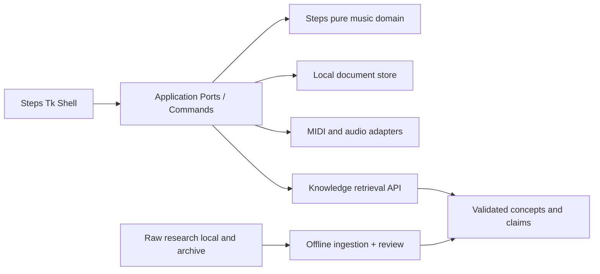

# STEPS – Architektur und Laufzeitgrenzen

> Die beschriebenen Laufzeitkomponenten, Ports und Plattformabläufe bilden das Architekturziel. Die implementierten Module und ihre Grenzen stehen im [Implementierungsstand](../IMPLEMENTATION.md).

> **Kritischer Aktualitätsnachtrag (10.11.2026, nach GitHub PR #75):** Der folgende Basisteil stammt aus dem früheren Paket und kann für Glide `main` noch den historischen Commit `61a2f3a`/Version 3.50.7 nennen. Der erneut verifizierte Stand ist **Glide `9e767bea` (3.53.0)**; der hochgeladene `app.pyw` ist blobgleich mit diesem HEAD, nicht aber bereits alle weiteren Module und Ressourcen unabhängig verifiziert. Aktuelle Bewertungen und Entscheidungsgates stehen in [`docs/project/PROJECT_OVERVIEW.md`](../../docs/project/PROJECT_OVERVIEW.md) und [`docs/audit/04_VERGLEICH_V1_V2_RESTRISIKEN_MASSNAHMEN.md`](../../docs/audit/04_VERGLEICH_V1_V2_RESTRISIKEN_MASSNAHMEN.md). Aussagen im folgenden Basisteil bleiben als **historisch datierte Ausgangsnotizen** erhalten, keine unmarkierte aktuelle Wahrheit.

**Stand:** 10.11.2026 (Europe/Berlin). **Status:** Entwurf und Prüfauftrag, keine Umsetzung/Freigabe. **Referenzstände:** Steps `main` `75329fef46878a5ac816cef3690e612a9e8fe52c`; Glide `main` `61a2f3ac2f0e1880e7fd8c0f3cfd9da0d0c9f16d`; lokal bereitgestellter Glide-Code `3.53.0`, SHA-256 `d7e19151eb0862a8ff58c4cc5e7d06a0452cde1daa73830ff97f54247bc75271`.

**Evidenz:** `UPLOAD` = bereitgestellte Datei, `GITHUB` = gelesener Remote-Stand, `BERICHTET` = in Unterlagen behauptet, `VORSCHLAG` = neue Empfehlung, `OFFEN` = unbestätigt. Kein dokumentierter Test bedeutet nicht bestanden.

## Geplantes Laufzeitbild

Im Zielbild startet `app/` die Desktop-Shell und orchestriert Fenster, Theme, Navigation und Arbeitsbereich. `app/adapters` ist für getrennte Schnittstellen vorgesehen. Der aktuelle [Python-Kern](../IMPLEMENTATION.md) verwendet Paketdaten für die kuratierten Progressionen. Der App-Adapter greift auf diese Progressionen zu. `research/` ist dabei keine Laufzeitabhängigkeit.

## Entworfene Schnittstellenverträge

- `WindowShell`: Fensterzustand, Sidebar/Workspace, Events/Shutdown und OS-Handling.
- `NavigationRegistry`: stabiler Eintrag mit `id`,`group`,`label`,`icon_role`,`enabled`,`route`; v0 no-op, später validierte Route.
- `ThemeService`: Tokens, Kontrast, Font-/Glyph-Metriken, eigenständige Steps-Marke.
- `PreferencesPort`: Optionsschema, Default/Migration, getrennte Steps-Datenablage.
- `ProgressionRepository`: atomic Save/Load/Backup, Unknown-Field-Policy, Tests.
- `HarmonyAnalyzer`: Chord+Context → mehrere `AnalysisResult` mit Framework/Evidenz/Confidence.
- `PlaybackPort`: nach Device/Library-Entscheidung `play`, `stop`, `loop`, `export_midi`; NoDevice Fallback.
- `KnowledgeLookup`: IDs/Version/Locator/Evidenz, `review_required` explizit.

## Entkopplung von Glide

Glide verwendet im 3.53.0-Upload `ListApp` mit 1.866 Methoden. **Kein** `ListApp`-Erben in `StepsApp`, da bei dieser Architektur Task-Semantik und Default-Datenpfade implizit mitreisen. Portiere in geprüften kleinen Schneisen: neutrales Widget; Theme; Sidebar; Settings; Event Lifecycle; Storage-Adapter; Domain-Schnittstellen. Bewahre originale Glide-Dateien und Historie unverändert.

## Versionierung

`StepsAppVersion` (neu), `ProgressionSchemaVersion`, `KnowledgeSnapshotVersion`, `SourceRegistryVersion` und `MigratedFromGlideCommit` unabhängig halten. V6.6/V6.7 sind Archivrevisionen und dürfen nie als Product-Music-Testbeleg gelten. Release erst bei eigenen Steps-Plattformtests.
