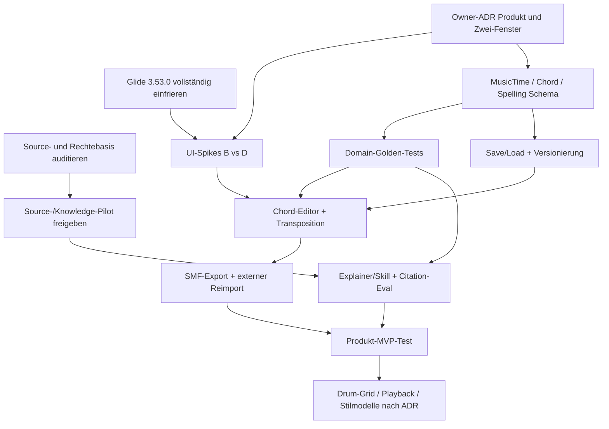

# STEPS – Abhängigkeitsbasierte Roadmap und Ressourcenplan

**Arbeitsstand:** 10.11.2026. **Nicht** vom Owner freigegebene Sprint- oder Zeitplanung. Grundlage: 28 Research-Handover-Requirements, 33 Auditdimensionen, aktuelle GitHub-Snapshots, Glide 3.53.0 und neue Architektur-/Quellen-Prüfgates. Die bisherigen historischen Gantt-Pläne bleiben in `source_archive/Steps_Technischer_Anhang_und_Originalvorlagen_2026-11-09.md`; konkrete alte Terminzusagen werden **nicht** als aktive Lieferfristen fortgeführt.

## 1. Kritische Pfadlogik

**Kritische Sequenz:** Ohne neutrale, testbare musikalische Datenmodelle sind UI-, MIDI- und Drum-Implementierung fragil. Ohne Rechts- und Quellenprüfung ist eine wachsende, öffentlich gehostete Knowledge Base nicht nachhaltig. Ohne eingefrorenes Glide-Referenzpaket ist ein Vergleich der Shell-Spikes kein verlässlicher Test.

## 2. Arbeitsstränge mit Deliverables und Gates

| ID | Arbeitspaket | Inputs | Konkretes Ergebnis | Erfolgsgate | Darf parallel? |
|---|---|---|---|---|---|
| **A0** | Öffentliches Repository und Rechte | Steps Tree, Lizenzregister, Dritt-PDF-/MIDI-/Webfiles | private Rechte-/Provenienztabelle, Entscheidung zu kritischen Public-Files | priorisierte Einzelfallstatus, keine stillschweigende Bereinigung | ja, blockiert Public-Release |
| **A1** | Glide 3.53.0 Freeze | Glide `main 9e767bea`, lokaler 3.53.0-Upload, Module/Assets/Tests | Freeze-MANIFEST + QA-Protokoll | alle 94 Quellmodule/Assets in echter Arbeitskopie verglichen; Plattformstatus korrekt | ja |
| **A2** | Produkt- und Fensterkonzeption | Screenshot, Handover REQ-001–028, Marktanalyse | Wireframes, MVP-Vergleich, 3 Owner-ADRs | Scope ausdrücklich bestätigt, keine Agentenannahme als Beschluss | ja |
| **A3** | Knowledge-Batch Pilot | erlaubte Originale, Registry, source types | Source→Extract→Claim→Concept→Test→Citation | Quellen-/Reviewerbelege, idempotenter zweiter Durchlauf | ja |
| **A4** | Music-Domain-Core | Research, fünf Stubschemata, REQ-Liste | reines Pitch/Chord/Progression/TimeModel | T01–T16 fachlich grün und unabhängig von Tk | nach A2 |
| **A5** | Shell-Spikes B und D | A1, A2, Glide-Reuse-Matrix | zwei kleine isolierte Tk-Prototypen mit Sidebar/Workspace/Header/Search/Settings | 30 Cases, explizite Differenzanalyse | nach A1/A2 |
| **A6** | Steps-Projekt- und Speichervertrag | A4 und Storage-Spec | `schema_version`, Projektdatei, Undo/Recovery | 16 IO-Tests, keine Glide-UserData-Zugriffe | nach A4 |
| **A7** | Erster vertikaler Musik-Slice | A4,A5,A6 | 4 Akkorde anlegen/ändern, transponieren, speichern, laden | eigener Steps-SHA, Unit-/OS-/UI-Test; 5 Nutzeraufgaben | nach A4–A6 |
| **A8** | MIDI 1.0 Datei-Export | A4,A7, offizielle SMF-Spezifikation | Dateien mit Note-on/off, PPQ, Tempo, Channels | 10 Gold-Dateien, Roundtrip und DAW-Reimport | nach A7 |
| **A9** | Erklärung und Skilladapter | A3,A4,A7 | durchsuchbarer Wissens-/Regellayer mit UI-Citation | Evalset einschließlich Alternativ-/No-answer-Fälle | nach A3/A4/A7 |
| **A10** | Drums/Playback/weitere Funktionen | A4,A8, Owner-Scope | gemeinsames Grid und Engine-Port | Sync-/Loop-/Fallback-/Groove-Tests | optional, nicht vor A2 |
| **A11** | Release und User Validation | A0,A7–A10 relevant, Q0–Q7 | Release Candidate, SBOM, Installation, Accessibility-Review | native Win/Mac/Linux, Rechte-/Menschenfreigabe | letzter Pfad |

Die Bezeichnung `A0–A11` ist dieses Paketplanungsraster, nicht identisch mit anderen historischen `A-xx`/`WA-xx` Glide-Feature-IDs. Beim Import niemals zwei Backlogs ohne ID-Mapping fusionieren.

## 3. Priorisierung nach Wert × Risikoreduktion × Blockade

**P0:** A0/A1/A2/A3/A4; die ersten vier sind weitgehend parallel, A4 nach minimalem Scope-Beschluss. **P1:** A5/A6/A7/A8/A9. **P2:** A10 mit expliziter Entscheidung, A11 als Gate vor Publikation. Die scheinbar kleinen Features wie „Seitenleiste klappt zu“ haben hohe technische Abhängigkeit; umgekehrt können mehrere hundert zusätzliche Quellenkarten *ohne* Ingestion-Test wenig unmittelbaren Produkterfolg bringen.

Eine konkrete Zeitschätzung in Personenstunden wäre ohne Git-Code-Readiness, testbarem UI-Kern, Anzahl zur Verfügung stehender Entwickler und tatsächlich erlaubten Bibliotheksoriginalen eine Scheingenauigkeit. Zur Planung stattdessen **Ranges nach vertikalem Trial** erstellen: Aufwand für A5-Prototyp inklusive QA messen; daraus Featuregröße und Release-Reihenfolge neu schätzen. Proprietäre KI-Tokenbudget-Zyklen nur als kurzfristige Ressourcenbeschränkung berücksichtigen, nicht als Schätzmodell.

## 4. Parallelisierung mit den verfügbaren KI-Tools

| Unabhängiger Auftrag | Geeignete Ausführung | Vermeiden |
|---|---|---|
| Glide Freeze und offene Tests | Copilot/VSS im Glide-Repo, aktueller Hauptcommit pinnen | noch laufende Glide-Arbeit mit einer nicht geprüften Steps-Kopie überschneiden |
| Knowledge-Pilot/Quellen | ChatGPT/Claude/Gemini mit nachweislich zugelassenem Quellmaterial | PDF-Volltexte ungeprüft ins öffentliche Repo oder mehrere Provider übertragen |
| Steps-Shell-Spikes | Codex oder Claude Code auf *eigenem* Branch/Arbeitsbaum | parallele Änderung an denselben Dateien, Agenten ohne Source SHA |
| Domain-Core und Golden Tests | lokaler Python-Testlauf und Fachreview; Agent unabhängig von UI | Musiktheorie nur aus Sprachmodelloutput speisen |
| Unabhängige QS | zweiter Agent mit Read-only-Diff und tatsächliche Plattformprüfung | Reviewer übernimmt Selbstbehauptungen eines Implementierungsagents |

Bei aufgebrauchtem Tokenbudget bleiben lokale deterministische Prüfskripte, Source-Metadatenpflege und dokumentierte Entscheidungen möglich. Jeder Agentenauftrag beginnt mit Git-Snapshot und endet mit einem YAML-Handover. Näheres: [`docs/operations/MULTI_AGENT_EXECUTION_AND_HANDOVER.md`](../operations/MULTI_AGENT_EXECUTION_AND_HANDOVER.md).

## 5. Abschlussbelege und Review-Stopps

- Ein ausgelieferter Prompt zählt als **geplanter Auftrag**, nicht als gelieferte Funktion.
- Eine `README.md` in `app/`, `src/steps/` oder `knowledge/` zählt als **Ordnerstruktur**, nicht als Engine/Concept-Implementierung.
- Ein bestandenes Glide-CI gilt nur für dessen Commit/Plattform und nicht automatisch für Steps.
- Unbekannte Rechte → keine neue öffentliche Bündelung. Offene Owner-Entscheidung → nur reversible Spikes, keine dauerhafte Festlegung.
- Bei Datenverlust/Glide-UserData-Berührung, unerwarteten API-Credentials, beschädigter Source-Registry, Tk-Callback nach Root-Destruction oder hängender MIDI-Note **sofort** stoppen, Ursache dokumentieren und Test hinzufügen.

## 6. Erste ausführbare, kleine Aufträge

**Nächster Schritt 1:** Glide 3.53.0 Source/Resource/QA Freeze; Bericht mit SHA pro Modul und `main`-Differenz. **Schritt 2:** zwei Wireframes (2 Pane/2 Toplevel) und Owner-Scope-ADR; ggf. Owner asynchron im eigenen System anfordern, nicht anlegen ohne Freigabe. **Schritt 3:** separater Core-Test-Batch (T01–T16) und ein legaler KB-Batch. **Schritt 4:** B/D Shell-Prototypen mit S01–S30 und No-Glide-Write-Tests. **Schritt 5:** exakt ein funktionsfähiger Chord→Save/Load→MIDI-Slice, bevor zehn neue UI-Module parallel entstehen.

## 7. Akzeptanz der Projektsteuerung

Aktualisieren bei jedem Review: `manifests/REQUIREMENTS_TRACE_28.csv` (Status tatsächlicher Funktion, nicht bloß Dokument), `manifests/INVESTIGATION_COVERAGE_33_V2.csv`, ADRs, reproduzierbare Testbelege, Task-to-owner, Branch/Commit-SHAs und Scope-/Rechteentscheidungen. Historische D- und WA-Nummern in Glide nicht rückwirkend überschreiben.
