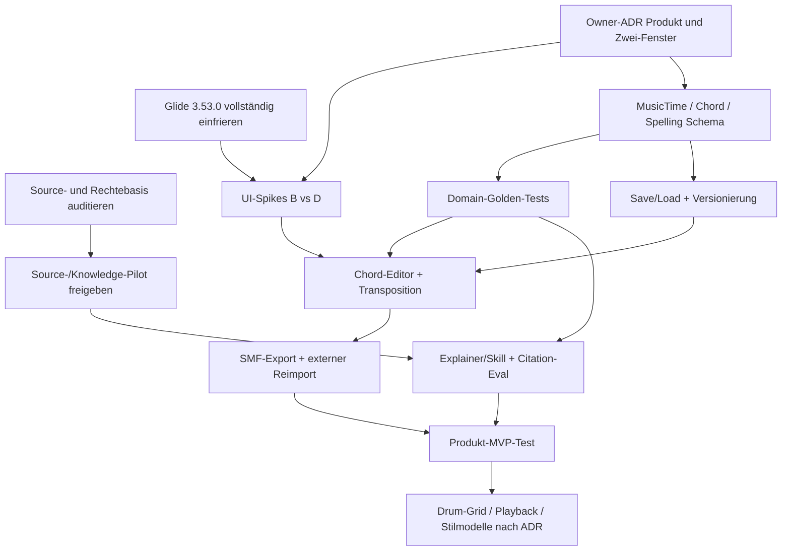

# STEPS – Abhängigkeitsbasierte Roadmap und Ressourcenplan

**Arbeitsstand:** 21.11.2026. **Nicht** vom Owner freigegebene Sprint- oder Zeitplanung. Grundlage: 28 Research-Handover-Requirements, 33 Auditdimensionen, aktuelle GitHub-Snapshots, Glide 3.53.0 und neue Architektur-/Quellen-Prüfgates. Die bisherigen historischen Gantt-Pläne bleiben in `source_archive/Steps_Technischer_Anhang_und_Originalvorlagen_2026-11-09.md`; konkrete alte Terminzusagen werden **nicht** als aktive Lieferfristen fortgeführt.

> **Aktualisierung 19.11.2026:** Die nachfolgenden ursprünglichen Phasen und A0–A11-Bezeichnungen bleiben als datierter Plan erhalten und sind kein aktueller Lieferstatus. Unveränderlicher Repository-Snapshot: `b67294a5161b42d281be4afdea5bb74b7385a786`; der Entwicklungsstand ist `0.2.0-dev`, v0.1.0 ist veröffentlicht. PR #170 ergänzt „Neu“ mit Dirty-State-Rückfrage; PR #172–#179 ergänzen Save-Schutz-, Voicing-, Linux-Xvfb- und Wheel-Artifact-Abnahmen; PR #180–#181 synchronisieren kanonische Status-SHAs. PR #190 ergänzt MIG-006 für ungültige Projekt-Zeiteinstellungen, PR #191 synchronisiert die aktive Statusdokumentation. PR #197 ergänzt den Next-Chord-Explorer, PR #198 den Reviewed-Beispiel-Workflow, PR #199 die Stimmführungsstil-Steuerung, PR #200 die Wheel-Bau-Dokumentation und PR #201 synchronisierte den damaligen Status. PR #203–#205 richten den Desktop-Sessionexport an ADR-017 aus, erzwingen vier Akkordstimmen und ergänzen optionale Exportmodi; PR #206 prüft zehn Goldenexporte mit dem unabhängigen `SMFParser`. Am 19.11.2026 geprüfter Main-Stand: `bc1154241f5d57cc94e1a55a05e47bd788552c2f`; letzter Implementierungskommit: `e9eb1070e718cd9af79e3b536c09307dc59f6cac`; 765 automatisierte Tests bestanden. Das vorgeschlagene, noch nicht vom Inhaber freigegebene v1.0-Ziel und die aktuellen Lücken stehen in [V1.0.0_PRODUCT_CONTRACT.md](../product/V1.0.0_PRODUCT_CONTRACT.md). Bestehende offene Arbeit ist in den Epics [#149](https://github.com/n05a-design/steps/issues/149), [#150](https://github.com/n05a-design/steps/issues/150) und [#151](https://github.com/n05a-design/steps/issues/151) erfasst; STEPS-Lokalisierung ist zusätzlich in [#154](https://github.com/n05a-design/steps/issues/154) erfasst.

> **Aktualisierung 20.11.2026:** PR #220 ist in `main` gemergt; der aktuelle geprüfte Main-Stand ist `e2faf276adf6d65caf81fe28f38521a176e0c283`. Die lokale Full-Suite besteht mit 791 automatisierten Tests. Die Merge-Kennung ist ein Code-/Testbeleg und schließt weder die unabhängige DAW-, Accessibility-, Übersetzungs-, Plattform-, Fach-, Rechte- noch Veröffentlichungsabnahme ab.

> **Aktualisierung 21.11.2026:** Geprüfter Main-Stand `3a5db64b6131806c432b7b38dca60680c5a57d9b` (PR #265). Lokal bestehen 875 automatisierte Tests (`python3 -B -m unittest discover -s tests -p "test_*.py"`, macOS, Python 3.14). Der Wissensbenchmark meldet 92 PASS, 0 FAIL und 27 PENDING. Die fachliche Musikabnahme (`scripts/verify_musical_release.py --report-only`) meldet `theory-core` und `midi-export` als READY; `desktop-voicing`, `recommendations`, `learning-pilot`, `knowledge-adapter`, `harmony-coach` und `research-library` bleiben BLOCKED, weil unabhängige Fachprüfungen fehlen. Abschnitt 0 ersetzt die früheren Aktualisierungsnotizen als aktuelle Arbeitsfolge; die Abschnitte 1–7 bleiben der datierte Ursprungsplan.

> **Aktualisierung 23.11.2026:** Auf Basis von `main` (`5b5708de6b5572f727a26d94c544158baa731794`) wurde `glide_shell` `0.6.2` aus dem verifizierten Glide-Release `v1.0.2` (`7dcd8dc04366f88943fa17827882cef4d81421b8`, System `V1.86`) als Desktop-Fundament (`AppHost`, `modal_session`, `window_lifetime`, `window_geometry`, `system_appearance`, `custom_controls`, `desktop_adapter`, `text_fit`, `DESIGN_RICHTLINIEN.md`) integriert.

> **Aktualisierung 24.11.2026:** Vollständige Umsetzung des Glide-Designsystems (`docs/design/GLIDE_DESIGN_CONTRACT.md`) mit durchgehenden `RoundedSurfaceCard`-Flächen (`8 px` Abstand), `RoundedButton`-Bedienelementen, 10 barrierefreien Themes (WCAG 2.2 AA $\ge 4{,}5:1$), Okabe-Ito-Farben für Kontrastmodi, D63-Buttonbeschränkung auf 24 Zeichen, D71-Menühäkchen, einklappbarer Seitenleiste (Wide / 64px-Rail / Hidden) mit `◧`/`⚙`-Kopfsteuerungen rechts oben, responsiven Dichte-Breakpoints und Kompaktmodus, vollständiger Glide-Anpassungsparität (`AppearanceDialog` mit `GlideOptionSelector`, `AccentMonogramTile` und Sprachwahl), macOS-Icon-Gitterfaktor (`824/1024`) sowie eigenständigen Desktop-Startern außerhalb jeder DAW (`python3 -m app`, `STEPS.pyw`, `STEPS.command`, `steps-desktop`). Die Entwicklungs- und Paketversion wurde auf `0.8.0-dev` / `0.8.0.dev0` angehoben; lokal auf macOS bestehen 914 automatisierte Tests.

## 0. Aktueller Stand und nächste Etappen (21.11.2026)

**MVVE-Arbeitsstand vom 27.–28.11.2026.** Auf Basis von PR #271 laufen im lokalen MVVE-Zweig unabhängige Theorie-, Erkennungs-, Bassrollen- und Zustandsprüfungen. Die nächste Abfolge für dieses Arbeitspaket ist technische CI-Ausführung und GitHub-Enforcement, breitere musikalische Ergebnisprüfung, unabhängige Fachprüfung der offenen Profile und weiterführende Knowledge-/Skill-Evaluation. Geräteintegration folgt einer Entscheidung zu ADR-019. Die [Anforderungs- und Befundmatrix](../audit/2026-11-27/MVVE_V2.md) nennt die ausgeführten Prüfungen und offenen Nachweise.

### 0.1 Seit PR #220 umgesetzt

Die Liste fasst die gemergten PRs nach Bereich zusammen. Sie belegt Code und automatisierte Tests, keine Fach-, Plattform-, Übersetzungs- oder Nutzerabnahme. Einzelheiten stehen im [Änderungsprotokoll](../../CHANGELOG.md) und im [Implementierungsstand](../IMPLEMENTATION.md).

| Bereich | PRs | Ergebnis |
|---|---|---|
| Desktop-Bedienung und Tastatur | #222, #226, #227, #229, #235–#238 | Dialogfokus, Tastaturnavigation, lokalisierte Dateifehler und Sicherungswiederherstellung, Progressionseditor für lange Folgen, Timing-Editor mit absoluten Ticks, Duplizieren und Teilen von Akkorden, isolierte native Tk-Smoke-Tests |
| Stimmführungslabor und Voicings | #233, #234, #242, #249, #254, #261 | Tonumfang und Einzelstimmen, synchrone Akkordnavigation mit Zeitzoom, Slash-Bass und alterierte Quinten, Power- und Quartalprofile, Vergleich ausgewählter Übergänge |
| Harmonik und Next Chord Explorer | #228, #241, #243, #244, #246, #252, #255–#257, #265 | Tastaturführung, Kandidatenvergleich, korrigierte Stufenanalyse, Stufe im Inspektor, Transposition mit Stufenerhalt, doppelte Vorzeichen, Prüfstatus der Vorschläge, getrennte Fundstellen und Modellregeln, Literatur der Vergleichskandidaten |
| Bibliothek und Lernbeispiele | #223, #230, #232, #263 | Suche, Akkord- und Stufenvorschau, Quellen- und Freigabebelege, transponierte Übungskopien in `INT`/`DE` |
| MIDI-Export | #225, #231, #239, #240, #251, #264 | atomares Ersetzen, Namens- und Ordnervorschlag, Überlappungsanzeige, reproduzierbare DAW-Prüfdateien, enge Lage und echtes Drop-2, Anzeige der Exportdaten mit Revisionsschutz |
| Wissensbasis und Kuration | #245, #248, #250, #253, #258–#260 | Gesamtaudit, belegpflichtige Kurationsfreigaben, Evidenzfelder, Freigabeprüfung vor der Wissensausgabe, Wiederherstellung, Lebenszyklusaudit, Laufzeitprüfung der Referenzfragen |
| Release-Gates und Paketierung | #247, #262 | Musikabnahme pro Funktionsbereich, protokollierter lokaler macOS-App-Build |

### 0.2 Etappen bis 1.0

Die Etappen folgen Abhängigkeiten, nicht Kalenderterminen. Keine Etappe ist vom Inhaber als Termin- oder Umfangszusage freigegeben.

| Etappe | Ziel | Abschlussbelege | Abhängigkeit | Tracking |
|---|---|---|---|---|
| **E1 – Repository-Wahrheit** | Status, Roadmap, Register und GitHub-Objekte zeigen denselben Stand | Dokumentations-, Release- und Linkchecks grün; Epics mit aktuellem Ist-Zustand; Release-Labels vorhanden | keine | [#149](https://github.com/n05a-design/steps/issues/149), OA-0036 |
| **E2 – Kandidat 0.2.0** | Den Desktop-Stand seit v0.1.0 als Entwicklungsrelease bündeln | Inhaberentscheidung zum Umfang; Version, Changelog und Katalog auf einem Commit; CI auf Ubuntu, Windows und macOS; Musikabnahme der enthaltenen Bereiche; Wheel- und macOS-Bundle-Prüfung | E1 | [#151](https://github.com/n05a-design/steps/issues/151) |
| **E3 – Unabhängige Abnahmen** | Fremdprüfungen nachholen, die Tests nicht ersetzen können | DAW-Importe nach [MIDI_DAW_MANUAL_PROTOCOL](../quality/MIDI_DAW_MANUAL_PROTOCOL.md) in zwei Anwendungen; VoiceOver/NVDA- und Tastaturprüfung; EN/DE-Textprüfung; Fachprüfung für `desktop-voicing` (P02), `recommendations` und `learning-pilot` | E2-Kandidat | [#151](https://github.com/n05a-design/steps/issues/151), [#154](https://github.com/n05a-design/steps/issues/154), OA-0038, OA-0039 |
| **E4 – Wissensfreigaben** | Offene Benchmarkfälle schließen oder als Blocker der abhängigen Inhalte führen | 15 manuelle Nachweise und 12 Coach-Bewertungen entschieden; `knowledge-adapter` und `research-library` mit unabhängiger Prüfung; Altregister OA-0001–OA-0033 zugeordnet | parallel zu E3 | [#150](https://github.com/n05a-design/steps/issues/150), OA-0034, OA-0037 |
| **E5 – 1.0-Umfang und Auslieferung** | 1.0 festlegen und installierbar machen | angenommenes 1.0-ADR (Plattformen, Drums, Notationsvorgaben); signierte bzw. notarisierte Pakete; Drittanbieterhinweise und Abhängigkeitsinventar; Supportgrenzen | E2; Entscheidung des Inhabers | [V1.0.0-Zielbild](../product/V1.0.0_PRODUCT_CONTRACT.md) |
| **E6 – Release Candidate 1.0** | Freigabe auf einem unveränderlichen Commit | alle Gates des Zielbilds belegt oder als Blocker benannt; menschliche Releasefreigabe; Tag und geprüfte Artefakte | E3–E5 | [#149](https://github.com/n05a-design/steps/issues/149), [#151](https://github.com/n05a-design/steps/issues/151) |

Nach 1.0 und nur nach neuer Inhaberentscheidung: Drum-Editor in der Oberfläche ([ADR-013](../../decisions/ADR-013-v01-umfang-akkorde-und-midi-export.md)), Wiedergabe ([ADR-007](../../decisions/ADR-007-audio-nur-dateiexport-v01.md)) und MIDI-Import.

### 0.3 Inhaberhandlungen auf GitHub

Diese Punkte lassen sich nicht durch Repository-Dateien erledigen. Sie bleiben `OWNER_ACTION_REQUIRED`, bis das Ergebnis auf GitHub beobachtet ist.

| Objekt | Beobachtung 21.11.2026 | Erforderliche Handlung |
|---|---|---|
| Schutz von `main` | Klassischer Branch-Schutz fehlt; das aktive Ruleset `basic` aktiviert nur Copilot-Code-Review | Pull Request, erforderliche Statuschecks und Code-Owner-Freigabe für `main` festlegen |
| GitHub Project | Mit dem verfügbaren Token nicht lesbar (`read:project` fehlt) | Board nach [GITHUB_PROJECT_SPEC](../community/GITHUB_PROJECT_SPEC.md) anlegen oder vorhandenes Board bestätigen |
| Wiki | Funktion aktiv, aber nicht initialisiert | erste Seite anlegen, danach [WIKI_PUBLICATION_MANIFEST](../community/WIKI_PUBLICATION_MANIFEST.md) anwenden |
| OneDrive-Synchronisation | lokal nicht belegbar | Ergebnis im OneDrive-Client prüfen (OA-0040) |

## 1. Kritische Pfadlogik

**Kritische Sequenz:** Ohne neutrale, testbare musikalische Datenmodelle sind UI-, MIDI- und Drum-Implementierung fragil. Ohne Rechts- und Quellenprüfung ist eine wachsende, öffentlich gehostete Knowledge Base nicht nachhaltig. Ohne eingefrorenes Glide-Referenzpaket ist ein Vergleich der Shell-Spikes kein verlässlicher Test.

## 2. Arbeitsstränge mit Deliverables und Gates

| ID | Arbeitspaket | Inputs | Konkretes Ergebnis | Erfolgsgate | Darf parallel? |
|---|---|---|---|---|---|
| **A0** | Öffentliches Repository und Rechte | Steps Tree, Lizenzregister, Dritt-PDF-/MIDI-/Webfiles | private Rechte-/Provenienztabelle, Entscheidung zu kritischen Public-Files | priorisierte Einzelfallstatus, keine stillschweigende Bereinigung | ja, blockiert Public-Release |
| **A1** | Glide 3.53.0 Freeze | Glide `main 9e767bea`, lokaler 3.53.0-Upload, Module/Assets/Tests | Freeze-MANIFEST + QA-Protokoll | alle 94 Quellmodule/Assets in echter Arbeitskopie verglichen; Plattformstatus korrekt | ja |
| **A2** | Produkt- und Fensterkonzeption | Screenshot, Handover REQ-001–028, Marktanalyse | Wireframes, MVP-Vergleich, 3 Owner-ADRs | Scope ausdrücklich bestätigt, keine Agentenannahme als Beschluss | ja |
| **A3** | Knowledge-Batch Pilot | erlaubte Originale, Registry, source types | Source→Extract→Claim→Concept→Test→Citation | Quellen-/Reviewerbelege, idempotenter zweiter Durchlauf | ja |
| **A4** | Music-Domain-Core | Research, fünf Stubschemata, REQ-Liste | reines Pitch/Chord/Progression/TimeModel | T01–T16 fachlich grün und unabhängig von Tk | nach A2 |
| **A5** | Shell-Spikes B und D | A1, A2, Glide-Reuse-Matrix | zwei kleine isolierte Tk-Prototypen mit Sidebar/Workspace/Header/Search/Settings | 30 Cases, explizite Differenzanalyse | nach A1/A2 |
| **A6** | Steps-Projekt- und Speichervertrag | A4 und Storage-Spec | `schema_version`, Projektdatei, Undo/Recovery | 16 IO-Tests, keine Glide-UserData-Zugriffe | nach A4 |
| **A7** | Erster vertikaler Musik-Slice | A4,A5,A6 | 4 Akkorde anlegen/ändern, transponieren, speichern, laden | eigener Steps-SHA, Unit-/OS-/UI-Test; 5 Nutzeraufgaben | nach A4–A6 |
| **A8** | MIDI 1.0 Datei-Export | A4,A7, offizielle SMF-Spezifikation | Dateien mit Note-on/off, PPQ, Tempo, Channels | 10 Gold-Dateien, Roundtrip und DAW-Reimport | nach A7 |
| **A9** | Erklärung und Skilladapter | A3,A4,A7 | durchsuchbarer Wissens-/Regellayer mit UI-Citation | Evalset einschließlich Alternativ-/No-answer-Fälle | nach A3/A4/A7 |
| **A10** | Drums/Playback/weitere Funktionen | A4,A8, Owner-Scope | gemeinsames Grid und Engine-Port | Sync-/Loop-/Fallback-/Groove-Tests | optional, nicht vor A2 |
| **A11** | Release und User Validation | A0,A7–A10 relevant, Q0–Q7 | Release Candidate, SBOM, Installation, Accessibility-Review | native Win/Mac/Linux, Rechte-/Menschenfreigabe | letzter Pfad |

Die Bezeichnung `A0–A11` ist dieses Paketplanungsraster, nicht identisch mit anderen historischen `A-xx`/`WA-xx` Glide-Feature-IDs. Beim Import niemals zwei Backlogs ohne ID-Mapping fusionieren.

## 3. Priorisierung nach Wert × Risikoreduktion × Blockade

**P0:** A0/A1/A2/A3/A4; die ersten vier sind weitgehend parallel, A4 nach minimalem Scope-Beschluss. **P1:** A5/A6/A7/A8/A9. **P2:** A10 mit expliziter Entscheidung, A11 als Gate vor Publikation. Die scheinbar kleinen Features wie „Seitenleiste klappt zu“ haben hohe technische Abhängigkeit; umgekehrt können mehrere hundert zusätzliche Quellenkarten *ohne* Ingestion-Test wenig unmittelbaren Produkterfolg bringen.

Eine konkrete Zeitschätzung in Personenstunden wäre ohne Git-Code-Readiness, testbarem UI-Kern, Anzahl zur Verfügung stehender Entwickler und tatsächlich erlaubten Bibliotheksoriginalen eine Scheingenauigkeit. Zur Planung stattdessen **Ranges nach vertikalem Trial** erstellen: Aufwand für A5-Prototyp inklusive QA messen; daraus Featuregröße und Release-Reihenfolge neu schätzen. Proprietäre KI-Tokenbudget-Zyklen nur als kurzfristige Ressourcenbeschränkung berücksichtigen, nicht als Schätzmodell.

## 4. Parallelisierung mit den verfügbaren KI-Tools

| Unabhängiger Auftrag | Geeignete Ausführung | Vermeiden |
|---|---|---|
| Glide Freeze und offene Tests | Copilot/VSS im Glide-Repo, aktueller Hauptcommit pinnen | noch laufende Glide-Arbeit mit einer nicht geprüften Steps-Kopie überschneiden |
| Knowledge-Pilot/Quellen | ChatGPT/Claude/Gemini mit nachweislich zugelassenem Quellmaterial | PDF-Volltexte ungeprüft ins öffentliche Repo oder mehrere Provider übertragen |
| Steps-Shell-Spikes | Codex oder Claude Code auf *eigenem* Branch/Arbeitsbaum | parallele Änderung an denselben Dateien, Agenten ohne Source SHA |
| Domain-Core und Golden Tests | lokaler Python-Testlauf und Fachreview; Agent unabhängig von UI | Musiktheorie nur aus Sprachmodelloutput speisen |
| Unabhängige QS | zweiter Agent mit Read-only-Diff und tatsächliche Plattformprüfung | Reviewer übernimmt Selbstbehauptungen eines Implementierungsagents |

Bei aufgebrauchtem Tokenbudget bleiben lokale deterministische Prüfskripte, Source-Metadatenpflege und dokumentierte Entscheidungen möglich. Jeder Agentenauftrag beginnt mit Git-Snapshot und endet mit einem YAML-Handover. Näheres: [`docs/operations/MULTI_AGENT_EXECUTION_AND_HANDOVER.md`](../operations/MULTI_AGENT_EXECUTION_AND_HANDOVER.md).

## 5. Abschlussbelege und Review-Stopps

- Ein ausgelieferter Prompt zählt als **geplanter Auftrag**, nicht als gelieferte Funktion.
- Eine `README.md` in `app/`, `src/steps/` oder `knowledge/` zählt als **Ordnerstruktur**, nicht als Engine/Concept-Implementierung.
- Ein bestandenes Glide-CI gilt nur für dessen Commit/Plattform und nicht automatisch für Steps.
- Unbekannte Rechte → keine neue öffentliche Bündelung. Offene Owner-Entscheidung → nur reversible Spikes, keine dauerhafte Festlegung.
- Bei Datenverlust/Glide-UserData-Berührung, unerwarteten API-Credentials, beschädigter Source-Registry, Tk-Callback nach Root-Destruction oder hängender MIDI-Note **sofort** stoppen, Ursache dokumentieren und Test hinzufügen.

## 6. Erste ausführbare, kleine Aufträge

**Nächster Schritt 1:** Glide 3.53.0 Source/Resource/QA Freeze; Bericht mit SHA pro Modul und `main`-Differenz. **Schritt 2:** zwei Wireframes (2 Pane/2 Toplevel) und Owner-Scope-ADR; ggf. Owner asynchron im eigenen System anfordern, nicht anlegen ohne Freigabe. **Schritt 3:** separater Core-Test-Batch (T01–T16) und ein legaler KB-Batch. **Schritt 4:** B/D Shell-Prototypen mit S01–S30 und No-Glide-Write-Tests. **Schritt 5:** exakt ein funktionsfähiger Chord→Save/Load→MIDI-Slice, bevor zehn neue UI-Module parallel entstehen.

## 7. Akzeptanz der Projektsteuerung

Aktualisieren bei jedem Review: `manifests/REQUIREMENTS_TRACE_28.csv` (Status tatsächlicher Funktion, nicht bloß Dokument), `manifests/INVESTIGATION_COVERAGE_33_V2.csv`, ADRs, reproduzierbare Testbelege, Task-to-owner, Branch/Commit-SHAs und Scope-/Rechteentscheidungen. Historische D- und WA-Nummern in Glide nicht rückwirkend überschreiben.
