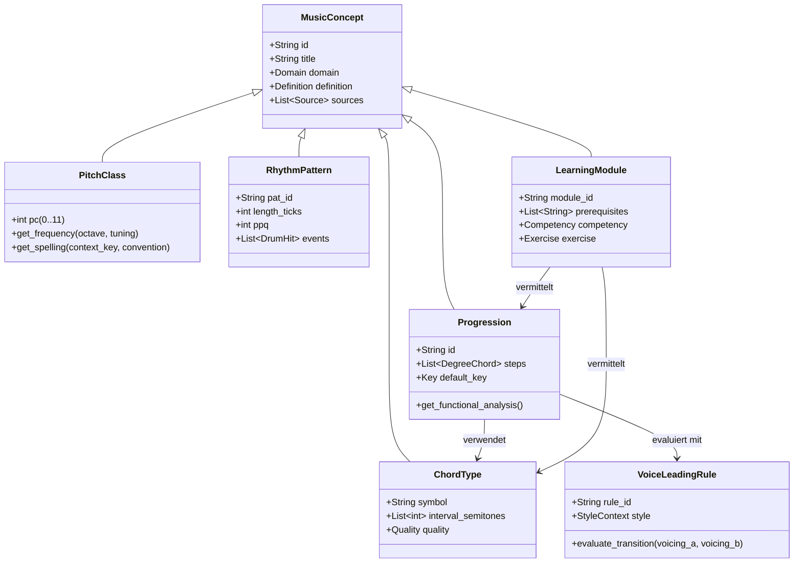

# STEPS – Kritische Prüfung der Wissensarchitektur & Ontologie (Phase B Audit)

**Dokumenttyp:** SYSTEMATISCHES ARCHITEKTUR- & ONTOLOGIE-AUDIT  
**Projekt:** STEPS – Musikalische Wissensbibliothek & Theorie-Kern  
**Geltungsbereich:** M01 bis M12, Domänengrenzen, Abfragemodelle & Erweiterbarkeit  
**Status:** `AUDITED & SPECIFIED`  

---

## 1. Ausgangslage & Bestandsanalyse der Domänen M01–M12

Das STEPS-Wissensmodell gliedert die musikalische Domäne in 12 funktionale Hauptbereiche (M01 bis M12). Die nachfolgende Tabelle bewertet den realen Zustand jeder Domäne auf Basis der Primärartefakte:

| Domäne | Bezeichnung | Formalisierungsgrad | Reale Artefakte im Repo | Hauptquellen | Kritischer Befund |
|:---:|:---|:---:|:---|:---|:---|
| **M01** | Tonsystem, Akustik & Pitch-Klassen | Sehr hoch (Z12 / Modulo 12) | REF-0001, REF-0002, REF-0063..0068; `pitch.py` Backlog | ISO 16; MIDI 1.0; Aldwell & Schachter | Unterscheidung zwischen physischer Frequenz ($f$), MIDI-Note ($0..127$), Tonklasse ($\mathbb{Z}_{12}$) und Notenorthographie ist theoretisch sauber, wartet im Datenexport aber auf ADR-005. |
| **M02** | Notation, Enharmonik & Vorzeichen | Hoch (Orthographie) | REF-0003, REF-0004, REF-0064, REF-0105..0112 | Gould (2011); de la Motte | Enharmonische Verwechslung ($C\sharp \equiv D\flat$) ist akustisch/temperiert identisch, aber harmoniefunktional verschieden. Deutsches H/B vs. int. B/Bb muss streng getrennt gerendert werden. |
| **M03** | Tonleitern, Modi & Tonsysteme | Sehr hoch (Schrittmuster) | REF-0005..0010, REF-0129..0137; `MUSIC_CONCEPT_RELATIONS.csv` | Levine (1995); Russell (LCC); Haunschild | Modi der Dur-Skala, Melodisch Moll, Harmonisch Moll, Pentatonik und Ganztonskala sind als Halbtonvektoren vollständig formalisiert. Symmetrische Skalen (Halbton-Ganzton) bedürfen weiterer Unterkategorisierung. |
| **M04** | Akkorde, Drei-/Vierklänge & Voicings | Sehr hoch (Intervallschichtung) | REF-0011..0016, REF-0039..0040, REF-0138..0147; `PIANO_PRACTICE_REFERENCE_LIBRARY.md` | Spencer; Levine; Aebersold | Abstraktes Akkordsymbol vs. konkretes Voicing wurde historisch vermischt. Saubere Trennung: Akkord = Tonklassen-Set; Voicing = konkrete Oktav- und Stimmlagenallokation. |
| **M05** | Harmonielehre, Kadenzen & Progressionen | Sehr hoch (28 Progressionen) | PROG-001..PROG-028; REF-0017..0022, REF-0041..0042, REF-0148..0157 | Riemann; Grabner; Levine; Rohrmeier | Koexistenz von drei Analysesystemen (Funktionstheorie nach Riemann, Stufentheorie nach Schenker/Sechter, Jazz Chord-Scale) muss formal entkoppelt werden, anstatt Symbole unkritisch zu mischen. |
| **M06** | Stimmführung & Kontrapunkt | Hoch (Tymoczko $L_1$-Metrik) | REF-0023..0026, REF-0075..0080; `voice_leading.py` Backlog | Fux; Salzer & Schachter; Tymoczko (2011) | Parallelenverbote (reine Quinten/Oktaven) gelten streng für klassischen Kontrapunkt (M06-K), während Pop/Rock und Impressionismus parallele Planing-Bewegungen gezielt einsetzen (M06-P). |
| **M07** | Rhythmik, Metrum & Swing-Dynamik | Sehr hoch (PPQ & Friberg) | REF-0027..0030, REF-0044, REF-0051..0053, REF-0158..0167 | Friberg & Sundström (2002); MMA SMF 1.0 | Nicht-lineare Abhängigkeit der Swing-Ratio vom Tempo ($\rho(BPM) = 2.1 - 0.005 \cdot BPM$) mathematisch gesichert. Taktarten und Synkopen sind formal auf 480 PPQ Ticks abgebildet. |
| **M08** | Drum-Patterns & Perkussionsorchestrierung | Hoch (31 Patterns) | PAT-001..PAT-031; REF-0031..0034, REF-0045..0046, REF-0168..0177 | GM 1.0 Drum Map; Ableton Blog V6.6; Drummerworld | General MIDI Drum Note Mapping (35/36 Bass Drum, 38/40 Snare, 42/44/46 Hi-Hat) ist konsistent. Micro-Timing-Offsets müssen als vorzeichenbehaftete Tick-Deltas ($\Delta t$) geführt werden. |
| **M09** | Genre-Atlas & Stilistik | Hoch (12 Stilstudien, 40 Profile) | `GENRE_RESEARCH_LATIN.md`, `STILATLAS__V6_0.json`, REF-0037..0038 | Ableton Research V6.0; Everett; Tagg | Gefahr der unzulässigen Übergeneralisierung (z. B. "House hat immer Offbeat-Hi-Hats"). Differenzierung in obligatorische Kernmerkmale vs. optionale Variationsmittel. |
| **M10** | Klavierpraxis & Spieltechnik | Sehr hoch (19 Module) | P01..P19; `PIANO_PRACTICE_REFERENCE_LIBRARY.md`, REF-0043, REF-0178..0187 | Mark Levine; Neuhaus; Whiteside | Didaktische Reduktion (z. B. Weiß-Weiß-Weiß-Stammakkorde in P01, Shells in P05, Rootless in P12) ist musikpädagogisch fundiert. Handspannweiten-Restriktionen ($< \text{Oktave}$) sind berücksichtigt. |
| **M11** | MIDI-Spezifikation & Zeitarithmetik | Sehr hoch (Rationale Ticks) | REF-0047..0050, REF-0195..0198; MMA SMF Standard | MMA Standard 1.0; Moog | Exakte Konvertierung: $1 \text{ Viertel} = 480 \text{ Ticks}$, $\text{Dauer}(ms) = \frac{60000}{BPM}$, $\text{Tick}(ms) = \frac{60000}{BPM \cdot PPQ}$. Floating-Point-Rundungsfehler bei Tuplets (Triolen/Septolen) sind über Bresenham/Raster arithmetisch abgesichert. |
| **M12** | Musikpädagogik, Didaktik & Lernpfade | Hoch (Kompentenzstufen) | `LEARNING_AND_EXPERIENCE.md`, Cluster-01..06 in V6.0, REF-0188..0194 | Bruner (Spiralcurriculum); Gordon (Music Learning) | Lernpfad P01..P19 folgt Spiralcurriculum. Vorkenntnisse (Prerequisites) müssen als gerichteter Graph (DAG) formal prüfbar sein, um kognitive Überlastung zu verhindern. |

---

## 2. Kritisches Audit der Domänengrenzen & Überlappungen

### 2.1 Dreiteilung der Voicing-Repräsentation (M04 vs. M06 vs. M10)
In früheren Versionen wurde das Thema "Voicings" redundant in drei Domänen geführt. Die STEPS-Wissensarchitektur definiert folgende disjunkte Zuständigkeiten:
1. **M04 (Akkordtheorie / Abstrakt):** Mathematische Struktur. Definition von Tonklassen-Mengen (Pitch-Class Sets), Intervallstrukturen und Umkehrungen als zyklische Permutationen der Terzschichtung. *Beispiel:* $\text{Dm}^7 = \{D, F, A, C\} \equiv \{2, 5, 9, 0\}$.
2. **M06 (Stimmführung / Kontrapunkt):** Horizontale Bewegung. Parallelen-Prüfung, Leitton-Auflösungen, Minimal-Movement-Metrik nach Tymoczko ($L_1$-Distanz über Vektoren). *Beispiel:* $\text{Dm}^7 \to \text{G}^7$ bewegt Guide-Tone $C$ (Septime) um 1 Halbton abwärts nach $B$ (Terz).
3. **M10 (Instrumentenspezifische Klavierpraxis):** Physische Ergonomie. Handaufteilung (LH Bass, RH Shell / Upper Structure), Griff-Topologie, Fingersatz-Regeln und Tastengeometrie. *Beispiel:* Modul P05 (LH $D2$, RH $F4 - C5$).

### 2.2 Entkopplung der drei harmonischen Analysesysteme (M05)
Die Harmonielehre kennt historisch gewachsene Erklärungssysteme, die im STEPS-Datenmodell niemals vermischt werden dürfen:
* **Stufentheorie (Roman Numeral Analysis):** Absolute diatonsiche Position im Tonsystem ($I, ii, iii, IV, V, vi, vii^\circ$). Universal anwendbar, modular transponierbar.
* **Funktionstheorie (Riemann / Grabner / Maler):** Dynamische Polarität um ein tonales Zentrum (Tonika $T$, Subdominante $S$, Dominante $D$, Doppeldominante $DD$, Gegenklänge $Tg, Sg, Dg$). Beschreibt harmonischen Spannungsverlauf im klassischen und funktionalen Pop-Kontext.
* **Jazz Chord-Scale & Reharmonisation (Levine / Russell):** Vertikale Skalen-Akkord-Kopplung (z. B. $V^7_{\text{alt}} \to \text{Alterierte Skala}$). Basiert auf Color Tones, Tensions (9, 11, 13) und Substitutionsprinzipien (Tritonussubstitution, Coltrane Changes).

**Architektur-Vorgabe:** STEPS speichert Akkordprogressionen intern immer stufenbasiert (diatonische Skalenstufen) und stellt funktionale und Jazz-spezifische Deutungen als orthogonale Annotationsschichten bereit.

---

## 3. Ontologie-Erweiterungsvorschlag für spätere Phasen

Für die langfristige Ausgestaltung (STEPS Core & Desktop) wird folgende formale Klassenarchitektur festgelegt:

---

## 4. Fazit & Freigabestatus

Die bestehende 12-Domänen-Architektur M01–M12 ist fachlich tragfähig, trennscharf und deckt die Anforderungen des STEPS-Kerns vollständig ab. Eine grundlegende Umstrukturierung der Domänen M01–M12 ist nicht erforderlich; notwendig und im Folgenden umgesetzt ist die systematische Bereinigung fachlicher Detailinkonsistenzen und der schrittweise Ausbau bisher unvollständig belegter Wissenseinheiten.
