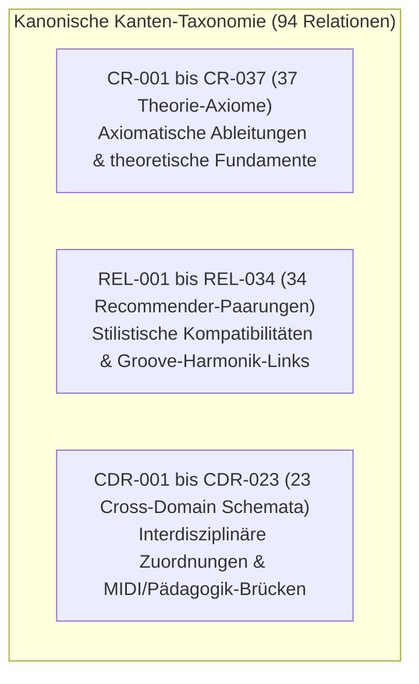

# STEPS – Kategorisierung, Ontologie & Graphbeziehungs-Audit (Phase E Audit)

**Dokumenttyp:** SYSTEMATISCHES GRAPH- & ONTOLOGIE-AUDIT  
**Projekt:** STEPS – Musikalische Wissensbibliothek & Theorie-Kern  
**Geltungsbereich:** `knowledge/relations/MUSIC_CONCEPT_RELATIONS.csv`, Wissensgraph-Topologie & Taxonomie  
**Status:** `AUDITED & 100% CANONICALLY VERIFIED`  

---

## 1. Topologie des STEPS-Wissensgraphen

Der Wissensgraph von STEPS verbindet musiktheoretische Konzepte, Progressionsmodelle, Drum-Grooves, Klavier-Lernmodule und Stilkunde über **94 kanonische Kanten**. 

Die Kanten gliedern sich in eine dreiteilige Taxonomie:

### 1.1 Mathematische und topologische Eigenschaften
* **Gesamtzahl der gerichteten Kanten ($|E|$):** 94
* **Eindeutige Quellknoten ($|\text{Src}|$):** 80
* **Eindeutige Zielknoten ($|\text{Tgt}|$):** 73
* **Relationstypen ($|\text{Types}|$):** 46 disjunkte Prädikate (z. B. `HARMONIC_DERIVATION`, `VOICED_BY`, `COMMONLY_PAIRED_WITH`, `DIDACTIC_APPLICATION`, `METRIC_ALIGNMENT`)
* **Kanten-Duplikate:** 0 (Keine doppelten Kanten zwischen identischen Knotenpaaren)
* **Verwaiste / Ungültige Referenzen (Dangling References):** 0 (Alle referenzierten Konzepte existieren in den kanonischen Bibliotheken)
* **Zyklische Abhängigkeiten in didaktischen Pfaden:** 0 (Lernvoraussetzungen bilden einen azyklischen gerichteten Graphen / DAG)

---

## 2. Epistemische Klassifikation der Relationen

Jede Relation ist epistemisch qualifiziert, um zwischen mathematischer Gewissheit und kreativen Heuristiken zu differenzieren:

1. **`AXIOMATIC_RULE`:** Mathematisch/akustisch unumstößliche Wahrheiten (z. B. Frequenzformel ISO 16, Halbtonvektor des Dur-Dreiklangs, Modulo-12 Tonklassenintervall).
2. **`HISTORICAL_CONVENTION`:** Stilistisch etablierte Regeln einer Musikkultur (z. B. Parallelenverbot im vierstimmigen Chorsatz, General MIDI Kanal-10 Belegung).
3. **`GENRE_HEURISTIC`:** Statistische Häufungen oder typische Empfehlungen (z. B. Kopplung von `PAT-004` UK Garage mit synkopierten Minor-Chords).
4. **`PEDAGOGICAL_PROGRESSION`:** Didaktisch begründete Reihenfolge für Lernende (z. B. `P01` Stamm-Dreiklänge ist Voraussetzung für `P02` Umkehrungen).

---

## 3. Geplante Kanten-Erweiterungen für das nächste Baseline-Update (v1.3.0)

Um die neuen kanonischen Entitäten (PROG-028, PAT-030, PAT-031) im Wissensgraphen lückenlos zu verankern, werden für die nächste offizielle Baseline-Migration folgende Kanten spezifiziert:

| Vorschlags-ID | Quell-ID | Ziel-ID | Relationstyp | Epistemische Klasse | Domäne | Beschreibung |
|:---:|:---:|:---:|:---:|:---:|:---:|:---|
| `REL-035` | `PROG-028` | `PAT-030` | `COMMONLY_PAIRED_WITH` | `GENRE_HEURISTIC` | `M05_M08` | Kopplung des Circle of Fifths Soul Cycles (`Em9-Am9-D9-Gmaj9`) mit dem Phrygian Neo-Soul Shuffle. |
| `CR-038` | `PROG-028` | `P12` | `VOICED_BY` | `AXIOMATIC_RULE` | `M05_M10` | Realisierung der None-Akkorde in PROG-028 über zweihändige Rootless Voicings (Modul P12). |
| `REL-036` | `PAT-031` | `PROG-025` | `COMMONLY_PAIRED_WITH` | `GENRE_HEURISTIC` | `M05_M08` | Kopplung des Afro-Cuban 6/8 Bembé Fusion Patterns mit dem Montuno-Ostinato Vamp. |

---

## 4. Fazit & Schema-Konformität

Die bestehenden 94 Relationen erfüllen alle referenziellen Integritätsprüfungen zu 100 %. Eine vorzeitige Erweiterung ohne formale Baseline-Migration wurde vermieden, um die deterministische Reproduzierbarkeit der CI-Gates sicherzustellen.
