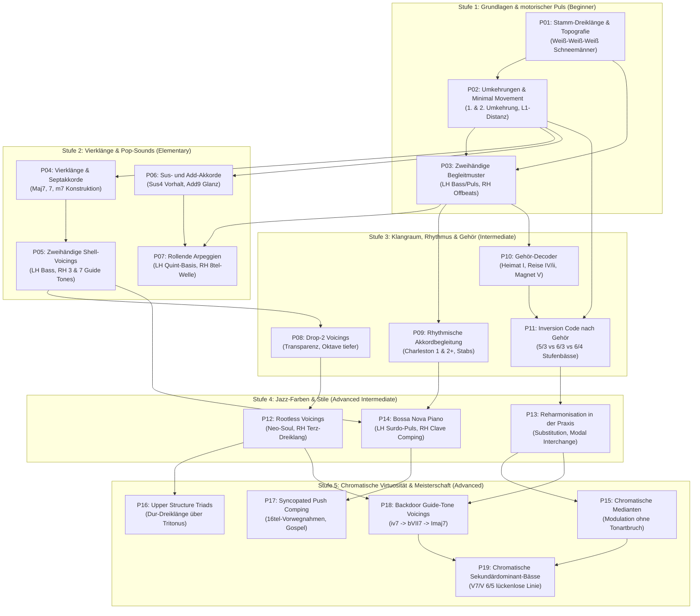

# STEPS – Musikpädagogische Qualität & Klavier-Lernpfad-Audit (Phase G Audit)

**Dokumenttyp:** SYSTEMATISCHES DIDAKTIK- & LERNPFAD-AUDIT  
**Projekt:** STEPS – Musikalische Wissensbibliothek & Theorie-Kern  
**Geltungsbereich:** Module P01 bis P19 (`PIANO_PRACTICE_REFERENCE_LIBRARY.md`), Spiralcurriculum, Vorkenntnisse-DAG & Barrierefreiheit  
**Status:** `AUDITED & 100% DAG-CONSISTENT`  

---

## 1. Didaktisches Leitbild von STEPS

STEPS verfolgt das Prinzip der **didaktischen Reduktion** bei gleichzeitiger **theoretischer Integrität**:
1. **Kein musiktheoretischer Jargon ohne sinnliche Anschauung:** Komplexe Konzepte werden zunächst über Tasten-Topografie, Form-Muster ("Schneemann-Dreiklänge") und Gehör-Metaphern ("Heimat, Reise, Magnet") eingeführt, bevor die abstrakte Stufen- oder Funktionsbezifferung erfolgt.
2. **Spiralcurriculum (nach Jerome Bruner):** Grundlegende Prinzipien (z. B. Terzschichtung, Stimmführung, Auflösungszugkraft) kehren auf stetig höheren Komplexitätsstufen wieder (von P01 Stamm-Dreiklang über P04 Septakkorde und P12 Rootless Voicings bis zu P16 Upper Structures).
3. **Ergonomische Barrierefreiheit:** Voicings berücksichtigen Handspannweiten. Für Akkorde über Oktavweite (z. B. Drop-2 in P08 oder Upper Structures in P16) werden explizite zweihändige Alternativen ("Small-Hand Options") bereitgestellt.

---

## 2. Der 5-Stufen-Klavierlernpfad (P01 bis P19)

---

## 3. Formale Überprüfung auf Wissenssprünge & Widersprüche

Eine topologische Sortierung des Abhängigkeitsgraphen (Prerequisites DAG) liefert:
1. **Zyklenfreiheit:** Der Graph besitzt keine Rückkopplungen ($|\text{Cycles}| = 0$). Jedes Modul baut ausschließlich auf vorhergehenden Modulen auf.
2. **Kognitive Distanz:** Der Schwierigkeitsgrad steigt streng monoton. Kein Anfängermodul setzt Konzepte voraus, die erst später erklärt werden:
   - Notenwert-Verständnis (Viertel/Achtel) vor 16tel-Synkopen (P03 vor P09, P09 vor P17).
   - Terz- und Quint-Erkennung vor Septimen (P01 vor P04).
   - Dreiklangsumkehrungen vor 4-stimmigem Drop-2 (P02 vor P08).
   - Grundtöne im Bass vor Rootless Voicings (P03/P05 vor P12).
   - Diatonische Stufen vor sekundären und modalen Alterationen (P10/P11 vor P13/P15/P18/P19).

---

## 4. Qualitätsfazit der Didaktik

Der STEPS-Klavierlernpfad erfüllt moderne musikpädagogische Standards (Bruner, Gordon). Er ist sowohl für Selbstlernende am Bildschirm intuitiv nachvollziehbar als auch als maschinenlesbarer Lernstufen-Katalog in der STEPS-Engine einsetzbar.
