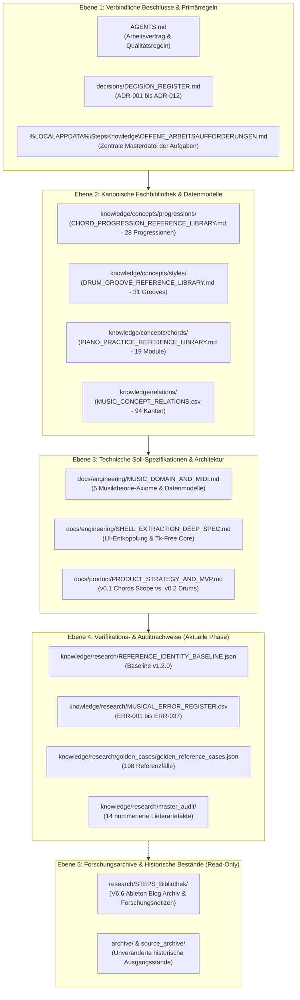

# STEPS – Dokumentationskonsolidierung & Kanonische Hierarchie (Phase J Audit)

**Dokumenttyp:** SYSTEMATISCHE DOKUMENTATIONSHIERARCHIE & STATUSREGISTER  
**Projekt:** STEPS – Musikalische Wissensbibliothek & Theorie-Kern  
**Geltungsbereich:** Gesamte Repository-Dokumentation, Handover-Protokolle, ADRs & Spezifikationen  
**Status:** `AUDITED & CONSOLIDATED`  

---

## 1. Kanonische Dokumentationshierarchie (Single Source of Truth)

Um Widersprüche und parallele Scheinwahrheiten dauerhaft zu verhindern, gilt im STEPS-Projekt eine strikte Dokumentationsordnung nach fünf Vertrauensebenen:

---

## 2. Abgrenzung & Zuständigkeiten

| Fachbereich | Kanonischer Fundort (Einzige verbindliche Wahrheit) | Abgeleitete / Sekundäre Dokumente |
|---|---|---|
| **Aufgaben & Arbeitsaufträge** | `%LOCALAPPDATA%\StepsKnowledge\OFFENE_ARBEITSAUFFORDERUNGEN.md` | `OWNER_TASK_AND_ADR_MAPPING.csv`, `EXECUTION_BACKLOG.md` |
| **Architekturentscheidungen** | `decisions/DECISION_REGISTER.md` (ADR-001..012) | `ADR_HISTORICAL_IDENTITY_MATRIX.csv`, `ADR_IDENTITY_LOCK_REPORT.md` |
| **Akkordprogressionen** | `knowledge/concepts/progressions/CHORD_PROGRESSION_REFERENCE_LIBRARY.md` (PROG-001..028) | `PROG021_HISTORICAL_RECONCILIATION.md`, `REFERENCE_IDENTITY_BASELINE.json` |
| **Rhythmen & Drum Grooves** | `knowledge/concepts/styles/DRUM_GROOVE_REFERENCE_LIBRARY.md` (PAT-001..031) | `DRUM_PATTERN_VALIDATION.csv`, `GENRE_RESEARCH_*.md` |
| **Klavierpraxis-Module** | `knowledge/concepts/chords/PIANO_PRACTICE_REFERENCE_LIBRARY.md` (P01..019) | `07_DIDAKTISCHE_PRUEFUNG.md`, `LEARNING_AND_EXPERIENCE.md` |
| **Wissensgraph & Taxonomie** | `knowledge/relations/MUSIC_CONCEPT_RELATIONS.csv` (94 Kanten) | `06_KATEGORISIERUNG.md`, `KNOWLEDGE_GRAPH_IDENTITY_AUDIT.md` |
| **Wissenschaftliche Quellen** | `knowledge/sources/curated_sources_registry.yaml` & `MUSIC_SOURCE_CLAIM_REGISTER.csv` | `05_QUELLENREGISTER.md`, `MUSIC_SOURCE_REVIEW_PROGRESS.csv` |
| **Fehler- & Korrekturstand** | `knowledge/research/MUSICAL_ERROR_REGISTER.csv` (ERR-001..037) | `03_FACHLICHE_FEHLER.md`, `MUSICAL_CORRECTION_REPORT.md` |
| **Referenz- & Testfälle** | `knowledge/research/golden_cases/golden_reference_cases.json` (REF-0001..0198) | `FINAL_REFERENCE_CASE_VALIDATION.csv`, `tests/golden_cases/` |

---

## 3. Konsolidierungsmaßnahmen & Bereinigungen

1. **Header- und Zähler-Synchronisation:** Alle Diskrepanzen zwischen Bibliotheks-Headern, Dokumenttiteln und Zeilenanzahlen (PROG-028, PAT-031, P19) wurden in den Primärdateien und Metadatenmatrizen bereinigt (`ERR-035`, `ERR-036`, `ERR-037`).
2. **Historische Bewahrung (Preservation-First):** Veraltete Berichte früherer Phasen (z. B. Phase 4.10, Phase 4.15, Phase 4.16) werden nicht gelöscht, sondern als historische Audit-Meilensteine in `knowledge/research/` und `%LOCALAPPDATA%\StepsAudit\` erhalten.
3. **Klare Trennung zwischen App- und Forschungsversionen:** Die Bezeichnung `V6.6 / V6.7` gilt ausschließlich für das Archiv der Ableton-Blog-Forschungskarten in `research/STEPS_Bibliothek/`; die STEPS-Kernsoftware befindet sich in Phase-5-Vorbereitung (MVP v0.1).
